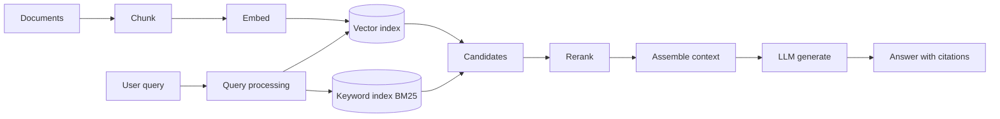
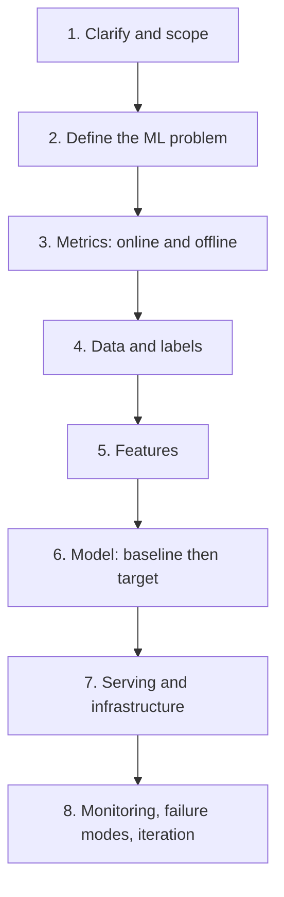
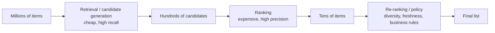
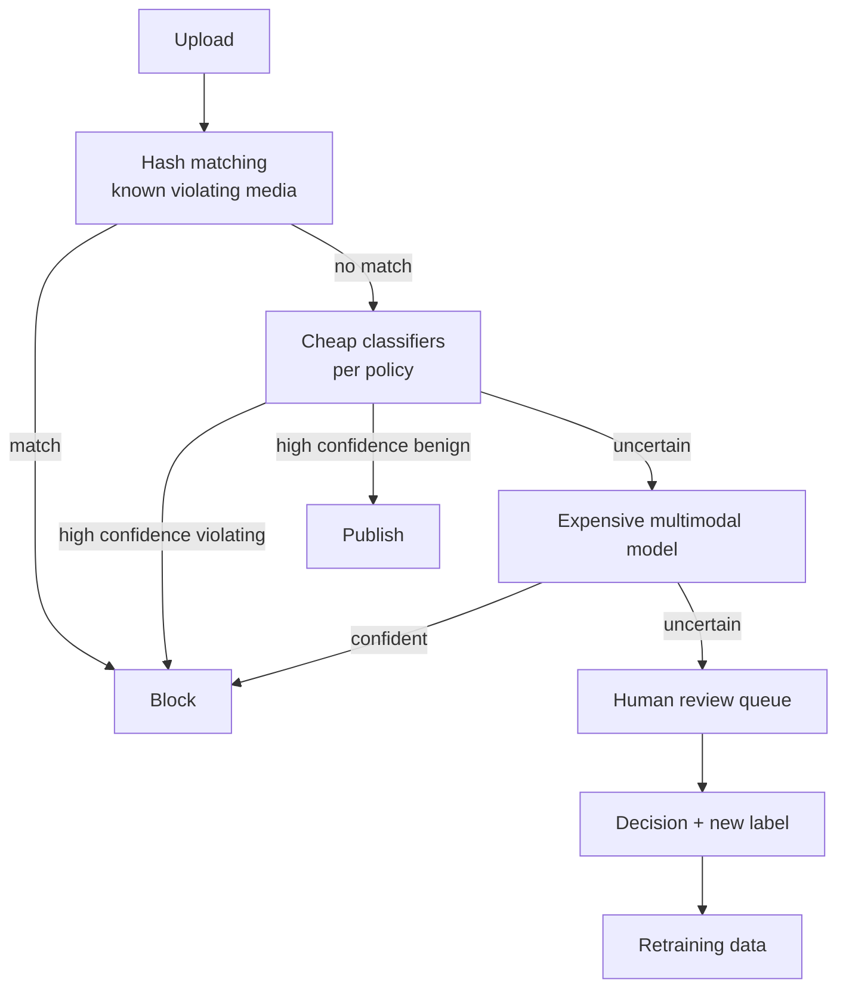
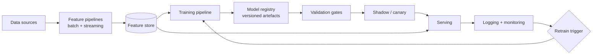

# The Complete Machine Learning Interview Tutorial

## Senior / Staff level · Generalist (MLE, DS/AS, DL & LLM)

2026-09-18 · prepared for @Behi

A self-contained, self-study course: every concept explained from intuition to mathematics, with worked interview questions, assignments, and full solutions. Assumes basic ML background and working Python.

## 1. How to use this guide, and what senior ML interviews actually test

At senior and staff level you are not graded on whether you can recite the definition of precision. You are graded on whether the company can hand you an ambiguous business problem and trust you to come back with a system that works, that other engineers can maintain, and that does not quietly destroy a metric six months later. Every round in the loop is an attempt to sample that ability cheaply.

This section gives you the map. Read it once now, then again the week before your onsite.

### 1.1 The anatomy of a modern ML loop

Companies differ in naming, but the rounds cluster into six recognisable types. A senior loop usually has four to six of them.

| Round | Typical length | What it looks like | What is really being measured |
| --- | --- | --- | --- |
| Recruiter / HM screen | 30 min | Career narrative, why this team | Can you frame your own work in terms of business impact |
| ML fundamentals | 45–60 min | Rapid questions on theory, metrics, models | Depth and honesty; can you reason from first principles when pushed past memorised answers |
| Coding | 45–60 min | LeetCode-style, or implement an ML primitive in NumPy, or a data-wrangling task | Fluency and correctness under time pressure; whether your code is reviewable |
| ML system design | 60 min | "Design the recommendation system for X" | Scoping, judgement, tradeoff reasoning, production realism |
| Project deep dive | 45–60 min | You present past work, they drill | Technical ownership; can you defend decisions and admit what failed |
| Behavioural / values | 45 min | Conflict, influence, failure, ambiguity | Whether you can operate across teams without a manager holding your hand |

At staff level two extra things get probed, often inside the design and behavioural rounds rather than as separate ones. First, **scope**: have you changed how a team or an organisation does ML, not just shipped a model. Second, **judgement under constraint**: can you say "we should not build this" and be right.

### 1.2 The rubric interviewers are silently filling in

Most large companies use a rubric with roughly these axes. Knowing them lets you aim your answers.

1. **Problem formulation.** Did you turn a vague ask into a precise ML problem with a target, a label definition, a unit of prediction, and a success metric? Weak candidates jump straight to models.
2. **Technical depth.** When the interviewer pushes one level deeper than your answer, do you still have something to say? Depth is tested by follow-ups, not by the first answer.
3. **Breadth and appropriateness.** Do you reach for gradient boosting on a 50k-row tabular problem, or do you reach for a transformer because it is fashionable?
4. **Production realism.** Latency, cost, training/serving skew, monitoring, retraining, failure modes, rollback. This is the single biggest separator between mid and senior.
5. **Communication.** Can the interviewer follow you without effort? Do you check in, state assumptions, and structure your answer out loud?
6. **Collaboration and ownership.** Do you say "I" when you did it and "we" when the team did it, and can you tell the difference?

A useful mental model: the interviewer is writing a document that has to convince a hiring committee that has never met you. Give them quotable evidence. "We reduced p99 latency from 340 ms to 90 ms by moving the cross-encoder out of the online path into a nightly precompute, which let us keep the accuracy gain" is quotable. "I worked on optimising the model" is not.

### 1.3 How a senior answer differs from a junior answer

The content overlaps; the shape does not.

| Question | Junior answer | Senior answer |
| --- | --- | --- |
| "How do you handle class imbalance?" | "Use SMOTE or class weights." | "First I'd ask whether imbalance is actually a problem — it usually is not for ranking, and it usually is for thresholded decisions. Then I'd check whether the metric is wrong rather than the data. Class weights change the implied cost matrix, so I'd rather set the decision threshold from real costs and keep probabilities calibrated. Resampling I use only when the minority class is so rare that gradients are noisy, and I recalibrate afterwards because resampling shifts the prior." |
| "Which model would you use?" | Names a model. | Names a baseline, names the model, names the condition under which they'd switch, and names what they'd measure to know. |
| "Your model's offline AUC improved but online CTR dropped." | "Maybe overfitting." | Enumerates the hypothesis space — train/serve skew, feedback loops, position bias, a metric mismatch, a delayed-label horizon, an A/B assignment bug — and says which they'd check first and why it is cheapest. |

The senior pattern is: **state the decision, state the tradeoff, state the evidence you would collect.** Three moves. Practise them until they are reflex.

### 1.4 A protocol for answering any technical question

Use this in every round. It costs ten seconds and it buys you structure.

1. **Restate and scope.** "So we're predicting whether a transaction is fraudulent, at authorisation time, with a decision budget of about 50 ms — is that right?" This catches misunderstandings while they are free.
2. **Say the shape of your answer.** "I'll cover three things: the label, the model, and how I'd evaluate." Now the interviewer can follow you.
3. **Answer, starting with the simplest correct thing.** Baselines first. They signal maturity.
4. **Name the tradeoff you are making.** Every choice has a cost. Saying it unprompted is the strongest senior signal available.
5. **Say what you don't know.** "I haven't deployed a diffusion model in production, so I'd be reasoning by analogy here." Interviewers reward this heavily and punish bluffing brutally, because bluffing is a hiring risk.

### 1.5 How to study with this document

The tutorial is written to be read linearly, but it is also a reference. Sections 2–8 are foundations, 9–12 are deep learning and LLMs, 13 is implementation, 14–16 are systems and production, 17–19 are the interview itself, 20–23 cover material that appears in specific loops (SQL, bandits, interpretability and fairness, forecasting), and 24 is the study plan.

For each section:

- Read the explanation once without touching the questions.
- Close the document and write, from memory, a five-line summary of the section. If you cannot, reread.
- Do the exercises **before** reading their solutions. Reading a solution feels like learning and mostly is not. The act of failing to retrieve is what creates the memory.
- Say your answers out loud. Interviews are spoken. Many people who can write a correct answer cannot speak one.
- Keep a single file of your own mistakes. Review it weekly. This one habit is worth more than any extra chapter.

Section 24 has a six-week plan if you want a schedule rather than a menu. Sections 20–23 are modular: read the ones your target role actually tests.

### 1.6 Warm-up questions (solutions immediately below)

**Q1.1.** An interviewer asks: "What is your favourite ML model?" What is this question actually testing, and what makes a good answer?

**Q1.2.** You are 20 minutes into a system design round and realise your proposed architecture cannot meet the latency requirement you agreed at minute 3. What do you do?

**Q1.3.** In a fundamentals round you are asked something you genuinely do not know — say, the details of conformal prediction. Give a good response and a bad response.

---

**Solution 1.1.** It tests whether you have opinions grounded in experience, and whether you understand context-dependence. A bad answer names a model with no context ("transformers, they're state of the art"). A good answer refuses the premise gently and converts it into judgement: "I don't have a favourite in the abstract — but the model I reach for most often is gradient-boosted trees, because most industrial problems are tabular, medium-sized, and need to be debugged by people who are not me. I switch to neural nets when I have unstructured input, or when I need to share representations across tasks, or when the data is large enough that the flexibility pays for itself." You have now demonstrated breadth, a default, and a switching condition.

**Solution 1.2.** Say it out loud, immediately. "I want to flag something — the two-tower retrieval plus cross-encoder reranking I described won't fit in 50 ms at 10k QPS with this model size. Let me revise." Then propose the fix: precompute item embeddings offline, use ANN retrieval, shrink the reranker or apply it to fewer candidates, or cache. Catching your own error and repairing it in real time is a *positive* signal — it is exactly what the job is. Silently hoping the interviewer does not notice is a negative signal, and they almost always notice.

**Solution 1.3.** Bad: inventing plausible-sounding mechanics. Interviewers who ask about conformal prediction usually know it well, and fabrication reads as a character risk, not a knowledge gap. Good: "I know the goal — distribution-free finite-sample coverage guarantees on prediction sets — and I know it works by calibrating on a held-out set using nonconformity scores, but I've never implemented it and I'd be guessing on the exchangeability conditions. What I have used for uncertainty is quantile regression and ensembling. Would you like me to reason about how conformal would compare, flagging where I'm speculating?" You lose one point for the gap and gain three for calibration and honesty.

## 2. Mathematical foundations that actually appear in interviews

You do not need measure theory. You need about fifteen ideas, held tightly enough that you can rederive things on a whiteboard when a follow-up question goes one level deeper than you expected. This section covers exactly those.

### 2.1 Linear algebra: the four ideas that matter

**Idea 1 — a matrix is a linear map, and its shape tells you what it does.** An m×n matrix takes vectors from an n-dimensional space to an m-dimensional one. Everything else follows. When someone asks why the Gram matrix XᵀX appears everywhere, the answer is: it is the n×n matrix of pairwise inner products between features, and inner products are how linear models measure agreement.

**Idea 2 — rank is the number of genuinely independent directions.** If your feature matrix has rank less than the number of columns, some feature is a linear combination of others. Then XᵀX is singular, the normal equations have infinitely many solutions, and linear regression coefficients become unidentifiable. This is exactly what multicollinearity is, and it is why ridge regression works: adding λI makes XᵀX + λI invertible by lifting every eigenvalue by λ.

**Idea 3 — eigendecomposition and SVD are the same story told twice.** For a symmetric positive semi-definite matrix (like a covariance matrix), eigendecomposition A = QΛQᵀ says: there is a rotation into coordinates where A only stretches, never shears. The eigenvalues are the stretch factors. SVD generalises this to any matrix:

$$
X = U \Sigma V^{\top}
$$

where U and V are orthonormal and Σ is diagonal with non-negative entries. The columns of V are directions in input space, the columns of U are directions in output space, and σᵢ says how much the map stretches the i-th direction. **PCA is just the SVD of the centred data matrix**: the right singular vectors are the principal directions, and σᵢ² / (n−1) are the variances along them.

Why interviewers love this: it connects six topics at once (PCA, collinearity, condition number, low-rank approximation, LoRA, recommender matrix factorisation).

**Idea 4 — the condition number predicts optimisation pain.** The condition number κ = σ\_max / σ\_min of the Hessian controls how badly gradient descent zig-zags. Gradient descent on a quadratic converges at a rate governed by (κ−1)/(κ+1) per step, so an ill-conditioned problem (κ = 10⁴) needs orders of magnitude more steps. This is the real reason we standardise features, use batch normalisation, and prefer Adam on badly-scaled problems: all three reduce effective ill-conditioning.

**Practical note.** Never compute (XᵀX)⁻¹Xᵀy literally. Solve the least squares system with QR or SVD. Squaring X squares the condition number, and you lose half your floating-point precision for free.

### 2.2 Probability: the vocabulary you must own

**Random variables, expectation, variance.** Expectation is linear always — E\[aX + bY\] = aE\[X\] + bE\[Y\] — with no independence needed. Variance is not: Var(X + Y) = Var(X) + Var(Y) + 2Cov(X, Y). Half of all probability interview mistakes come from forgetting which of these needs independence.

**Law of total expectation (the tower rule).** This is the workhorse:

$$
E[X] = E\big[\,E[X \mid Y]\,\big]
$$

and its variance cousin, the **law of total variance**:

$$
\operatorname{Var}(X) = E\big[\operatorname{Var}(X \mid Y)\big] + \operatorname{Var}\big(E[X \mid Y]\big)
$$

Read the second one aloud: total variability equals average within-group variability plus variability between group means. It is the mathematical skeleton of the bias–variance decomposition, of ANOVA, and of why hierarchical models shrink.

**Bayes' rule.** Posterior ∝ likelihood × prior:

$$
P(\theta \mid D) = \frac{P(D \mid \theta)\,P(\theta)}{P(D)}
$$

The interview version of this is almost always the base-rate question (see Q2.2). The lesson to internalise: **when the base rate is low, even a very accurate test produces mostly false positives.** This is not a puzzle-book curiosity; it is the daily reality of fraud detection, rare-disease screening, and abuse classification.

**Distributions worth knowing cold.**

| Distribution | Models | Key facts |
| --- | --- | --- |
| Bernoulli / Binomial | A coin flip; k successes in n trials | Var = np(1−p), maximised at p = 0.5 |
| Poisson | Counts of rare events in a fixed interval | Mean = variance = λ; overdispersion means Poisson is wrong |
| Exponential | Waiting times | Memoryless; the only continuous distribution that is |
| Gaussian | Sums of many small effects (CLT) | Sum of independent Gaussians is Gaussian; fully specified by mean and covariance |
| Beta | A probability you are uncertain about | Conjugate prior for Bernoulli; Beta(α,β) posterior after s successes, f failures is Beta(α+s, β+f) |
| Categorical / Multinomial | One-of-K outcomes | The target distribution behind softmax cross-entropy |

**Central limit theorem, stated carefully.** The mean of n i.i.d. draws with finite variance converges in distribution to a Gaussian with variance σ²/n. Two caveats interviewers probe: it says nothing about the tails at finite n, and it fails when variance is infinite (heavy-tailed revenue data, for example). This is why you bootstrap revenue metrics rather than trusting a t-test.

### 2.3 Maximum likelihood, MAP, and where every loss function comes from

This is the single most valuable unification in the whole subject. **Loss functions are not arbitrary; they are negative log-likelihoods.**

Given data D = {(xᵢ, yᵢ)} and a model p(y | x, θ), maximum likelihood picks

$$
\hat{\theta}_{\mathrm{MLE}} = \arg\max_{\theta} \sum_{i=1}^{n} \log p(y_i \mid x_i, \theta)
$$

Now substitute different likelihoods:

- **Gaussian noise with fixed variance** → maximising the log-likelihood is minimising Σ(yᵢ − f(xᵢ))². **Squared error is the Gaussian assumption.** That is why MSE is so sensitive to outliers: a Gaussian assigns them near-zero probability, so the model contorts to accommodate them.
- **Bernoulli** → minimising −Σ\[y log p + (1−y) log(1−p)\]. **Binary cross-entropy is the Bernoulli assumption.**
- **Categorical** → softmax cross-entropy.
- **Poisson** → Poisson deviance, the right loss for count targets.
- **Laplace noise** → minimising Σ|yᵢ − f(xᵢ)|, i.e. MAE, which is robust precisely because Laplace has fatter tails.

MAP adds a prior:

$$
\hat{\theta}_{\mathrm{MAP}} = \arg\max_{\theta} \Big[ \sum_i \log p(y_i \mid x_i, \theta) + \log p(\theta) \Big]
$$

and now regularisation falls out too. A Gaussian prior N(0, τ²I) on θ contributes −‖θ‖²/(2τ²), which is **L2 regularisation**. A Laplace prior contributes −‖θ‖₁/b, which is **L1 regularisation**. So ridge is MAP with a Gaussian prior, lasso is MAP with a Laplace prior, and λ is the ratio of noise variance to prior variance.

If you can say that paragraph fluently in an interview, you have just demonstrated more depth than most candidates manage in the whole round.

**MLE properties worth quoting.** Under regularity conditions MLE is consistent (converges to the truth), asymptotically normal, and asymptotically efficient (attains the Cramér–Rao lower bound). It is **not** unbiased in general — the MLE of Gaussian variance divides by n, not n−1, and is biased low.

### 2.4 Information theory in four quantities

**Entropy** H(p) = −Σ p(x) log p(x) is the average number of nats (or bits, with log₂) needed to encode a draw from p using an optimal code. It measures uncertainty: uniform is maximum entropy, a point mass is zero.

**Cross-entropy** H(p, q) = −Σ p(x) log q(x) is the cost of encoding draws from p using a code optimised for q. Training a classifier minimises cross-entropy between the empirical label distribution and the model.

**KL divergence** is the excess cost:

$$
D_{\mathrm{KL}}(p \,\|\, q) = \sum_x p(x) \log \frac{p(x)}{q(x)} = H(p, q) - H(p)
$$

It is non-negative, zero only when p = q, and **asymmetric** — which matters enormously in practice. Minimising KL(p‖q) over q is *mode-covering* (q must put mass wherever p does, or the ratio blows up), while minimising KL(q‖p) is *mode-seeking* (q can safely ignore regions of p). Variational inference uses the reverse form and therefore tends to produce under-dispersed approximations. This asymmetry is also the reason KL appears as a one-sided trust-region penalty in PPO.

**Mutual information** I(X; Y) = H(X) − H(X | Y) = KL(p(x,y) ‖ p(x)p(y)) measures how much knowing Y reduces uncertainty about X. It is zero exactly when X and Y are independent, and unlike correlation it captures nonlinear dependence. It underpins information-gain splits in decision trees and InfoNCE in contrastive learning.

**A key consequence.** Since cross-entropy = entropy + KL, and entropy of the labels is fixed by the data, **minimising cross-entropy is exactly minimising KL from the true conditional to your model.** Your classifier is doing density estimation whether you think of it that way or not.

### 2.5 Convexity, gradients, and the calculus you will be asked to do

**Convexity** means the line segment between any two points on the graph lies above the graph; equivalently, the Hessian is positive semi-definite. It matters because a convex problem has no bad local minima — any local minimum is global. Linear regression, logistic regression, SVMs, and lasso are convex. Neural networks are not, and the modern empirical finding is that this matters far less than 1990s theory feared: in high dimensions, most critical points are saddles rather than poor local minima, and the minima found by SGD tend to have similar loss.

**The gradients you should be able to derive on a whiteboard.**

Linear regression, L(w) = ½‖Xw − y‖²:

$$
\nabla_w L = X^{\top}(Xw - y), \qquad \text{setting it to zero gives} \quad w = (X^{\top}X)^{-1}X^{\top}y
$$

Logistic regression with σ(z) = 1/(1+e⁻ᶻ) and L = −Σ\[yᵢ log pᵢ + (1−yᵢ) log(1−pᵢ)\] where pᵢ = σ(wᵀxᵢ):

$$
\nabla_w L = \sum_{i=1}^{n} (\sigma(w^{\top}x_i) - y_i)\, x_i = X^{\top}(p - y)
$$

Notice that this has *exactly the same form* as the linear regression gradient with p in place of Xw. That is not a coincidence — it is a property of the exponential family: for any GLM with the canonical link, the gradient is Xᵀ(prediction − target). Saying this out loud is a strong signal.

Softmax cross-entropy: if pₖ = softmax(z)ₖ and y is one-hot, then

$$
\frac{\partial L}{\partial z_k} = p_k - y_k
$$

This beautifully simple result is why softmax and cross-entropy are always paired: the Jacobian of softmax and the derivative of log cancel. Implementations fuse them for exactly this reason (and for numerical stability — always use `log_softmax`, never `log(softmax(x))`).

**The log-sum-exp trick.** Computing log Σ eᶻⁱ directly overflows. Subtract the max first:

$$
\log \sum_i e^{z_i} = m + \log \sum_i e^{z_i - m}, \qquad m = \max_i z_i
$$

Expect to be asked this in a coding round.

### 2.6 Exercises

**Q2.1 (warm-up).** Show that for a Gaussian likelihood with known variance, maximising the log-likelihood is equivalent to minimising the sum of squared errors. State explicitly where the variance goes.

**Q2.2 (base rates).** A fraud model has 99% sensitivity (true positive rate) and 99% specificity. Fraud occurs in 0.1% of transactions. A transaction is flagged. What is the probability it is actually fraud? What does this imply for the product?

**Q2.3 (total variance).** You have a model that predicts house prices. You bootstrap the training set 100 times and get 100 models. For one test house, the predictions have mean 400k and standard deviation 30k; the true price is 450k. Decompose the expected squared error into bias², variance, and irreducible noise, and say what you can and cannot estimate from this information.

**Q2.4 (linear algebra).** Your design matrix X is 1,000,000 × 500 and two of the columns are perfectly correlated. What happens to OLS, to ridge, and to lasso? What would you do?

**Q2.5 (KL asymmetry).** Give a concrete scenario where minimising KL(p‖q) and KL(q‖p) give visibly different answers, and say which you'd want for (a) a generative model of images, (b) a variational posterior approximation.

**Q2.6 (derivation under pressure).** Derive the gradient of the L2-regularised logistic loss and state the update rule for gradient descent. Then explain why the regulariser is usually *not* applied to the bias term.

---

**Solution 2.1.** With y | x \~ N(f(x), σ²), the log-likelihood of n independent points is

$$
\log L = -\frac{n}{2}\log(2\pi\sigma^2) - \frac{1}{2\sigma^2}\sum_{i=1}^{n}\big(y_i - f(x_i)\big)^2
$$

The first term does not involve f, and σ² is a positive constant multiplying the second. So maximising log L over f is minimising Σ(yᵢ − f(xᵢ))². The variance becomes an overall scale factor — it disappears from the *argmin* but not from the *value*, which is why σ² matters if you are comparing likelihoods across models or estimating uncertainty. If σ² varies per point (heteroscedasticity), it does not disappear: you get weighted least squares with weights 1/σᵢ².

**Solution 2.2.** Take 1,000,000 transactions. 1,000 are fraud; 999,000 are not. True positives: 0.99 × 1,000 = 990. False positives: 0.01 × 999,000 = 9,990. Precision = 990 / (990 + 9,990) ≈ **9.0%**.

So roughly eleven out of twelve alerts are wrong. Product implications: (a) you cannot auto-block on this model without destroying customer experience, so you route to a review queue or a step-up challenge; (b) the relevant metric is precision at a fixed review capacity, not accuracy or even AUC; (c) if manual review costs \$2 per case and fraud costs \$200 per case, the economics can still work — do the arithmetic rather than asserting the model is bad. Senior candidates always convert this into a cost calculation.

**Solution 2.3.** The decomposition is E\[(y − f̂(x))²\] = Bias² + Variance + σ²\_noise, where bias is measured against the *true regression function* E\[y | x\], not against the single realised price.

From the bootstrap you can estimate Variance ≈ 30k² = 9 × 10⁸. You *cannot* separate bias from noise, because the single observed price 450k is one draw from the conditional distribution, so the 50k gap confounds systematic bias with that draw's noise. To separate them you would need repeated observations of comparable houses, or a strong assumption about σ². Saying this clearly — that bias and irreducible noise are not identifiable from one label — is the point of the question.

**Solution 2.4.** OLS: XᵀX is singular, so the solution is not unique; numerically you get either an error or wildly unstable coefficients with huge opposing values, and the standard errors blow up. Predictions on data that preserves the collinearity are still fine — it is the *coefficients* that are meaningless, which matters if anyone will interpret them.

Ridge: XᵀX + λI is invertible for any λ > 0, so you get a unique solution. With perfectly correlated columns ridge splits the weight evenly between them, which is stable and is the usual desired behaviour.

Lasso: the solution is generally not unique in the perfectly-collinear case; it will typically pick one column arbitrarily and zero the other. That is fine for prediction and dangerous for interpretation, since the choice can flip with a tiny data change.

What I'd do: drop one of the duplicates, or use elastic net if I want the grouping behaviour, and check the rest of the matrix with a condition number or VIF scan since perfect duplication usually indicates a data-pipeline bug (the same feature joined twice under two names).

**Solution 2.5.** Let p be bimodal — say a mixture of two well-separated Gaussians — and let q be a single Gaussian.

Minimising KL(p‖q) (forward, mode-covering) forces q to put mass wherever p has mass, so q becomes a wide Gaussian straddling both modes, placing most of its mass in the empty valley between them. Minimising KL(q‖p) (reverse, mode-seeking) lets q collapse onto one mode and ignore the other, because the penalty only fires where q has mass.

(a) For a generative model of images you generally prefer mode-covering behaviour if you care about diversity and coverage, but mode-seeking if you care about every sample looking realistic. Maximum-likelihood training (which minimises forward KL) gives blurry-but-diverse; adversarial and reverse-KL-flavoured objectives give sharp-but-mode-dropping. This tradeoff is the classic diagnosis of GAN mode collapse.

(b) For a variational posterior you are stuck with reverse KL for computational reasons (it is the form that gives a tractable ELBO), and the known consequence is that mean-field VI underestimates posterior variance and can lock onto one mode.

**Solution 2.6.** With L(w) = −Σᵢ\[yᵢ log pᵢ + (1−yᵢ) log(1−pᵢ)\] + (λ/2)‖w‖², and pᵢ = σ(wᵀxᵢ + b):

$$
\nabla_w L = X^{\top}(p - y) + \lambda w, \qquad \frac{\partial L}{\partial b} = \sum_i (p_i - y_i)
$$

Gradient descent update: w ← w − η(Xᵀ(p − y) + λw), which can be rewritten as w ← (1 − ηλ)w − ηXᵀ(p − y). The first term is literally weight decay — the weights shrink multiplicatively each step before the data term acts.

The bias is excluded from the penalty because regularisation encodes a prior that the *function* should be smooth and near-zero-slope, not that the output should be near zero. Penalising the intercept makes the fitted function depend on where you happen to have centred y: shift every label by +1000 and a bias-penalised model would be systematically wrong. The same logic says you should standardise features before applying L1/L2, because otherwise the penalty is applied in arbitrary and inconsistent units.

## 3. Statistics, experimentation, and causal inference

Every ML system that ships is eventually judged by an experiment. At senior level you are expected to design that experiment, not just read its output. This section is heavily weighted in Data Scientist and Applied Scientist loops, and it appears in ML Engineer loops through the question "how would you know your model helped?"

### 3.1 Hypothesis testing, told properly

A test asks: if the null hypothesis were true, how surprising is data at least this extreme? The **p-value** is that probability. It is *not* the probability the null is true, and it is *not* the probability your result replicates. Interviewers ask this specifically to filter out people who have memorised procedures without understanding them.

The machinery:

- **Type I error (α)**: rejecting a true null — shipping a change that does nothing. Conventionally 0.05.
- **Type II error (β)**: failing to reject a false null — missing a real improvement. Power = 1 − β, conventionally 0.8.
- **Effect size**: the magnitude of the difference you care about. You must choose this from the business, not from the data.

The sample size for a two-sample comparison of means at power 0.8 and α = 0.05 (two-sided) is approximately

$$
n \;\approx\; \frac{16\,\sigma^{2}}{\delta^{2}} \quad \text{per arm}
$$

where δ is the minimum detectable effect and σ² the per-unit variance. Where the 16 comes from: the difference between two arm means has variance 2σ²/n, so detecting δ requires (z\_{0.975} + z\_{0.8})·√(2σ²/n) ≤ δ. Squaring gives n ≥ 2(1.96 + 0.84)²σ²/δ² ≈ 15.7σ²/δ², which we round to 16. The factor of 2 is the variance of a difference, not a count of arms. **Memorise this formula.** It lets you answer "how long should we run this?" in your head, and it makes the key insight obvious: halving the detectable effect requires **four times** the sample.

For a proportion (conversion rate p), σ² = p(1−p), so n ≈ 16p(1−p)/δ². At p = 5% and a relative lift of 2% (δ = 0.001), n ≈ 16 × 0.0475 / 10⁻⁶ ≈ 760,000 per arm. Being able to produce that number quickly is a genuine senior signal.

**Which test when.**

| Situation | Test | Notes |
| --- | --- | --- |
| Two means, large n | Two-sample t-test / z-test | CLT makes normality assumption mild; unequal variances → Welch's t-test, which should be your default |
| Two proportions | Two-proportion z-test, or chi-squared | Equivalent at large n |
| Heavy-tailed metric (revenue, session length) | Bootstrap or a trimmed/capped metric | t-tests are badly behaved with infinite-variance-like tails |
| Paired or repeated measures | Paired t-test | Removes between-unit variance, much more powerful |
| Counts in a contingency table | Chi-squared, or Fisher's exact for small cells |  |
| Ratio metrics (clicks/impressions across users) | Delta method or bootstrap | The naive variance is wrong because the denominator is random |

**Confidence intervals beat p-values** in interviews and in practice. A 95% CI of \[−0.1%, +4.1%\] communicates "possibly nothing, possibly a lot, we need more data" far better than "p = 0.09, not significant". Always report intervals.

### 3.2 Multiple testing

Run 20 independent tests at α = 0.05 and you expect one false positive. Teams that check 50 metrics per experiment and celebrate the one that moved are manufacturing noise.

- **Bonferroni**: use α/m. Controls the family-wise error rate; very conservative, fine for a handful of primary metrics.
- **Benjamini–Hochberg**: controls the false discovery rate — the expected proportion of rejections that are false. Sort p-values ascending, find the largest k with p₍ₖ₎ ≤ (k/m)α, reject the first k. This is the right default when you have many metrics and can tolerate some false discoveries.
- **The practical fix**: declare *one* primary metric before launch, plus a small set of guardrail metrics with pre-specified thresholds. Everything else is exploratory and cannot be used to declare a win.

**Peeking** is the same problem in disguise. Checking significance daily and stopping when p < 0.05 inflates the real Type I error to 20–30%. Remedies: fix the horizon in advance, use sequential testing (always-valid p-values, mixture sequential probability ratio tests), or use group-sequential boundaries such as O'Brien–Fleming.

### 3.3 A/B test design in industry

**Randomisation unit.** Choose the unit that matches where interference happens. User-level is the default. Session-level gives more power but breaks when the treatment has memory (a recommender that learns from the user). Cluster-level (household, geography, seller) is needed when units interact.

**Variance reduction is free power.** The most important technique is **CUPED** (Controlled-experiment Using Pre-Experiment Data). If Y is your metric and X is the same metric measured before the experiment, define

$$
Y_{\mathrm{cuped}} = Y - \theta\,(X - \bar{X}), \qquad \theta = \frac{\operatorname{Cov}(Y, X)}{\operatorname{Var}(X)}
$$

This is unbiased for the treatment effect (X is pre-treatment, so it cannot be affected by the treatment) and its variance is reduced by a factor of (1 − ρ²) where ρ is the correlation between pre- and post-period metrics. With ρ = 0.7 you cut variance by half, equivalent to doubling your sample size at zero cost. Knowing CUPED by name and being able to explain why it is unbiased is a strong marker of experimentation maturity.

Related: stratified sampling, post-stratification, and regression adjustment on pre-treatment covariates all do the same job.

**Interference / SUTVA violations.** The stable unit treatment value assumption says one unit's outcome does not depend on another's assignment. It fails in:

- **Marketplaces** — if you show treated buyers better listings, those listings sell out and control buyers see worse inventory. The measured effect overstates the global effect.
- **Social networks** — treated users influence their untreated friends, diluting the measured difference.
- **Shared models or budgets** — ad auctions, delivery couriers, inventory.

Fixes: cluster randomisation (randomise by region, by market side, by network community), **switchback experiments** (randomise time blocks within the same market, standard in ride-hailing and delivery), and budget-split designs.

**Novelty and primacy effects.** Early lifts can be curiosity that decays; early drops can be habit disruption that recovers. Plot the treatment effect over time rather than reading a single pooled number, and consider holdouts that run for months.

**Sample ratio mismatch (SRM).** If you assigned 50/50 but observe 50.4/49.6 on a million users, that is astronomically improbable by chance. An SRM means the assignment or logging is broken and **the experiment's results are invalid** — do not try to interpret them. Test it with a chi-squared goodness-of-fit on the arm counts. Interviewers love this because the correct response is "stop and debug", not "adjust for it".

**Common guardrails to pre-register**: latency, error rate, crash rate, revenue per user, retention, and a fairness or complaint metric.

### 3.4 Causal inference when you cannot randomise

The core problem: we want E\[Y(1) − Y(0)\] but each unit reveals only one potential outcome. Randomisation solves it by making assignment independent of potential outcomes. Without randomisation you need an identifying assumption, and your job in an interview is to **state the assumption explicitly** and say how you would stress-test it.

| Method | Assumption | Typical use |
| --- | --- | --- |
| Propensity score matching / weighting | Unconfoundedness: all confounders observed | Observational product analysis |
| Difference-in-differences | Parallel trends absent treatment | Geographic or staggered rollouts |
| Instrumental variables | Instrument affects treatment, affects outcome only through it | Encouragement designs, non-compliance |
| Regression discontinuity | Units just above/below a cutoff are comparable | Score thresholds, eligibility rules |
| Synthetic control | A weighted combination of controls reproduces pre-treatment trend | One treated region, few periods |
| Uplift / heterogeneous effects (T-learner, X-learner, causal forests) | Unconfoundedness plus overlap | Targeting who to treat |

**Confounding, colliders, and why "control for everything" is wrong.** A confounder (common cause of treatment and outcome) must be adjusted for. A **collider** (a common effect of treatment and outcome) must *not* be — conditioning on it creates spurious association. A **mediator** (on the causal path) should not be adjusted for if you want the total effect. The rule of thumb that ML people over-apply — "throw all features in" — is actively harmful for causal questions. Draw the DAG.

**Simpson's paradox** is the vivid version: an aggregate trend reverses within every subgroup. The resolution is not statistical, it is causal — you need to know whether the subgroup variable is a confounder (condition on it) or a collider/mediator (do not).

**Uplift modelling** deserves a mention because it comes up in any "who should we send this offer to" question. You do not want to target users most likely to convert; you want to target users whose conversion probability is most *changed* by the treatment. The four-quadrant framing — persuadables, sure things, lost causes, and sleeping dogs (people the treatment actively annoys) — is the vocabulary interviewers expect.

### 3.5 Exercises

**Q3.1.** Your team wants to detect a 1% relative lift in a conversion rate that currently sits at 4%. Traffic is 200,000 users per day, split evenly. How long must the test run at 80% power, α = 0.05? What would you tell the PM?

**Q3.2.** An experiment shows +3.2% revenue, p = 0.03. The PM wants to ship. Name five things you check first.

**Q3.3.** Explain CUPED to a PM in three sentences, without formulas, and say when it will not help.

**Q3.4.** You run a ride-hailing pricing experiment by randomising riders. Why is this likely to give the wrong answer, and what would you do instead?

**Q3.5.** A model deployed without an A/B test correlates with a 5% retention increase over the following quarter. Your VP calls this proof. Give three alternative explanations and one design that would settle it.

**Q3.6.** You have 300 metrics in your experiment dashboard. Design a policy that keeps false discoveries under control without paralysing the team.

---

**Solution 3.1.** p = 0.04, a 1% relative lift means δ = 0.0004 absolute. Per-arm n ≈ 16 × p(1−p)/δ² = 16 × 0.0384 / 1.6 × 10⁻⁷ = 0.6144 / 1.6 × 10⁻⁷ ≈ **3.84 million per arm**, so 7.68 million users total. At 200,000/day that is about **38 days**.

What I'd tell the PM: "Detecting a 1% relative lift takes about six weeks, which is longer than our release cadence and long enough that seasonality will contaminate it. We have three options: accept a larger minimum detectable effect — 2% relative needs only about 10 days, since the requirement scales with 1/δ²; apply CUPED and covariate adjustment, which realistically buys 30–50% variance reduction and cuts this to roughly three to four weeks; or ask whether a 1% lift is worth six weeks of a traffic slot at all." That framing — converting statistics into a resource-allocation decision — is what senior means here.

**Solution 3.2.** (1) **Sample ratio mismatch** — if assignment is skewed, nothing else matters. (2) **Was revenue the pre-registered primary metric**, or one of thirty we scanned? If the latter, the p-value is meaningless without correction. (3) **Was the horizon fixed**, or did someone stop the test the day it crossed 0.05? (4) **Heavy tails** — revenue is dominated by a few whales; I'd check whether the effect survives capping at the 99th percentile and whether a bootstrap CI agrees with the t-test. (5) **Guardrails and heterogeneity** — did latency, error rate, or retention degrade, and is the effect concentrated in one platform or country in a way that suggests a bug rather than a behavioural change? I'd also plot the daily effect to check for novelty decay.

**Solution 3.3.** "Users differ hugely from each other, and most of that difference has nothing to do with our change — a heavy spender is a heavy spender in both arms. CUPED uses each user's behaviour from *before* the experiment to subtract off that predictable part, so what's left is mostly the effect of our change. It doesn't bias anything because past behaviour can't be affected by a change that hadn't launched yet, and in practice it often cuts the runtime by a third or more."

When it will not help: for new users with no pre-period data; when the metric is weakly autocorrelated (one-off actions, rare conversions); and when the pre-period is contaminated by another experiment or by the same treatment.

**Solution 3.4.** Rider-level randomisation violates SUTVA because riders compete for a shared, finite supply of drivers. If treated riders see lower prices and book more, they consume drivers, which raises wait times and surge for control riders. The control group is degraded by the treatment, so the measured difference overstates the true global effect — the classic "cannibalisation" bias.

Instead: **switchback design** — pick a city (or a set of city–time cells), randomise entire time blocks of, say, 30–60 minutes to treatment or control, and compare block-level outcomes. This makes the market the unit, so within a block everyone experiences a consistent equilibrium. Caveats to raise: carryover between adjacent blocks (mitigate with burn-in periods that are excluded from analysis), much smaller effective sample size (blocks, not riders), and strong temporal correlation that must be accounted for in the variance estimate. Alternatives are geographic cluster randomisation across many cities, or a marketplace simulation for directional guidance.

**Solution 3.5.** Three alternatives: (1) **Secular trend** — retention may have been rising anyway due to seasonality, a marketing push, or a concurrent app release. (2) **Selection** — the model may have been rolled out to a non-random population (power users, one platform, one region) whose retention differs for other reasons. (3) **Simultaneous changes** — other launches in the same quarter, a competitor outage, or a pricing change.

The design that settles it: a proper randomised holdout. If the model is already fully rolled out, use a **long-term holdout** — carve out a persistent 1–5% of users who never receive it — or run a **reverse experiment** (randomly turn it off for a slice) and measure the drop. If neither is politically possible, a difference-in-differences across regions with staggered rollout, with a placebo test on pre-treatment periods to check parallel trends, is the best observational fallback, and I'd state its assumption out loud.

**Solution 3.6.** A workable policy has four layers. First, **one primary metric per experiment**, declared in the design doc before launch; only this can declare success. Second, a fixed set of about five to ten **guardrails** with pre-specified degradation thresholds, evaluated one-sided — these are safety checks, not wins. Third, everything else is **exploratory**: displayed with Benjamini–Hochberg-adjusted q-values and labelled as hypothesis-generating, never as evidence. Fourth, any exploratory finding worth acting on must be **confirmed in a fresh experiment** with that metric pre-registered as primary. The point is not statistical purity; it is that the cost of a false ship (maintenance, complexity, misdirected roadmap) is high enough to justify one extra confirmation cycle.

## 4. Learning theory: generalization, bias–variance, regularization, optimization

This is the section that separates people who can use scikit-learn from people who can diagnose why a model is failing. Almost every ML fundamentals round contains at least two questions from here.

### 4.1 The bias–variance decomposition, derived

Suppose the truth is y = f(x) + ε with E\[ε\] = 0 and Var(ε) = σ². You fit f̂ on a random training set D. For a fixed test point x, the expected squared error over both the noise and the draw of D is

$$
E\big[(y - \hat{f}(x))^2\big] = \underbrace{\big(E[\hat{f}(x)] - f(x)\big)^2}_{\text{Bias}^2} + \underbrace{E\big[(\hat{f}(x) - E[\hat{f}(x)])^2\big]}_{\text{Variance}} + \underbrace{\sigma^2}_{\text{Irreducible}}
$$

The derivation is two lines: add and subtract E\[f̂(x)\], expand the square, and note the cross term vanishes because E\[f̂ − E\[f̂\]\] = 0 and ε is independent of D. Being able to do this on a whiteboard is a common ask.

**What the terms mean in words.** Bias is how wrong your model is *on average across training sets* — it measures the inadequacy of your hypothesis class. Variance is how much your model *changes* when the training set changes — it measures sensitivity to data. Irreducible noise is the part of y that x simply does not determine; no model removes it, and mistaking it for bias is how teams burn quarters chasing impossible accuracy targets.

**Diagnostic table** — this is what interviewers want you to reach for when they describe a broken model:

| Train error | Validation error | Diagnosis | Actions |
| --- | --- | --- | --- |
| High | High (≈ train) | Underfitting / high bias | More capacity, better features, longer training, weaker regularisation, check for a broken loss or LR |
| Low | High (gap) | Overfitting / high variance | More data, stronger regularisation, simpler model, early stopping, data augmentation, bagging |
| Low | Low, but bad in production | Distribution shift, leakage, or a wrong metric | Re-examine splits, check train/serve skew, audit for leakage |
| High | Lower than train | Almost always a bug | Leakage into validation, mismatched preprocessing, or dropout/BN in the wrong mode |

**Important caveat for senior candidates.** The decomposition above is exact only for squared loss. For 0–1 loss and cross-entropy there are analogues but they are not as clean, and "bias–variance" becomes a metaphor rather than a theorem. Saying this when someone asks you to apply it to a classifier shows you know where the maths ends.

### 4.2 Why generalization happens at all

**Empirical risk minimisation.** We minimise training loss as a proxy for expected loss over the true distribution. Classical theory bounds the gap:

$$
R(h) \;\le\; \hat{R}(h) + O\!\left(\sqrt{\frac{\text{complexity} + \log(1/\delta)}{n}}\right)
$$

where complexity is VC dimension, Rademacher complexity, or a similar capacity measure. The qualitative lessons survive even though the bounds are vacuous for modern networks: error falls roughly like 1/√n, and capacity costs you generalization unless data grows with it.

**Why the classical story is incomplete.** A ResNet can fit random labels perfectly, so its capacity is enormous, yet it generalizes well on real labels. This was the point of Zhang et al.'s "Understanding deep learning requires rethinking generalization" (2017). The modern explanation emphasises **implicit regularization**: SGD with realistic learning rates and batch sizes does not find an arbitrary zero-training-error solution, it finds a particular one — biased toward small norm, toward flatter minima, and toward learning simple (low-frequency) structure first. The **double descent** curve captures the empirical shape: test error rises as capacity approaches the interpolation threshold (parameters ≈ data points), then *falls again* as capacity grows past it. If asked, say clearly that this is an active research area with competing explanations rather than a settled theory.

**No free lunch**, stated correctly: averaged over *all possible* target functions, every learning algorithm has identical expected performance. The practical reading is not "nothing works" but "every method encodes an inductive bias, and it works exactly when that bias matches reality". Convolutions encode translation equivariance; trees encode axis-aligned piecewise-constant structure; attention encodes permutation-equivariant pairwise interaction. Choosing a model is choosing a prior.

### 4.3 Regularization: a complete inventory

**L2 / ridge / weight decay.** Adds (λ/2)‖w‖². Shrinks coefficients toward zero smoothly, never exactly to zero. Geometrically, in the eigenbasis of XᵀX, ridge shrinks the coefficient along eigenvector j by a factor dⱼ²/(dⱼ² + λ): directions with little variance in the data are shrunk hardest. That is exactly the right behaviour, since those are the directions the data cannot pin down.

**L1 / lasso.** Adds λ‖w‖₁. Produces exact zeros, hence feature selection. The reason is geometric: the L1 ball has corners on the axes, and the first contact between the loss contours and the constraint region tends to occur at a corner. Analytically, the subgradient of |w| is constant (±λ) near zero, so it can overcome a small data gradient and pin w at exactly zero; the L2 gradient 2λw vanishes at zero and cannot.

**Elastic net.** αλ‖w‖₁ + (1−α)λ‖w‖²/2. Use when features are correlated in groups: lasso arbitrarily picks one member of a correlated group, elastic net keeps the group together.

**Early stopping.** Stop when validation loss turns up. For linear models with gradient descent this is provably *approximately equivalent* to ridge, with the number of steps playing the role of 1/λ. It is the cheapest regulariser and should almost always be on.

**Data augmentation.** Encodes invariances you know the task has. It is regularization by enlarging the effective dataset in directions you believe are label-preserving. The failure mode is augmenting in a direction that is *not* label-preserving (horizontal flips on digit recognition, aggressive colour jitter on a task where colour is the signal).

**Dropout.** Randomly zeroes activations during training, scaling at test time (or scaling up at train time — "inverted dropout", which is what frameworks implement). Interpretations: an efficient ensemble over exponentially many subnetworks; a way of preventing co-adaptation of features. Note it interacts badly with batch normalisation, and in modern transformers it is used sparingly or not at all in large-scale pretraining where data is abundant.

**Ensembling / bagging.** Averaging k decorrelated models with variance v and pairwise correlation ρ gives variance ρv + (1−ρ)v/k. **This formula is the whole theory of random forests**: bagging reduces the (1−ρ)v/k term, and random feature subsampling attacks ρ. Bagging reduces variance and leaves bias roughly unchanged; boosting reduces bias and can increase variance.

**Label smoothing.** Replace one-hot targets with (1−ε) on the true class and ε/(K−1) elsewhere. Prevents the network from driving logits to infinity, improves calibration in some settings, and slightly hurts the quality of learned representations for downstream distillation — a nuance worth mentioning.

**Noise injection, max-norm constraints, stochastic depth, mixup/cutmix** round out the list. Mixup in particular — training on convex combinations of inputs and labels — is a strong regulariser and a good answer when someone asks for something beyond dropout.

### 4.4 Optimization fundamentals

**Gradient descent and its variants.** Full-batch GD computes the exact gradient and is expensive. **Stochastic gradient descent** uses a minibatch; its gradient is an unbiased estimate with variance inversely proportional to batch size. The noise is not purely a cost — it helps escape saddle points and correlates with better generalization, which is why extremely large batches often generalize worse unless the learning rate and schedule are adjusted.

**Convergence intuition.** On a smooth convex function with step size η < 2/L (L = the Lipschitz constant of the gradient, i.e. the largest Hessian eigenvalue), GD converges. Too large a step and you oscillate or diverge. The condition number κ = L/μ governs the rate. **This is the theoretical core of most "my training diverged" questions**: the learning rate exceeded the stability threshold, usually because a gradient spiked or a normalisation layer was removed.

**Saddle points, not local minima.** In high dimensions a random critical point is overwhelmingly likely to be a saddle, because it requires all d Hessian eigenvalues to be positive to be a minimum. Plateaus near saddles, not bad minima, are the practical obstacle; momentum and adaptive methods exist largely to get through them.

**Second-order methods.** Newton's step is H⁻¹∇L, which fixes conditioning in one step but costs O(d³) to invert and O(d²) to store — infeasible at d = 10⁹. Quasi-Newton (L-BFGS) is used for small convex problems, and diagonal approximations (Adam's second moment, Shampoo's factored preconditioner) are the practical compromise in deep learning.

The detailed treatment of SGD, momentum, Adam, AdamW and schedules lives in Section 9, where it belongs alongside deep learning practice.

### 4.5 Exercises

**Q4.1.** Your random forest gets 0.99 train AUC and 0.71 validation AUC. Your linear model gets 0.74 train and 0.73 validation. What does each tell you, and what do you do next?

**Q4.2.** Explain, without waving your hands at "the diamond shape", why L1 produces exactly zero coefficients and L2 does not.

**Q4.3.** Adding more training data improves a high-variance model. Does it help a high-bias model? Explain precisely.

**Q4.4.** Your validation loss is lower than your training loss, consistently, every epoch. Give four possible causes.

**Q4.5.** A colleague says "deep networks generalize because they're regularized by dropout and weight decay". Push back with evidence.

**Q4.6.** Derive the variance of an average of k models with pairwise correlation ρ, and use it to explain the design of random forests.

---

**Solution 4.1.** The forest has a 0.28 AUC gap: high variance, it is memorising. The linear model has a 0.01 gap: it is not overfitting at all, but its ceiling (0.73) is barely above the forest's validation score, suggesting either genuinely weak features or a hard problem.

What this tells me together: the forest's validation AUC (0.71) is *lower* than the linear model's (0.73) despite vastly more capacity, so the extra capacity is being spent on noise. Next steps, cheapest first: (1) constrain the forest — increase `min_samples_leaf`, cap depth, reduce `max_features` — and re-check; (2) verify the split is honest (grouped or time-based if the data demands it) since a 0.28 gap in tabular data sometimes means the split leaks; (3) get more data or more signal, because if a well-tuned forest converges to \~0.74 the problem is feature-limited, not model-limited; (4) try gradient boosting with strong regularisation, which usually dominates random forests on tabular data. I would also check whether the validation set is large enough for 0.71 vs 0.73 to be distinguishable at all.

**Solution 4.2.** Consider a single coordinate w with data-fit gradient g at w = 0. The L1 objective near zero has subgradient g + λ·sign(w), and at w = 0 the subdifferential is the interval \[g − λ, g + λ\]. Zero is a minimum whenever 0 lies in that interval, i.e. whenever |g| ≤ λ. So there is a whole *range* of data gradients for which exactly zero is optimal — the penalty's pull has constant magnitude λ regardless of how close to zero you are, so it can hold the coefficient pinned.

For L2 the penalty gradient is λw, which goes to zero as w does. At w = 0 the total gradient is just g, so unless g is exactly zero the optimum is strictly nonzero. The coefficient shrinks toward zero but never reaches it.

The closed forms for orthonormal features make this vivid: lasso gives soft-thresholding, ŵ = sign(w\_ols)·max(|w\_ols| − λ, 0); ridge gives ŵ = w\_ols/(1 + λ). The first has a dead zone; the second is a pure rescaling.

**Solution 4.3.** No, or only marginally. If the error is dominated by bias — your hypothesis class simply cannot represent the true function — then more samples make you estimate the *same wrong function* more precisely. Formally, more data shrinks the variance term toward zero and leaves the bias term unchanged, so the learning curve flattens at a plateau equal to bias² + σ² rather than at σ².

The operational consequence is a decision rule worth stating in interviews: plot the learning curve. If train and validation error have converged to each other at a high value, buying more data is wasted money and you need better features or a richer model. If there is still a gap, more data is the highest-return action available.

**Solution 4.4.** (1) **Regularisation active only at training time** — dropout and stochastic depth are on during training and off during evaluation, so the training loss is measured on a handicapped model. This is the most common and completely benign cause. (2) **Loss averaged over the epoch versus evaluated at its end** — the training figure includes early-epoch batches when the model was worse, while validation is measured with the final weights. (3) **An easier validation set** — a non-random split, a deduplicated validation set, or a validation set drawn from a cleaner data source. (4) **A real bug** — augmentation applied to train but not validation, different preprocessing on the two paths, or (worst case) leakage where validation examples also appear in training. I would distinguish (1) and (2) by evaluating the training set in eval mode after the epoch; if the gap disappears, nothing is wrong.

**Solution 4.5.** The evidence against that explanation: networks trained with **no** explicit regularisation — no dropout, no weight decay, no augmentation — still generalize well, while the *same* networks can fit random labels to zero training error. That combination rules out explicit regularisation as the mechanism, since a capacity argument that permits memorising random labels cannot explain why real labels generalize. This is the central result of Zhang et al. (2017).

What explains it instead is **implicit** bias: SGD converges to particular solutions among the many that fit, and those solutions have properties (small norm, flat curvature, a spectral bias toward low-frequency functions learned early) that correlate with generalization. Explicit regularisation helps — it usually buys a percent or two — but it is a modifier, not the cause. I'd add the honest caveat that the field has not converged on a single account, and that flatness-based explanations have known counterexamples because flatness is not reparameterisation-invariant.

**Solution 4.6.** Let each model have variance v and let every pair have correlation ρ. For the average X̄ = (1/k)ΣXᵢ:

$$
\operatorname{Var}(\bar{X}) = \frac{1}{k^2}\Big[ k\,v + k(k-1)\rho v \Big] = \rho v + \frac{1 - \rho}{k}\,v
$$

Read it: the second term vanishes as k → ∞, but the first does not. **Correlation sets a floor on how much ensembling can help.** Adding the 500th tree to a forest of 500 identical trees does nothing.

Random forests attack both terms. Bootstrap sampling of rows gives each tree a different dataset, and **random feature subsampling at each split** (`max_features`, classically √p for classification) is the crucial ingredient: without it, a single dominant feature would be chosen at the root of every tree and ρ would be near 1. Deep unpruned trees keep bias low and v high, which is acceptable precisely because averaging is attacking v. This is why random forests are relatively insensitive to the number of trees beyond a few hundred (the 1/k term has already vanished) and very sensitive to `max_features` (which controls ρ).

## 5. Classical supervised models, deeply

Most industrial ML is still tabular, and most tabular ML is still gradient-boosted trees. A senior candidate who can only talk about transformers will fail a well-run fundamentals round. This section covers the models you will be asked about, in the order of how often they appear.

### 5.1 Linear regression

**The model.** ŷ = wᵀx + b, fit by minimising squared error. Closed form w = (XᵀX)⁻¹Xᵀy; in practice solved by QR or SVD.

**Assumptions, and which ones actually matter.** Textbooks list linearity, independence, homoscedasticity, and normal errors. What matters in practice:

- **Linearity in the parameters** — the real constraint. You can include x², log x, or interactions and still be "linear".
- **Independence of errors** — violated by time series and clustered data; ignoring it makes standard errors badly wrong (usually too small), so you over-declare significance.
- **Homoscedasticity** — if violated, coefficients stay unbiased but standard errors are wrong. Fix with robust (Huber–White) standard errors or weighted least squares.
- **Normality of errors** — needed only for exact small-sample inference. Irrelevant for prediction, and irrelevant for inference at large n thanks to the CLT.

Note that **nothing requires the features to be normally distributed.** This is the single most common misconception, and interviewers use it as a filter.

**R² and its traps.** R² = 1 − SS\_res/SS\_tot is the fraction of variance explained. It never decreases when you add a feature, which is why adjusted R² exists. It is not comparable across different target variables, and a high R² does not mean the model is causally right or useful.

### 5.2 Logistic regression

**The model.** p(y=1|x) = σ(wᵀx + b). It is a linear model *in the log-odds*:

$$
\log \frac{p}{1-p} = w^{\top}x + b
$$

so a unit increase in xⱼ multiplies the odds by e^{wⱼ}. That sentence is the answer to "how do you interpret a logistic regression coefficient?", and getting it wrong (saying "probability" instead of "odds") is a common stumble.

**Why not squared error?** Two reasons, and interviewers want both. First, squared error with a sigmoid is **non-convex** in w, so optimisation has local minima. Second, and more importantly, squared error **gradients vanish** when the model is confidently wrong: the derivative carries a factor σ'(z) = σ(z)(1−σ(z)) which is \~0 at saturation, so a badly wrong prediction produces almost no learning signal. Cross-entropy's gradient is (p − y)x, which is *largest* when the model is most wrong. Cross-entropy is also the proper negative log-likelihood of the Bernoulli model, so it yields calibrated probabilities.

**No closed form.** Solved by Newton/IRLS for small problems or gradient methods at scale. Perfectly separable data makes the MLE diverge (weights → ∞); regularisation fixes it, and the fact that you *noticed* separability is the signal.

**Why logistic regression is still everywhere.** It is calibrated by construction, it trains in seconds on billions of rows, its coefficients are auditable (essential in credit and insurance, where adverse-action explanations are legally required), it extends to online learning trivially, and with good feature engineering it is a genuinely strong baseline. Large-scale ads CTR systems ran on regularised logistic regression with hashed features and FTRL-Proximal for years, and many still use it as one component.

### 5.3 Generalized linear models

A GLM has three parts: a distribution from the exponential family, a linear predictor η = wᵀx, and a link function g with g(E\[y|x\]) = η. Linear regression is the identity link with a Gaussian; logistic is the logit link with a Bernoulli; **Poisson regression** is the log link with a Poisson, and is the correct model when your target is a count (sessions, purchases, clicks) — using linear regression there is a standard mistake because it can predict negative counts and assumes constant variance when the variance should grow with the mean.

Mention **Tweedie regression** if asked about targets that are zero-inflated and continuous-positive (insurance claim amounts, customer spend). It is the standard answer and few candidates know it.

### 5.4 Decision trees

**How a split is chosen.** For each feature and each candidate threshold, compute the impurity of the resulting children weighted by size, and pick the split with the largest reduction.

- **Gini impurity**: 1 − Σ pₖ². Interpretation: the probability of misclassifying a randomly chosen element if labelled by the node's class distribution.
- **Entropy**: −Σ pₖ log pₖ. Information gain is the entropy reduction.
- Gini and entropy agree almost always; Gini is marginally cheaper (no logarithm). The honest answer to "which is better" is: it essentially never matters, and choosing between them is not where your tuning budget should go.
- **For regression**: variance reduction (equivalently MSE).

**Properties.** Trees handle mixed feature types, need no scaling, capture interactions automatically, and are invariant to monotone transformations of features (since only the ordering matters for thresholds). They are **high variance** — a small data change can flip a top split and reshape the whole tree — and they cannot extrapolate beyond the range of the training targets, which matters for forecasting.

**The bias in impurity-based feature importance.** Trees inflate the importance of high-cardinality and continuous features simply because such features offer more candidate splits. Use permutation importance or SHAP instead, and say so — it is a well-known trap that separates practitioners from readers.

### 5.5 Random forests

Bootstrap the rows, subsample features at each split, grow deep trees, average. The theory is Section 4.6's variance formula: bagging drives down the (1−ρ)v/k term, feature subsampling drives down ρ itself.

**Practical notes.** More trees never hurts accuracy (only compute) — there is no overfitting-by-adding-trees in a forest, unlike boosting. `max_features` is the key hyperparameter. **Out-of-bag error** gives you a nearly free validation estimate, since each tree can be evaluated on the \~36.8% of rows it did not see (the probability a given row is omitted from a bootstrap sample is (1 − 1/n)ⁿ → 1/e ≈ 0.368 — a classic interview micro-question).

### 5.6 Gradient boosting: the workhorse

**The idea.** Build an additive model F\_m(x) = F\_{m−1}(x) + ν·h\_m(x), where each new weak learner h\_m is fit to the **negative gradient of the loss with respect to the current predictions**. For squared loss that gradient is the residual, which is why the intuition "each tree fits the previous errors" is correct there and only approximately correct elsewhere. ν is the learning rate (shrinkage), typically 0.01–0.1.

More precisely, modern implementations use a second-order approximation. Expanding the loss to second order around the current prediction gives, for each leaf, the optimal weight

$$
w_j^{*} = -\frac{\sum_{i \in I_j} g_i}{\sum_{i \in I_j} h_i + \lambda}
$$

where gᵢ and hᵢ are the first and second derivatives of the loss at example i, and λ is the L2 regularisation on leaf weights. The corresponding gain from a split is used to choose splits. This is the core of XGBoost, and being able to state it — gradients and Hessians per example, leaf weights as their regularised ratio — is a strong depth signal.

**Boosting vs bagging, stated precisely.** Bagging trains base learners **independently in parallel** and reduces variance. Boosting trains them **sequentially, each correcting the ensemble so far**, and primarily reduces bias. Consequently boosting uses shallow trees (depth 3–8) while forests use deep ones, and boosting *can* overfit with too many rounds — early stopping on a validation set is mandatory.

**The three implementations you should be able to compare.**

|  | XGBoost | LightGBM | CatBoost |
| --- | --- | --- | --- |
| Tree growth | Level-wise (depth-wise) by default | **Leaf-wise** — splits the leaf with highest gain, giving deeper, unbalanced trees | Symmetric (oblivious) trees — same split at every node of a level |
| Speed on large data | Fast | **Fastest**, via histogram binning + GOSS + EFB | Moderate |
| Categoricals | Needs encoding | Native categorical support | **Ordered target statistics**, its main selling point |
| Key risk | — | Leaf-wise growth overfits small datasets; control with `num_leaves` and `min_data_in_leaf` | Slower training |
| Overfitting control | `max_depth`, `lambda`, `subsample`, `colsample` | same + `num_leaves` | ordered boosting reduces target leakage |

**CatBoost's ordered target statistics** deserve explanation because the concept generalises. Naive target encoding (replace a category with the mean target for that category) leaks the label of the row itself into its own feature, causing severe overfitting. CatBoost computes each row's encoding using only rows that come *earlier* in a random permutation, which removes the self-leak. If you use target encoding by hand, you must do the equivalent with out-of-fold encoding — this is one of the most common leakage bugs in industry, and a great thing to volunteer.

**Tuning order that actually works.** Set a low learning rate (0.05) and use early stopping to choose the number of trees. Then tune tree complexity (`max_depth` / `num_leaves`, `min_child_weight`). Then tune the sampling parameters (`subsample`, `colsample_bytree`). Then the regularisers (`lambda`, `alpha`). Finally lower the learning rate and increase trees proportionally if you have compute to spare.

### 5.7 Support vector machines

**Margin maximisation.** The hard-margin SVM finds the hyperplane maximising the distance to the nearest point, which reduces to minimising ½‖w‖² subject to yᵢ(wᵀxᵢ + b) ≥ 1. Soft margin adds slack variables and a penalty C, giving the equivalent unconstrained form: minimise ½‖w‖² + C·Σ max(0, 1 − yᵢ(wᵀxᵢ + b)). That second term is the **hinge loss**. So an SVM is just L2-regularised hinge-loss minimisation, and C is an inverse regularisation strength.

**The kernel trick.** In the dual formulation the data appear only as inner products xᵢᵀxⱼ, so you can replace them with K(xᵢ, xⱼ) = φ(xᵢ)ᵀφ(xⱼ) and work in a high- or infinite-dimensional space without ever computing φ. RBF kernel K(x, x′) = exp(−γ‖x − x′‖²) corresponds to an infinite-dimensional feature space. γ controls locality: large γ means each point influences only its immediate neighbourhood, which means high variance.

**Why SVMs faded.** Training is roughly O(n²)–O(n³) in the number of samples and kernel SVMs require storing the kernel matrix, so they do not scale past \~10⁵ rows; they produce no calibrated probabilities natively (Platt scaling is a post-hoc patch); and boosted trees beat them on most tabular tasks. They remain excellent for small-n, high-dimensional problems — text classification with tens of thousands of features and a few thousand documents is the classic case.

**Hinge vs logistic loss.** Hinge is exactly zero once a point is correctly classified with margin ≥ 1, which produces sparsity in the support vectors and focuses capacity on the boundary. Logistic loss is never exactly zero, so every point keeps contributing a little, which gives you probabilities at the cost of caring about points far from the boundary.

### 5.8 k-nearest neighbours and naive Bayes

**kNN** is a non-parametric, lazy learner: no training, all cost at prediction. Small k means high variance and jagged boundaries; large k means high bias and smoothing. It requires a meaningful distance, so features must be scaled, and it degrades badly in high dimensions (**curse of dimensionality**: in high-d, distances concentrate — the ratio of nearest to farthest distance approaches 1 — so "nearest" stops meaning anything). It is still very much alive in modern systems, just renamed: **approximate nearest neighbour search over embeddings** is the retrieval stage of every recommender and every RAG pipeline.

**Naive Bayes** assumes features are conditionally independent given the class. This assumption is essentially always false, yet the classifier often works, because for *classification* you only need the argmax of the posterior to be right, not the probabilities themselves — the independence assumption distorts the magnitudes far more than the ordering. Its virtues: trains in one pass, handles very high dimensions, works with tiny data. Its vices: probabilities are wildly overconfident (never use them for thresholding without recalibration), and correlated features get double-counted. Laplace/add-one smoothing is required to avoid a single unseen feature value zeroing the entire product.

### 5.9 Choosing a model: the decision table

| Situation | Reach for | Why |
| --- | --- | --- |
| Tabular, 10³–10⁷ rows, mixed types | Gradient boosting (LightGBM/XGBoost) | Best accuracy-per-effort on tabular data; robust to scaling and monotone transforms |
| Need coefficient-level explanation for regulators | Regularised logistic regression or a GAM | Auditable, monotone constraints available |
| Very high dimensional, small n (text bag-of-words) | Linear SVM or logistic with L1/L2 | Linear separability is common in high-d; trees struggle with sparse high-cardinality input |
| Images, audio, text semantics | Neural networks / pretrained transformers | Representation learning beats manual features on unstructured data |
| Extremely low latency, simple signal | Logistic regression, or a distilled tree ensemble | Microseconds per prediction |
| Ranking with many items | Two-stage retrieval + reranking | See Section 15 |
| Tiny data (< 1,000 rows) | Regularised linear model, or a simple heuristic | Anything flexible will overfit; consider whether ML is warranted at all |

### 5.10 Exercises

**Q5.1.** Why does squared error make logistic regression hard to optimise? Give the mathematical reason and the practical consequence.

**Q5.2.** Explain gradient boosting to someone who knows linear regression but has never heard of it. Then explain how it differs from random forests in one sentence each for bias, variance, and parallelism.

**Q5.3.** You target-encode a categorical feature with 50,000 levels using the training-set mean. CV accuracy is superb; production is a disaster. Diagnose and fix.

**Q5.4.** When does a random forest beat gradient boosting?

**Q5.5.** Your logistic regression has a coefficient of 2.3 on a binary feature. What does that mean, concretely?

**Q5.6.** Why is kNN a bad choice with 500 features, and what would you do if you still wanted a neighbour-based method?

**Q5.7 (senior).** A stakeholder demands a model that is "monotone increasing in income". How do you deliver that with gradient boosting, and why might they be right to ask?

---

**Solution 5.1.** Mathematically: with L = ½(σ(z) − y)², the gradient with respect to z is (σ(z) − y)·σ(z)(1 − σ(z)). The factor σ(z)(1 − σ(z)) is the sigmoid's derivative, which approaches zero as |z| grows. So if the model predicts 0.999 when the truth is 0, the error is nearly 1 but the gradient is multiplied by roughly 0.001 — **the model learns almost nothing from its worst mistakes**. Additionally, this objective is non-convex in w, so gradient descent can stall in a local minimum.

With cross-entropy, ∂L/∂z = σ(z) − y exactly; the σ′ term cancels against the derivative of the log. The gradient is proportional to the error, so confident mistakes produce the largest updates. Practically: the squared-error version trains slowly, plateaus, and is sensitive to initialisation, and its outputs are not proper probability estimates.

**Solution 5.2.** "Fit a very simple model — say a shallow tree — to your data. It will be wrong. Now look at how wrong it is on each row, and fit a *second* simple model whose job is to predict those errors. Add a small fraction of that second model's predictions to the first. Repeat a thousand times. Each round nudges the ensemble toward the rows it is currently getting wrong, so a collection of individually useless models becomes collectively very accurate. The formal version replaces 'errors' with 'the negative gradient of whatever loss you chose', which lets the same algorithm handle classification, ranking, or count data by changing only the loss."

Bias: boosting reduces bias by sequentially correcting; bagging leaves bias essentially unchanged. Variance: bagging reduces variance by averaging decorrelated models; boosting can increase variance and needs early stopping. Parallelism: forests train all trees in parallel; boosting is sequential across rounds (only the within-tree split search parallelises).

**Solution 5.3.** The diagnosis is twofold. First, **target leakage within each row**: a level appearing once takes the encoded value equal to that row's own label, so the model can read the label off the feature. The training signal is spectacular and entirely fake. Second, **the CV was also contaminated** if the encoding was computed on the full training set before splitting — every fold's validation rows contributed to the encoding that the model saw. In production, unseen or rare levels get the global mean and the model collapses.

The fix: compute target encodings **out-of-fold** (inside the CV loop, using only the other folds), or use CatBoost-style ordered statistics with a random permutation. Apply **smoothing toward the global mean** with weight proportional to level frequency, e.g. (n·mean\_level + m·mean\_global)/(n + m) with m around 10–50, so that rare levels regress to the prior. Add noise during training if needed. Define an explicit fallback for unseen levels. Also reconsider whether 50,000 levels should be encoded at all — hashing, grouping the tail into "other", or a learned embedding are alternatives — and check whether the high-cardinality feature is something like a user ID that will never generalise.

**Solution 5.4.** Four situations. (1) **When tuning time is scarce**: forests are famously insensitive to hyperparameters; boosting needs care and can be badly worse if misconfigured. (2) **When the label is very noisy**: boosting chases noise because each round targets residuals, so it can fit noise aggressively; bagging averages it away. (3) **When you need honest uncertainty cheaply**: the spread across trees and the out-of-bag estimate give useful diagnostics for free. (4) **When training must be embarrassingly parallel** or done online in a sharded way. Also, for very small datasets forests are safer. Note that in accuracy terms on well-behaved tabular data, well-tuned boosting usually wins — the honest answer includes that.

**Solution 5.5.** The coefficient is on the log-odds scale, so switching the feature from 0 to 1 multiplies the **odds** of the positive class by e^{2.3} ≈ 10, holding everything else fixed. It does **not** mean the probability multiplies by 10. If the baseline probability is 1%, the odds go from 0.0101 to 0.101, so the probability rises to about 9.2% — nearly a 10× change. But if the baseline is 50%, the odds go from 1 to 10 and the probability rises to 91% — less than a 2× change. Always convert to the probability scale for stakeholders, and quote it at a realistic baseline. One more caveat worth adding: "holding everything else fixed" is a statistical statement, not a causal one, and if the feature is correlated with omitted variables the coefficient does not tell you what happens if you intervene.

**Solution 5.6.** In 500 dimensions, distances concentrate: under mild conditions the ratio (d\_max − d\_min)/d\_min tends to zero as dimension grows, so every point is roughly equidistant from every other and "nearest neighbour" carries almost no information. The data needed to maintain a fixed density grows exponentially with dimension. On top of that, kNN gives every feature equal weight in the distance, so 450 irrelevant features drown out the 50 useful ones, and query cost is O(n·d) per prediction.

If I wanted a neighbour method anyway: first reduce dimension with something supervised or semantically meaningful — PCA, a learned embedding from a neural net trained on the task, or metric learning with a triplet/contrastive loss — so that distance in the new space actually tracks label similarity. Then use an ANN index (HNSW, IVF-PQ) for speed. This is precisely the architecture of modern retrieval: learn an embedding, then do approximate kNN in it.

**Solution 5.7.** Deliver it with **monotone constraints**, which XGBoost, LightGBM and CatBoost all support directly (`monotone_constraints` with +1, 0, or −1 per feature). The implementation is simple: when evaluating a candidate split on a constrained feature, the algorithm rejects any split whose child leaf values would violate the required ordering, and propagates bounds down the tree. You pay a small amount of accuracy in exchange for a guarantee.

Why they may be right to ask: (1) **Regulatory and fairness requirements** — in lending, a model that approves someone at \$50k and rejects them at \$60k is indefensible and may be illegal. (2) **Robustness to distribution shift** — a monotone model extrapolates sensibly into sparse regions, whereas an unconstrained tree can produce arbitrary behaviour where data is thin. (3) **Trust and adoption** — non-monotone artefacts in an income feature are usually the model fitting noise or a confounder (people with very high income may have odd product usage in the training data), and the constraint encodes genuine domain knowledge. The senior move is to agree, implement it, and then *measure the accuracy cost* so the tradeoff is explicit rather than assumed.

## 6. Unsupervised learning, dimensionality reduction, and representations

Unsupervised questions look easy and are where candidates most often reveal shallowness, because the honest answers involve admitting that evaluation is hard.

### 6.1 k-means

**Algorithm (Lloyd's).** Initialise k centroids. Repeat: assign each point to its nearest centroid; recompute each centroid as the mean of its assigned points. Stop when assignments stop changing.

**What it optimises.** Within-cluster sum of squares, Σ\_j Σ\_{i ∈ C\_j} ‖xᵢ − μ\_j‖². Each step is coordinate descent on this objective, so the objective monotonically decreases and the algorithm always converges — to a **local** optimum. It is NP-hard in general; Lloyd's is a heuristic.

**Assumptions you must be able to name.** Clusters are (a) spherical, (b) of similar size and density, (c) separable by Euclidean distance. It fails on elongated, nested, or density-varying structures — the two-crescents and concentric-circles examples. It is sensitive to feature scaling and to outliers (the mean is not robust; k-medoids is).

**k-means++** initialisation picks the first centroid at random and each subsequent one with probability proportional to the squared distance from the nearest existing centroid. This spreads seeds out and gives an O(log k) approximation guarantee in expectation. It is the default in scikit-learn and you should say it by name.

**Choosing k.** The elbow method on inertia (subjective and often has no elbow), the **silhouette score** (mean of (b − a)/max(a, b) per point, where a is mean intra-cluster distance and b is mean distance to the nearest other cluster — ranges −1 to 1, higher is better), the gap statistic, or BIC if you switch to a GMM. The honest senior answer is: **choose k by downstream utility.** If the clusters feed a marketing campaign that can support five messages, k = 5, and your job is to make five good clusters, not to discover a mystical true k.

### 6.2 Gaussian mixtures and EM

A GMM models p(x) = Σ\_k π\_k N(x | μ\_k, Σ\_k). Fitting uses **expectation–maximisation**:

- **E-step**: compute responsibilities γ\_{ik} = P(component k | xᵢ), the posterior probability that point i came from component k.
- **M-step**: update π, μ, Σ with responsibility-weighted maximum likelihood.

EM monotonically increases the likelihood (each step maximises a lower bound, the ELBO, that touches the likelihood at the current parameters) and converges to a local optimum. **k-means is the limiting case** of a GMM with spherical, equal, shrinking-to-zero covariances and hard assignments — a crisp answer to a very common question.

GMMs give you soft assignments, per-cluster shapes (via full covariance matrices), a proper likelihood you can use with BIC to choose k, and a generative model you can sample from. The costs are more parameters (a full covariance is O(d²) per component, so regularise or use diagonal covariances in high dimensions) and degenerate solutions where a component collapses onto a single point and the likelihood goes to infinity — fixed by a covariance floor or a prior.

### 6.3 Density and hierarchical methods

**DBSCAN** groups points with at least `min_samples` neighbours within `eps`, expanding clusters transitively, and labels the rest as noise. Advantages: finds arbitrarily shaped clusters, does not need k, and has an explicit noise category, which makes it a decent anomaly detector. Disadvantages: two unintuitive hyperparameters, poor behaviour when density varies across clusters, and degradation in high dimensions. **HDBSCAN** fixes the varying-density problem by building a hierarchy over `eps` and extracting the most stable clusters; mention it as the modern default.

**Hierarchical agglomerative clustering** merges the closest pair repeatedly, producing a dendrogram you can cut at any level. Linkage choice determines behaviour: single linkage chains and finds elongated shapes but is fragile; complete linkage makes compact clusters; **Ward linkage** minimises the increase in within-cluster variance and is the usual default. Cost is O(n²) memory and O(n² log n) to O(n³) time, so it is limited to tens of thousands of points.

### 6.4 PCA and the SVD

**What PCA does.** Centre the data, then find the orthogonal directions of maximum variance. Equivalently: find the rank-r linear subspace minimising reconstruction error. Equivalently: eigendecompose the covariance matrix. Equivalently: take the SVD of the centred data matrix. All four descriptions are the same object and being able to state that fluently is the point of the question.

**Mechanics.** Compute X\_c = X − mean. Then X\_c = UΣVᵀ. The columns of V are principal directions; the projected coordinates are X\_c V = UΣ; the variance explained by component j is σⱼ²/Σσᵢ².

**Practical points.** You must centre; you should usually standardise when features have different units, because otherwise the component with the largest raw scale dominates. PCA is unsupervised, so there is no guarantee the top components are the ones predictive of your label — a high-variance direction can be pure noise (sensor drift, lighting). It assumes linear structure and Gaussian-ish geometry. Use randomised or truncated SVD for large matrices rather than forming the full covariance.

**Whitening** rescales each component to unit variance. Useful as a preprocessing step, dangerous when low-variance components are noise, because whitening amplifies them.

### 6.5 Nonlinear embeddings: t-SNE and UMAP

Both build a neighbourhood graph in high-dimensional space and find a low-dimensional layout preserving it. t-SNE minimises the KL divergence between neighbour distributions, with a heavy-tailed (Student-t) kernel in the low-dimensional space that prevents crowding. UMAP uses a fuzzy simplicial set formulation and cross-entropy, is substantially faster, and preserves more global structure.

**The warnings you must volunteer**, because interviewers use this as a maturity test:

- **Cluster sizes mean nothing.** t-SNE normalises density locally.
- **Distances between clusters mean little**, especially in t-SNE.
- **Hyperparameters change the picture drastically** — perplexity in t-SNE, `n_neighbors` and `min_dist` in UMAP. Always look at several settings.
- **They are visualisation tools, not preprocessing.** Do not fit t-SNE, then train a classifier on the 2-D coordinates. Notably, t-SNE has no natural out-of-sample transform at all; UMAP does, but its embedding is still not a stable feature space.
- Apparent clusters can be artefacts of random initialisation on genuinely unstructured data.

### 6.6 Matrix factorization and embeddings

**Matrix factorization** approximates a sparse interaction matrix R ≈ PQᵀ, where P is users × d and Q is items × d. Fit by alternating least squares or SGD on observed entries only, with L2 regularisation and bias terms:

$$
\min_{P,Q,b} \sum_{(u,i) \in \mathcal{O}} \big(r_{ui} - \mu - b_u - b_i - p_u^{\top}q_i\big)^2 + \lambda\big(\|p_u\|^2 + \|q_i\|^2 + b_u^2 + b_i^2\big)
$$

The bias terms matter more than people expect — a large fraction of rating variance is "this user rates everything highly" and "this item is generally liked". For implicit feedback (clicks, plays), use **weighted ALS** with confidence weights on observed interactions and treat unobserved entries as weak negatives, or **BPR** with a pairwise ranking loss. Never treat missing entries as zeros without weighting: absence usually means "not seen", not "disliked".

**Word and item embeddings.** word2vec's skip-gram with negative sampling learns vectors by predicting context words, and the negative-sampling objective is a computationally cheap approximation to a softmax over the vocabulary. The famous result is that skip-gram with negative sampling implicitly factorizes a shifted pointwise-mutual-information matrix — a nice link back to information theory. The same recipe applied to sequences of item IDs (item2vec, prod2vec) is used everywhere in recommendations.

### 6.7 Self-supervised learning

The modern answer to "what do you do with unlabelled data". Design a pretext task whose labels come free from the data itself, then fine-tune on the small labelled set.

- **Contrastive** (SimCLR, MoCo, CLIP): pull augmented views of the same example together, push different examples apart. The **InfoNCE** loss is a lower bound on mutual information between views. Critical practical detail: contrastive methods need many negatives, hence large batches or a memory bank/momentum encoder.
- **Non-contrastive** (BYOL, SimSiam, DINO): no explicit negatives; collapse is avoided by architectural asymmetry (predictor head, stop-gradient, momentum target).
- **Masked prediction** (BERT, MAE): mask part of the input and reconstruct it. This is the dominant paradigm in language and increasingly in vision.
- **Next-token prediction**: the autoregressive objective behind every LLM, and arguably the most successful self-supervised task ever devised.

### 6.8 Anomaly detection

The practical taxonomy:

| Approach | Method | When |
| --- | --- | --- |
| Statistical | z-score, robust z (median/MAD), seasonal decomposition | Univariate metrics, monitoring |
| Distance/density | kNN distance, LOF, DBSCAN noise | Low-dimensional, moderate n |
| Isolation | **Isolation Forest** — random splits isolate anomalies in fewer splits | High-dimensional tabular, fast, the usual default |
| Boundary | One-class SVM | Small, clean training set of "normal" |
| Reconstruction | Autoencoder / PCA reconstruction error | Complex structured data (images, telemetry) |
| Supervised | A classifier, if you have any labels at all | **Almost always better when labels exist** |

The senior point to make: anomaly detection is a last resort. If you have even a few hundred labelled anomalies, a supervised model with heavy class weighting will beat unsupervised methods substantially, because "unusual" and "bad" are different concepts and only labels can tell them apart.

### 6.9 Exercises

**Q6.1.** How do you choose k in k-means? Give three technical methods and then say what you would actually do at work.

**Q6.2.** State the relationship between k-means and Gaussian mixtures precisely.

**Q6.3.** Your PCA on 200 features shows the first component explaining 92% of variance. What do you suspect?

**Q6.4.** A colleague clusters customers with t-SNE, then uses the 2-D coordinates as features in a churn model. Critique.

**Q6.5.** You have 10 million users, 1 million items, and 200 million implicit interactions. Design an embedding-based retrieval system and explain how you'd handle the negatives.

**Q6.6.** How would you evaluate a clustering when you have no labels at all?

---

**Solution 6.1.** Three technical methods: (1) **Elbow on inertia** — plot within-cluster sum of squares against k and look for the kink; weak because inertia decreases monotonically and real data often has no clear elbow. (2) **Silhouette score** — for each point compute (b − a)/max(a, b) where a is the mean distance to its own cluster and b the mean distance to the nearest other cluster; average across points and pick the k that maximises it. Better than the elbow because it has a defined optimum, but it is biased toward compact spherical clusters, which is the same assumption k-means makes. (3) **Fit a GMM instead and use BIC or AIC**, which gives a principled likelihood-based criterion; or use the **gap statistic**, which compares inertia against what you would get on uniform random data of the same extent.

What I'd actually do: start from the decision the clustering serves. If it feeds a campaign with a budget for four creative variants, k = 4 and the technical question is which 4-way split is most useful. I'd also run the clustering across a range of k and several random seeds to check **stability** — if cluster memberships churn wildly between seeds, the structure is not real regardless of what the silhouette says. Finally I'd have a domain expert look at the cluster profiles; the ultimate test of a segmentation is whether the business can name the segments.

**Solution 6.2.** k-means is the limit of EM on a Gaussian mixture when (a) all covariances are constrained to σ²I with a shared σ, (b) σ² → 0, and (c) mixture weights are equal. As σ² → 0 the responsibilities γ\_{ik} become one-hot — the nearest centroid takes all the probability — so the soft E-step becomes hard assignment, and the M-step's responsibility-weighted mean becomes the plain cluster mean. Consequences worth stating: k-means inherits the spherical-equal-variance assumption, which is exactly why it fails on elongated clusters that a full-covariance GMM handles fine; and both are local optimisers with the same initialisation sensitivity, which is why k-means++ initialisation is also commonly used to seed GMMs.

**Solution 6.3.** The first suspicion is that **the data was not standardised** and one feature has a vastly larger scale than the rest — revenue in dollars alongside binary flags, for example. PCA then finds that one feature's axis and calls it a component. Check by inspecting the loadings of PC1: if it is dominated by a single variable, that is the answer.

Other possibilities: (2) a **strong common factor** genuinely drives everything — a size effect (large accounts are large on every metric) or a single sensor drift present in all channels; (3) **duplicated or near-duplicated features** from a join gone wrong, inflating a direction's variance; (4) the data is **nearly rank-one** because it was itself generated from a low-dimensional process. I'd standardise, re-run, look at the PC1 loadings, and plot the scores against known metadata to identify what the component actually is. The thing not to do is celebrate: one component explaining 92% usually means a data problem, not a discovery.

**Solution 6.4.** Several serious problems. (1) **No out-of-sample transform.** t-SNE has no learned mapping; you cannot embed a new customer without refitting the whole thing, and refitting produces a completely different coordinate system. The model is therefore unservable. (2) **Non-determinism.** Different seeds and different perplexities give different layouts, so the "features" are not reproducible and the model cannot be retrained reliably. (3) **Massive information loss.** Compressing to two dimensions destroys almost everything; any predictive signal not aligned with local neighbourhood structure is gone. (4) **Distances are not meaningful** — inter-cluster distances and cluster sizes in a t-SNE plot are artefacts, so any model that treats the coordinates numerically is reading noise. (5) If the t-SNE was fit on train and test together, that is **leakage**.

What to do instead: use the original features, or a supervised embedding, or PCA/autoencoder representations that have a deterministic transform, and keep t-SNE for what it is good at — a visual sanity check during exploration.

**Solution 6.5.** Architecture: a **two-tower model**. A user tower maps user features (recent interaction history, demographics, context) to a d-dimensional vector; an item tower maps item features (ID embedding, content features, metadata) to the same space. Score = dot product or cosine. Train with a softmax or sampled-softmax loss over items.

Handling negatives, which is the heart of the question:

- **In-batch negatives** are the standard trick: for a batch of B positive (user, item) pairs, treat the other B−1 items in the batch as negatives for each user. This gives B−1 negatives at essentially no extra cost.
- **Correct for sampling bias.** In-batch negatives are sampled proportionally to item popularity, so popular items are over-penalised. Apply the **logQ correction**: subtract log(estimated sampling probability) from the logit of each candidate. Without this, the model systematically under-ranks popular items.
- **Mix in uniformly sampled negatives** from the full catalogue so the model learns to separate the head from the enormous tail it never sees in-batch.
- **Hard negative mining** (items the model currently scores highly but the user did not engage with) sharpens the boundary, but too many hard negatives destabilises training and can amount to training against false negatives — an item the user would have liked but never saw. Ramp them in gradually.
- Treat unobserved items as **weak** negatives, never as certain ones, because exposure is confounded with preference.

Serving: precompute all 1M item embeddings nightly, load them into an ANN index (HNSW or IVF-PQ via FAISS/ScaNN), compute the user embedding online from fresh features, retrieve top \~500 in a few milliseconds, then pass to a heavier ranking model. Refresh item embeddings on a schedule and handle cold-start items by relying on content features in the item tower rather than an ID embedding.

**Solution 6.6.** Three families, and I'd use all three. **Internal validity indices** measure geometric quality without labels: silhouette, Davies–Bouldin (lower is better), Calinski–Harabasz. Their limitation is that they encode an assumption about cluster shape, so they favour whatever algorithm shares that assumption. **Stability analysis** is more convincing: repeatedly subsample or bootstrap the data, re-cluster, and measure how consistent assignments are (adjusted Rand index between runs on the overlapping points). Real structure is stable; artefacts are not. **Downstream and human evaluation** is the most honest: does using the clusters improve a task you can measure (a targeting campaign, a routing decision, an anomaly rate), and can domain experts look at the cluster centroids and exemplars and give each cluster a name? I would also always compare against a null baseline — cluster uniform random data with the same dimensions and see whether your index scores are actually distinguishable from noise, which is the core idea behind the gap statistic.

## 7. Evaluation: metrics, thresholds, calibration, imbalance

If there is one section to over-prepare, it is this one. Metric questions are asked in every round, and they are the questions where a wrong answer is most obviously wrong.

### 7.1 The confusion matrix and everything derived from it

With TP, FP, TN, FN:

| Metric | Formula | Answers the question | Use when |
| --- | --- | --- | --- |
| Accuracy | (TP+TN)/all | How often am I right? | Balanced classes and symmetric costs — rare in practice |
| Precision (PPV) | TP/(TP+FP) | When I flag, how often am I right? | False positives are expensive (spam, auto-blocking) |
| Recall (TPR, sensitivity) | TP/(TP+FN) | Of all real positives, how many did I catch? | False negatives are expensive (disease, fraud, safety) |
| Specificity (TNR) | TN/(TN+FP) | Of real negatives, how many did I clear? | Screening |
| F1 | 2PR/(P+R) | Harmonic mean of P and R | You need one number and P and R matter equally |
| FPR | FP/(FP+TN) | Of real negatives, how many did I wrongly flag? | The x-axis of ROC |

**Why the harmonic mean in F1?** Because it punishes imbalance. A model with precision 1.0 and recall 0.01 has an arithmetic mean of 0.505 but an F1 of 0.0198. F1 forces both to be decent. Fβ generalises it: β > 1 weights recall more (F2 is common in fraud and medicine), β < 1 weights precision.

**F1's blind spot**, worth volunteering: it ignores true negatives entirely, and it implicitly assumes a particular cost ratio. If you can state real costs, use expected cost instead of F1.

**Matthews correlation coefficient (MCC)** uses all four cells and is a better single number under heavy imbalance. Mentioning it signals you have thought past the standard list.

### 7.2 ROC-AUC versus PR-AUC

**ROC** plots TPR against FPR as the threshold sweeps. **AUC** is the area underneath, and it has a beautiful interpretation: **the probability that a randomly chosen positive is ranked above a randomly chosen negative.** That equivalence (to the Mann–Whitney U statistic) is a frequent interview question.

Properties: AUC is threshold-free, so it measures ranking quality, not decision quality. It is **invariant to class balance**, because TPR and FPR are each computed within a class. That invariance is a feature when you want to compare across datasets with different prevalence, and a serious bug when you care about precision.

Here is the concrete failure. Suppose prevalence is 0.1% and your model at some threshold catches 90% of positives with FPR = 1%. On a million records that is 900 true positives and 9,990 false positives — precision 8%. The ROC curve looks superb (TPR 0.9 at FPR 0.01 is a great-looking point), but the product is unusable. **PR curves** plot precision against recall and make this collapse visible immediately, because the y-axis directly reflects prevalence.

**The rule**: use ROC-AUC when classes are roughly balanced or when you genuinely care about both classes symmetrically; use **PR-AUC (average precision)** when positives are rare and you care about the positive class. Also note that a PR baseline is the prevalence, not 0.5, so "PR-AUC of 0.3" can be excellent at 1% prevalence.

**Metrics for thresholded operating points** are often better than either: precision at a fixed recall, recall at a fixed precision, or **precision at k** when your review capacity is k cases per day. Senior candidates ask what the capacity is.

### 7.3 Choosing the threshold

The threshold is a **business decision, not a modelling one**. Given cost C\_FP and C\_FN, expected cost per case at threshold t is

$$
\text{Cost}(t) = C_{FP}\cdot \mathrm{FP}(t) + C_{FN}\cdot \mathrm{FN}(t)
$$

and for a calibrated probability the optimal decision rule is to act whenever

$$
p(x) > \frac{C_{FP}}{C_{FP} + C_{FN}}
$$

This is one of the most useful formulas in applied ML. If a false negative costs ten times a false positive, act at p > 1/11 ≈ 0.09, not at 0.5. **The 0.5 default is almost never correct**, and saying so unprompted is a reliable senior signal.

When costs are unknown, choose the threshold from a capacity constraint (how many cases can be reviewed) or by maximising the metric that matches the deployment, and always report the full curve so the decision can be revisited without retraining.

### 7.4 Calibration

A model is **calibrated** if, among cases where it says 0.7, about 70% are positive. Ranking quality and calibration are independent: a model can have AUC 0.95 and be wildly miscalibrated, and a model can be perfectly calibrated and useless (predict the base rate for everyone — perfectly calibrated, AUC 0.5).

**When calibration matters.** Whenever the probability is used as a number rather than a rank: expected-value decisions, bidding (ads bid = pCTR × value), risk scores shown to humans, blending scores from multiple models, insurance pricing, capacity planning.

**How to measure it.** A **reliability diagram** — bin predictions, plot mean predicted against observed frequency — plus **Expected Calibration Error**, the bin-weighted average |confidence − accuracy|. **Brier score** (mean squared error on probabilities) is a proper scoring rule that decomposes into calibration plus refinement. Log loss is also proper and punishes confident mistakes harshly.

**How to fix it.**

- **Platt scaling**: fit a logistic regression on the model's scores using a held-out set. Two parameters, works well with little data, assumes a sigmoid-shaped distortion.
- **Isotonic regression**: fit a non-decreasing step function. More flexible, needs more data (a few thousand points), can overfit with little.
- **Temperature scaling**: divide logits by a single learned scalar T before softmax. The standard fix for neural networks, which are systematically overconfident. It preserves the argmax, so accuracy is unchanged — an important selling point.
- Always calibrate on a **held-out set that the model did not train on**, and recalibrate after any resampling.

**Which models need it.** Modern deep networks are overconfident. Boosted trees are usually mildly miscalibrated toward the extremes. SVMs produce uncalibrated margins. Naive Bayes is severely overconfident. Logistic regression fit by maximum likelihood is approximately calibrated *on the training distribution*, which is why it is still used where probabilities matter.

### 7.5 Class imbalance

**First question: is imbalance actually a problem?** For ranking tasks, often not — AUC and the ordering can be fine. It becomes a problem when (a) the minority class is so rare that gradient signal is drowned out, (b) the metric is accuracy, which is meaningless at 0.1% prevalence, or (c) a thresholded decision is required.

**The remedy ladder, in the order I'd apply it:**

1. **Use the right metric** (PR-AUC, recall at fixed precision, expected cost). Often this alone resolves the "problem".
2. **Move the threshold** using the cost formula above. This is free and does not touch the model.
3. **Class weights / cost-sensitive loss** — reweight the loss so minority errors count more. Equivalent to changing the implied prior; requires recalibration afterwards.
4. **Resampling**: undersample the majority (cheap, discards data, good when the majority is huge and redundant) or oversample the minority (**SMOTE** interpolates between minority neighbours). Note SMOTE is largely ineffective in high dimensions and with categorical features, and it can create synthetic points inside the majority region. Always resample **inside the CV fold**, never before splitting, or you leak.
5. **Focal loss** — (1 − p)^γ weighting that down-weights easy examples — from object detection, where background dominates foreground by orders of magnitude.
6. **Collect more positives** or use weak/semi-supervision. Usually the highest-value option and the one candidates forget to mention.

**The crucial caveat**: resampling and class weighting change the base rate the model implies, so the output probabilities no longer match reality. If you resample, either recalibrate on an unsampled held-out set, or apply the prior correction analytically (adjust the logit by log of the ratio of sampled to true prior).

### 7.6 Ranking and recommendation metrics

| Metric | What it measures | Notes |
| --- | --- | --- |
| Precision@k / Recall@k | Hits in the top k | Simple, position-insensitive within the top k |
| MAP | Mean average precision across queries | Position-sensitive, binary relevance |
| MRR | 1/rank of the first relevant item | Right metric when there is one correct answer (navigational search, QA) |
| **NDCG@k** | Discounted cumulative gain normalised by the ideal ordering | The standard for graded relevance; the log discount encodes that position 1 matters much more than position 10 |
| Hit rate / coverage / diversity / novelty | Catalogue health | Accuracy metrics alone drive popularity bias; always pair with these |

NDCG's formula, worth knowing: DCG@k = Σ\_{i=1}^{k} (2^{rel\_i} − 1)/log₂(i + 1), and NDCG = DCG/IDCG. The exponential in the numerator means highly relevant items dominate.

For regression: RMSE (penalises large errors, same units as the target), MAE (robust, the optimal predictor is the median rather than the mean), MAPE (scale-free but explodes near zero and asymmetrically punishes over-prediction), SMAPE and WAPE as fixes, and quantile loss (pinball) when you need prediction intervals.

### 7.7 The offline–online gap

One of the highest-value senior topics. A model improves offline and does nothing, or harms, online. The standard causes:

1. **Training/serving skew** — features computed differently in the two paths (different libraries, different time windows, a different null-handling rule).
2. **Feedback loops and position bias** — your logs record only what the *previous* model showed. A new model is evaluated on a biased sample, and items the old model never showed have no data. Fixes: inverse propensity weighting, randomised exploration traffic, and explicit position features that are set to a constant at inference.
3. **Delayed labels** — a conversion may arrive days later, so recent data looks negative. Requires an attribution window and either delayed-feedback modelling or careful exclusion of the immature period.
4. **Metric mismatch** — offline AUC is not online revenue. A better-ranked list might be less diverse, or shift users toward cheaper items.
5. **Distribution shift** between the training period and the serving period.
6. **System effects** — the new model is slower, and the latency cost exceeds the accuracy benefit.
7. **An underpowered or broken experiment** — see Section 3.

The structural fix is a **counterfactual evaluation** capability: log propensities, maintain a small randomised exploration slice, and use off-policy estimators (IPS, self-normalised IPS, doubly robust) so offline estimates are at least unbiased with respect to the logging policy.

### 7.8 Exercises

**Q7.1.** A fraud model has AUC 0.97 but the review team says it is useless. Explain how both can be true, and what you would show them instead.

**Q7.2.** Your model's accuracy is 99.5%. Is it good?

**Q7.3.** You train with class weights of 50:1 to handle imbalance. What happens to the predicted probabilities, and how do you fix it?

**Q7.4.** Give an example where a model with *lower* AUC should be preferred.

**Q7.5.** Explain NDCG to a PM and say why it is the right metric for a search results page.

**Q7.6 (senior).** Your offline evaluation of a new recommender uses logged data from the old recommender. Explain the bias precisely and describe two ways to get an unbiased estimate.

---

**Solution 7.1.** Both can be true because AUC measures *ranking across the whole score range* and is invariant to prevalence, while the review team lives at a single operating point where prevalence dominates. At 0.1% fraud, even an excellent ranker produces a queue that is mostly false positives: at 90% recall and 1% FPR you get roughly 8% precision, so eleven of twelve reviewed cases are clean. The AUC is genuinely 0.97 and the queue is genuinely miserable.

What I'd show them instead: a **precision–recall curve**, and specifically a table of "if you can review N cases per day, here is the precision, the recall, and the fraud value captured". Then an **expected-value calculation**: review cost per case × N versus fraud prevented. That converts the argument from "is the model good" into "what is the right review capacity and threshold", which is the decision they actually own. I'd also check whether a two-tier policy helps — auto-block above a very high threshold, challenge in a middle band, ignore below — since a single threshold rarely maximises value.

**Solution 7.2.** Unknowable without the base rate. If 99.5% of cases are negative, a model that predicts "negative" always achieves 99.5% accuracy while being completely worthless — this is the **null accuracy** baseline and it is the first thing to compute. I'd ask: what is the class prevalence, what does the confusion matrix look like, what are the costs of each error type, and what decision does this feed? Then I'd pick a metric that reflects those costs — PR-AUC, recall at a fixed precision, or expected cost — and compare against both the null baseline and the current production system or heuristic.

**Solution 7.3.** Class weighting effectively changes the prior the model is fit under: you are training on an implied population where positives are 50× more common than they really are. The consequence is that predicted probabilities are **systematically too high** — a case the model calls 0.6 might really be 0.03. Ranking is largely unaffected (AUC barely moves), which is exactly why the problem goes unnoticed until someone uses the probability as a number.

Two fixes. **Empirical**: recalibrate on a held-out set that retains the *natural* class balance, using Platt scaling or isotonic regression. This is the safer default because it also absorbs other distortions. **Analytic**: apply the prior-shift correction to the logit — subtract log(w₊/w₋), i.e. log 50 here — which recovers the true-prior probability under the assumption that the only distortion is the reweighting. I'd verify with a reliability diagram either way. And I'd ask whether the weighting was needed at all, since threshold-moving on an unweighted calibrated model achieves the same decisions without breaking the probabilities.

**Solution 7.4.** Several legitimate cases. (1) **The operating region is all that matters.** Model A has higher overall AUC but Model B dominates in the high-precision region where you actually threshold; AUC integrates over regions you will never use. Compare partial AUC or precision at your operating point instead. (2) **Calibration.** If the score feeds a bid or an expected-value calculation, a well-calibrated model with AUC 0.80 beats a miscalibrated one with AUC 0.83, because the downstream decision uses the magnitude. (3) **Latency and cost.** A 0.5-point AUC gain that adds 80 ms and triples serving cost is often a net loss once you account for the conversion impact of latency. (4) **Robustness and fairness.** A model with slightly lower aggregate AUC but much smaller performance gaps across subgroups, or much better stability under shift, may be the right choice. (5) **Interpretability requirements** in regulated settings. The general principle: AUC is a proxy, and senior judgement means knowing when the proxy diverges from the objective.

**Solution 7.5.** "Users read results top-down and rarely go past the first few. NDCG scores a results page by giving credit for each relevant result, but discounting that credit by how far down the page it sits — a great result at position 1 is worth much more than the same result at position 8. It also handles degrees of relevance, not just relevant/not, so a perfect match counts more than a partial one. Then it divides by the score of the best possible ordering of the same results, so a query where nothing good exists isn't punished for being hard, and scores are comparable across queries."

Why it fits search: relevance is graded rather than binary; position matters enormously because of the attention curve; queries differ wildly in how many relevant documents exist, and the normalisation controls for that. The caveats I'd add: NDCG needs relevance judgments, which are expensive and can disagree with real user behaviour; it says nothing about diversity or freshness; and it should be paired with online metrics like click-through, dwell time, and reformulation rate.

**Solution 7.6.** The bias is **selection bias induced by the logging policy**. Your logs contain (context, item, feedback) only for items the old policy chose to show. Items it never showed have no feedback at all, so a new recommender that would surface them is evaluated as if those recommendations were worthless, or is simply not evaluated on them. Worse, the items that *were* shown appeared at specific positions, and position strongly drives clicks, so the click labels conflate relevance with exposure. The result is a systematic bias toward the incumbent policy — offline replay rewards agreeing with the old model.

Two routes to an unbiased estimate:

**(1) Off-policy evaluation with propensities.** Log the probability π₀(a | x) with which the old policy chose each action — this requires the old policy to be stochastic, so you deliberately add randomisation. Then the inverse propensity score estimator

$$
\hat{V}_{\mathrm{IPS}} = \frac{1}{n}\sum_{i=1}^{n} \frac{\pi_{\mathrm{new}}(a_i \mid x_i)}{\pi_0(a_i \mid x_i)} \, r_i
$$

is unbiased for the new policy's value provided π₀ has full support. Its variance explodes when the policies disagree, so in practice use self-normalised IPS, clipped weights, or a **doubly robust** estimator that combines IPS with a learned reward model and remains consistent if either component is right.

**(2) A randomised exploration slice.** Reserve a small fraction of traffic (say 1%) where items are served from a uniformly random or heavily-explored policy. This data is unbiased by construction, so it gives an honest evaluation set and unbiased training data for the reward model, at the cost of a small amount of degraded user experience. In practice this is what mature systems do, because it also solves the cold-start and feedback-loop problems that pure logged data cannot.

I'd add that neither substitutes for an online A/B test; they exist to decide *which candidates are worth an A/B slot*, which is the scarce resource.

## 8. Data craft: features, leakage, splits, and label quality

The most common cause of a failed ML project is not the model. It is a label that does not mean what the team thought, or a split that leaks. This section is disproportionately valuable in interviews because it is where real experience shows.

### 8.1 Feature engineering that still matters

Deep learning removed the need for manual features on *unstructured* data. On tabular and behavioural data it did not, and gradient boosting plus good features remains the industrial default.

**Numeric transforms.** Standardisation (z-score) for anything distance- or gradient-based; min–max when you need a bounded range; log or log1p for right-skewed positive quantities (money, counts, durations); Box–Cox or Yeo–Johnson for a principled power transform; quantile/rank transforms when you want robustness to outliers; binning when you want to let the model learn a non-monotone response cheaply. Note that **trees need none of this**, since trees are invariant to monotone transformations of features.

**Categorical encodings.**

| Encoding | Mechanics | Use when | Watch out for |
| --- | --- | --- | --- |
| One-hot | Indicator per level | Low cardinality (< \~50), linear models | Dimension blow-up; trees handle it poorly at high cardinality |
| Ordinal / label | Integer per level | Trees, genuinely ordered categories | Implies a false order for linear models |
| Target / mean encoding | Level → smoothed mean of target | High cardinality, tree models | **Leakage** — must be out-of-fold and smoothed |
| Frequency / count | Level → its occurrence count | High cardinality, cheap | Loses identity |
| Hashing | Level → hash bucket | Streaming, unbounded vocabularies (ads) | Collisions; no inverse mapping |
| Learned embedding | Level → dense vector trained with the model | Very high cardinality, NN models, IDs | Needs enough data per level; cold start |

**Missing values.** First ask *why* it is missing, because the mechanism dictates the fix. Missing completely at random (MCAR) is benign. Missing at random given observed variables (MAR) can be imputed. Missing not at random (MNAR) — the missingness itself carries information, for example income is blank precisely for people who decline to report it — means the **missingness indicator is a feature**, and imputing without it destroys signal.

Methods: median/mode imputation plus an indicator column, model-based imputation (kNN, iterative/MICE), or letting the model handle it natively — LightGBM and XGBoost learn a default direction for missing values at each split, which is usually better than anything you would do by hand. Never impute using statistics computed on the full dataset before splitting; that is leakage.

**Temporal and behavioural features** are where the wins are in industry: counts and aggregates over multiple time windows (1h/1d/7d/30d), recency (time since last event), velocity (rate of change), ratios to a user's own baseline, and ratios to a peer-group baseline. The discipline that matters is that **every aggregate must be computable from data available strictly before the prediction timestamp**.

### 8.2 Leakage: a taxonomy

Leakage is any situation where the model sees information at training time that will not be available — or is a consequence of the label — at prediction time. It produces spectacular offline metrics and catastrophic production results. Learn these categories by name.

1. **Target leakage.** A feature is a downstream consequence of the label. Classic examples: `account_closed_date` in a churn model, `num_collection_calls` in a default model, `diagnosis_code` in a disease-prediction model. Test: could this feature have been populated before the outcome occurred?
2. **Train–test contamination.** Preprocessing fit on the whole dataset — scalers, imputers, target encoders, feature selectors, PCA, SMOTE. Fix: everything goes inside a `Pipeline` fit only on the training fold.
3. **Temporal leakage.** Random splitting of time-ordered data lets the model train on the future and predict the past. Fix: time-based splits.
4. **Group leakage.** The same entity appears in both train and test — the same patient with multiple visits, the same user with multiple sessions, near-duplicate images or documents. Fix: `GroupKFold` on the entity, plus near-duplicate detection.
5. **Feature-selection leakage.** Choosing the top-k features by correlation with the target using the whole dataset, then cross-validating. The selection already saw the test labels.
6. **Hyperparameter / decision leakage.** Tuning against the test set over many iterations. Every look costs you, which is why you need a genuinely untouched holdout.
7. **Pipeline leakage in production.** A feature whose value in production arrives after the decision point — a label-day aggregate, or a late-arriving field backfilled into the training table.

**The single best detector**: if a model is wildly better than you expected, assume leakage until proven otherwise. Then look at feature importance — leakage almost always shows up as one feature dominating. Then trace that feature's provenance to the timestamp at which it becomes available.

### 8.3 Splitting and cross-validation

**Plain k-fold** is correct only for i.i.d. data. Most industrial data is not i.i.d.

**Stratified k-fold** preserves class proportions per fold; use it for classification, especially with imbalance.

**GroupKFold** ensures all rows of a group land in the same fold. Use it when rows share an entity. `StratifiedGroupKFold` does both.

**Time-series splits.** Two options. *Expanding window (walk-forward)*: train on \[0, t), validate on \[t, t+h), then extend — this mirrors production retraining most closely. *Rolling window*: train on a fixed-length recent window, which suits strongly non-stationary processes where old data hurts.

Critical detail: insert a **gap (embargo)** between train and validation equal to the label horizon. If you predict 7-day churn, the last 7 days of the training window contain labels that overlap the validation period, and features built over those days leak. The financial-ML term for this is purging and embargoing.

**Nested cross-validation** is the correct procedure when you both tune hyperparameters and estimate generalization: an inner loop selects hyperparameters, an outer loop estimates the performance of the whole selection procedure. Without it, your reported CV score is optimistically biased by the tuning. It costs k\_outer × k\_inner fits, so many teams substitute a single untouched holdout — acceptable if you say so explicitly.

**Choosing the number of folds.** 5 or 10 is conventional. Leave-one-out has low bias, high variance, and high cost; its main use is tiny datasets. With time series, more folds means less training data per fold, so respect a minimum viable training window rather than maximising k.

**Test set discipline.** The test set is a one-shot instrument. Every time you look at it and change something, it becomes a validation set. On a long project, hold out a final test period that nobody touches until the launch decision, and consider a rolling fresh holdout drawn from the most recent data before each release.

### 8.4 Label quality, noise, and weak supervision

**Where labels come from** determines almost everything: explicit human annotation, implicit user behaviour (clicks, purchases, dwell), system outcomes (chargebacks, cancellations), or proxies. Each has a characteristic failure. Human labels carry inter-annotator disagreement — measure it with Cohen's or Fleiss' kappa, and treat an unreliable label as a ceiling on achievable performance. Behavioural labels conflate preference with exposure and are biased by position and by the previous model. Outcome labels arrive late and are defined by a policy that itself changes.

**Label noise.** Symmetric random noise mostly costs accuracy and can be partly absorbed by robust losses (MAE-style, generalised cross-entropy, symmetric cross-entropy) and by label smoothing. Systematic noise — one annotator or one segment labelled wrongly — creates bias that no amount of data fixes. Techniques worth naming: confident learning (identifying likely mislabelled examples from out-of-fold predicted probabilities), small-loss selection (models fit clean examples first, so high-loss examples early in training are suspect), and re-annotating a stratified sample to quantify the noise rate.

**Weak supervision** (Snorkel-style): write many noisy labelling functions — rules, heuristics, existing models, distant supervision from a knowledge base — then learn a generative model of their accuracies and correlations to produce probabilistic training labels. Useful when labels are expensive and rules are cheap. It works best when the labelling functions have genuinely independent error modes.

**Active learning** chooses which examples to label next: uncertainty sampling, query-by-committee, or expected model change. It pays off when labelling is the bottleneck. It also biases the labelled pool, so keep a random slice for unbiased evaluation.

**Positive–unlabelled learning** applies when you observe only positives and an unlabelled mixture — fraud you caught, but not fraud you missed. Naively training positives-versus-unlabelled underestimates the positive rate; the standard corrections estimate the label frequency and reweight.

### 8.5 Sampling bias and distribution shift

| Type of shift | What changes | Detection | Response |
| --- | --- | --- | --- |
| Covariate shift | p(x) changes, p(y given x) stable | Compare feature distributions; train a discriminator to separate train from serving data | Importance weighting, retrain on recent data |
| Label / prior shift | p(y) changes, p(x given y) stable | Monitor predicted positive rate against actual | Prior correction on logits, recalibration |
| Concept drift | p(y given x) changes | Monitor performance once labels arrive | Retrain, recency weighting, adaptive models |
| Selection bias | Training sample is not from the serving population | Compare against a random sample of production traffic | Reweight, or collect an unbiased sample |

The **adversarial validation** trick deserves a name-drop: train a classifier to distinguish training rows from production rows. If its AUC is near 0.5, the distributions match. If it is high, inspect its feature importance to find exactly which features shifted. It is fast, diagnostic, and interviewers rarely hear it.

### 8.6 Exercises

**Q8.1.** You are predicting 30-day customer churn. List five features that would leak and explain the mechanism for each.

**Q8.2.** Design the cross-validation scheme for a model predicting whether a hospital patient will be readmitted within 30 days. The dataset spans 3 years and patients can have multiple admissions.

**Q8.3.** Your model's AUC jumps from 0.72 to 0.94 after adding one feature. Walk through your investigation.

**Q8.4.** Explain out-of-fold target encoding as if writing a code review comment for a colleague who implemented the naive version.

**Q8.5.** Production accuracy is degrading month over month but training metrics are fine. Diagnose systematically.

**Q8.6 (senior).** You inherit a fraud model whose labels are "chargebacks confirmed by the ops team". Name four problems with this label and what you would do about each.

---

**Solution 8.1.** (1) `subscription_end_date` — populated only when the customer has already churned, so the label is a deterministic function of it. (2) `num_support_tickets_last_30d` if the window is measured *after* the prediction date rather than before, so the aggregation window straddles the label period. (3) `refund_issued` — refunds typically happen as part of cancellation, making it a consequence of the outcome. (4) `days_since_last_login` computed at export time rather than at prediction time: for churned customers this value keeps growing after they leave, so it encodes the label directly. (5) `account_status`, or any field the churn process itself updates, including a `customer_segment` field that ops re-labels to "at risk" when cancellation is requested. A sixth worth mentioning is a `last_invoice_amount` of zero, which only occurs post-cancellation.

The unifying test is a **timestamp audit**: for every feature, ask what wall-clock time its value was written, and require that time to precede the prediction timestamp. In practice this means building features from an event log with an explicit `event_time`, not from a mutable current-state table.

**Solution 8.2.** Three constraints interact: patients repeat (grouping), time moves forward (temporal), and the label has a 30-day horizon (embargo).

Design: **grouped, time-based walk-forward validation with a 30-day purge.** Sort admissions by date and use expanding windows — train on years 1–2, validate on the first quarter of year 3, then extend. Within that, ensure **no patient appears in both train and validation**; where a patient spans the boundary, drop their rows from one side rather than silently splitting them. Insert a 30-day gap between the end of the training window and the start of validation, so that training labels, which need 30 days of follow-up, cannot depend on events inside the validation period.

Additional points that earn credit: the final test period must be the most recent data, because that is what production resembles; readmission rates have strong seasonality and are sensitive to policy changes, so validate over several quarters rather than one; and any patient-level aggregates such as prior admission counts must be computed only from admissions before the index date. If the deployment is "score every admission as it happens", the validation should simulate exactly that — score admissions chronologically with a model retrained on the schedule you intend to use in production.

**Solution 8.3.** A 22-point AUC jump from one feature is almost always leakage. My prior before investigating is roughly 90% leakage, 10% genuine.

Investigation, in order. (1) **What is the feature, literally?** Read its definition in the source table and find who writes it and when. (2) **Timestamp audit** — is its value knowable strictly before prediction time for every row? Check whether it derives from a mutable state table updated by the outcome process. (3) **Univariate check** — what is the AUC of this feature alone? If a single raw feature scores 0.93 by itself, it is either the label in disguise or an extraordinary signal, and the former is far more likely. (4) **Inspect the relationship** — cross-tabulate feature against label; a near-deterministic mapping, or a value that appears only for positives, is conclusive. (5) **Check for contamination** — was the feature built with an aggregation or encoding computed across the whole dataset? (6) **Simulate production** — recompute the feature from a point-in-time snapshot of the source data and re-evaluate. If the gain disappears, it was leakage.

If it survives all of that, I would still validate on a genuinely out-of-time period and, before launching, run a shadow deployment comparing online feature values against training values to confirm there is no skew.

**Solution 8.4.** "This computes category means on the full training set and joins them back onto the same rows, so each row's encoded value includes its own label. For any category with few rows that is effectively `feature = y`, and the model learns to read the target off it. CV will look excellent and production will collapse, because at inference the encoding comes from historical data that never contains the current row.

Two changes. First, compute the encoding **out of fold**: inside each CV split, use only the other folds; for the final model, use means computed on the full training set and apply them to genuinely unseen data. Wrapping this in a transformer inside a `Pipeline` gets it right automatically, which is the cleanest fix. Second, **smooth toward the global mean** — `(n_cat * mean_cat + m * mean_global) / (n_cat + m)` with m around 20 — so a category with three observations does not get a wild estimate, and define explicit behaviour for categories unseen at inference by falling back to the global mean. If you would rather not hand-roll it, CatBoost's ordered target statistics implement the same idea with a permutation-based scheme."

**Solution 8.5.** I would work from cheapest and most likely to most expensive.

First, **rule out a data or pipeline break**: has a feature started arriving null, changed units, changed its default, or begun arriving late? Feature-level distribution monitoring against the training distribution catches most of this in minutes, and adversarial validation localises it to specific features. Also check whether online feature computation still matches offline — **training/serving skew** is the most common cause of slow unexplained decay, as the two code paths drift apart.

Second, **distinguish which kind of shift** it is. If p(x) moved but the relationship is stable, the model is being asked about regions it never learned, and retraining on recent data fixes it. If the predicted positive rate has drifted away from the actual rate, that is prior shift and recalibration is the first fix. If feature distributions look unchanged but performance still falls, it is concept drift: the relationship itself changed — a new fraud pattern, a competitor's pricing move, a product launch.

Third, **check for feedback loops**. Is the model's own action changing the data it is later evaluated on? A fraud model that blocks transactions removes exactly the positives it would have learned from, so measured performance degrades as the model succeeds. Detecting this needs a holdout slice that is never acted on.

Fourth, **check the labels**. Label collection processes decay too: a change in ops policy, a new annotation vendor, or a shifted attribution window moves measured performance without anything about the model changing.

The structural remedy is a monitoring stack covering input distributions, prediction distributions, online/offline feature skew, and delayed-label performance, plus scheduled retraining with automatic validation gates and a champion/challenger setup so a retrained model's benefit is measured rather than assumed.

**Solution 8.6.** (1) **Severe under-labelling / positive–unlabelled structure.** Chargebacks capture only fraud the customer noticed and disputed; friendly fraud, small-value fraud, and fraud on abandoned accounts never appear. So "not a chargeback" mixes true negatives with unobserved positives. Response: treat it as a PU problem, estimate the label frequency from a manually reviewed random sample, reweight accordingly, and supplement with a second label source such as investigation outcomes.

(2) **Delayed labels.** Chargebacks arrive weeks to months after the transaction — card-network dispute windows commonly extend to around 120 days. Recent data is therefore systematically under-labelled, and training on it teaches the model that recent transactions are clean. Response: define an explicit maturity window, exclude immature data, and if recency matters use a delayed-feedback model that accounts for censoring rather than pretending unlabelled means negative.

(3) **Selection bias from the incumbent system.** Transactions the current model blocked never occurred, so they never generated chargebacks and are absent from the label distribution entirely. The training data describes only what the old policy allowed. Response: maintain a small randomised allow-through slice with a loss budget agreed with finance, so you obtain unbiased labels, and use propensity-weighted evaluation otherwise.

(4) **Label definition drift and human inconsistency.** "Confirmed by the ops team" depends on ops policy, staffing, and thresholds, all of which change, and two analysts may adjudicate the same case differently. Response: measure inter-rater agreement on a sample, version the label definition alongside the model, monitor the confirmed-fraud rate for step changes that correlate with policy rather than reality, and hold the definition fixed within a training window.

A fifth, softer point worth raising in an interview: the label encodes *what the business chose to pursue*, not *what fraud is*. If chargeback recovery economics change, the label changes meaning even though the phenomenon did not, so any model trained on it is modelling ops behaviour as much as fraud.

## 9. Deep learning foundations

From here the tutorial moves into neural networks. The organising question interviewers use is: *do you understand why training works, or only which function to call?*

### 9.1 Backpropagation, derived

Backpropagation is the chain rule applied with dynamic programming so that each intermediate derivative is computed once.

Take a layer: z = Wa\_prev + b, a = φ(z), and let δ = ∂L/∂z be the error signal at that layer. Then:

$$
\delta^{(l)} = \big( W^{(l+1)\top} \delta^{(l+1)} \big) \odot \varphi'\!\big(z^{(l)}\big)
$$

$$
\frac{\partial L}{\partial W^{(l)}} = \delta^{(l)} \, a^{(l-1)\top}, \qquad \frac{\partial L}{\partial b^{(l)}} = \delta^{(l)}
$$

Read the first equation aloud: **the error at a layer is the error from the layer above, pulled back through the transpose of that layer's weights, then gated by the local derivative of the activation.** Those two operations — a linear pullback and an elementwise gate — are the whole algorithm. The second equation says the weight gradient is an outer product of the error at the output of the weight and the input to the weight.

**Why the transpose?** Because the forward pass maps a\_prev → z with W, so the pullback of a covector maps in the opposite direction with Wᵀ. Saying that shows you understand it structurally rather than symbolically.

**Cost.** The backward pass costs roughly twice the forward pass, and memory scales with the number of stored activations — which is why activation checkpointing (recompute activations during the backward pass instead of storing them) trades compute for memory in large models.

**Vanishing and exploding gradients** fall directly out of the recursion: the error is multiplied by Wᵀ and by φ′ at every layer. If the product of those factors is consistently below 1, signal decays exponentially with depth; if above 1, it explodes. Every architectural fix — better activations, careful init, normalisation, residual connections, gradient clipping — is an attack on this product.

### 9.2 Activations

| Activation | Form | Why it exists | Problems |
| --- | --- | --- | --- |
| Sigmoid | 1/(1+e⁻ᶻ) | Historical; still correct for a binary output | Saturates at both ends (max derivative 0.25), not zero-centred |
| Tanh | (eᶻ−e⁻ᶻ)/(eᶻ+e⁻ᶻ) | Zero-centred version of sigmoid | Still saturates |
| **ReLU** | max(0, z) | Derivative is exactly 1 on the positive side, so no decay; sparse; trivially cheap | Dying ReLU — a unit stuck in the negative region gets zero gradient forever |
| Leaky ReLU / PReLU | max(αz, z) | Fixes dying ReLU | Extra hyperparameter |
| GELU | z·Φ(z) | Smooth, better empirically in transformers | Slightly costlier |
| SiLU / Swish | z·σ(z) | Smooth and non-monotone | — |
| **SwiGLU** | (Wz) ⊙ SiLU(Vz) | Gated variant used in most modern LLM feed-forward blocks | Needs 3 matrices, so hidden width is usually scaled by 2/3 to keep the parameter count equal |
| Softmax | eᶻᵏ/Σeᶻʲ | Output layer for multi-class | Not a hidden activation |

**The one-line reason non-linearity is required**: composing linear maps gives a linear map, so a network of any depth without non-linearity is equivalent to a single linear layer.

### 9.3 Initialization

The goal is to keep the variance of activations (forward) and gradients (backward) roughly constant across layers. Write n\_in and n\_out for fan-in and fan-out.

- **Xavier/Glorot**: Var(W) = 2/(n\_in + n\_out). Derived for tanh and sigmoid, which are roughly linear near zero.
- **He/Kaiming**: Var(W) = 2/n\_in. The factor 2 compensates for ReLU zeroing half the inputs. Use this with ReLU-family activations.
- **Zero init is fatal** for hidden layers: every unit computes the same thing and receives the same gradient, so symmetry never breaks. Biases can safely be zero.
- **Too-large init** saturates activations and explodes gradients; too-small collapses the signal.
- Modern large models often scale residual-branch output weights by roughly 1/√(2L) so the residual stream's variance does not grow with depth.

### 9.4 Normalization

**Batch normalization.** Normalise each feature across the batch to zero mean and unit variance, then apply a learned scale γ and shift β. At inference, use running averages of mean and variance collected during training.

- Benefits: allows much higher learning rates, reduces sensitivity to initialisation, and acts as a mild regulariser via batch noise. The original "internal covariate shift" explanation is now widely doubted; the better-supported account is that it **smooths the loss landscape**, making gradients more predictable and enabling larger stable steps.
- Problems: depends on batch statistics, so it degrades with small batches; behaves differently in train and eval mode, a classic source of bugs; awkward for variable-length sequences; and needs cross-device synchronisation when per-device batches are small.

**Layer normalization.** Normalise across the feature dimension *within each example*. No batch dependence, identical behaviour in train and test, works with any batch size and sequence length. This is why **transformers use LayerNorm, not BatchNorm** — a very common interview question.

**RMSNorm** drops the mean-centering and rescales only by the root-mean-square, with a learned gain. Cheaper, empirically as good, and now standard in most large language models.

**Pre-norm versus post-norm.** The original transformer applied normalisation after the residual addition (post-norm), which requires learning-rate warmup for stability. Modern implementations put the norm inside the residual branch — x + Sublayer(Norm(x)) — which keeps a clean identity path from input to output and trains far more stably at depth. Explaining that the clean residual path is what preserves gradient flow is a strong depth signal.

**GroupNorm** (normalise over groups of channels) is the standard fallback in vision when batches are small, as in detection and segmentation.

### 9.5 Optimizers

**SGD**: w ← w − η∇L. Simple, well-understood, and still the best-generalizing choice for many vision models.

**Momentum**: v ← βv + ∇L; w ← w − ηv. Accumulates a velocity, damping oscillation across the steep directions of a ravine and accelerating along the flat one. The effective step is amplified by roughly 1/(1−β), so β = 0.9 gives about a 10× boost along consistent directions.

**Nesterov momentum** evaluates the gradient at the look-ahead point, giving a slightly better-behaved correction.

**RMSProp**: divide the step by a running root-mean-square of recent gradients per parameter, so rarely-updated parameters get large steps and frequently-updated ones get small steps.

**Adam** combines both — a bias-corrected first moment (momentum) and second moment (RMSProp):

$$
m_t = \beta_1 m_{t-1} + (1-\beta_1)g_t, \quad v_t = \beta_2 v_{t-1} + (1-\beta_2)g_t^2
$$

$$
\hat{m}_t = \frac{m_t}{1-\beta_1^t}, \quad \hat{v}_t = \frac{v_t}{1-\beta_2^t}, \quad w_t = w_{t-1} - \eta\,\frac{\hat{m}_t}{\sqrt{\hat{v}_t} + \epsilon}
$$

**Why bias correction?** m and v start at zero, so early estimates are biased toward zero; dividing by (1 − βᵗ) rescales them. Without it the first hundred or so steps are far too small when β₂ = 0.999.

**AdamW** is the version you should use. In plain Adam, L2 regularisation is added to the gradient and therefore gets divided by √v̂ along with everything else, so parameters with large historical gradients are decayed *less* — the opposite of the intent. AdamW **decouples** weight decay, applying w ← w − ηλw as a separate term. This is why AdamW became the default for transformers, and the explanation is frequently asked.

**Practical defaults**: AdamW with lr 1e-4 to 3e-4 for transformer fine-tuning (1e-3 and above for small models trained from scratch), β = (0.9, 0.95) for large language models and 0.999 for smaller ones, weight decay 0.01–0.1, ε = 1e-8. Exclude biases, normalisation gains, and embeddings from weight decay.

**Learning-rate schedules.** Warmup for the first few hundred to few thousand steps, then cosine decay to about 10% of peak, is the standard recipe. Alternatives: step decay, linear decay, one-cycle, cosine with restarts. **The learning rate is the single most important hyperparameter**; if you tune one thing, tune it.

### 9.6 Regularization and training tricks in practice

**Gradient clipping** by global norm (typically 1.0) stops a single bad batch from destroying the model. Essential for RNNs and near-universal in LLM pretraining.

**Mixed precision.** Compute in bf16 or fp16 while keeping an fp32 master copy of the weights and fp32 optimizer accumulation. bf16 has the same exponent range as fp32 and so needs no loss scaling; fp16 has a much narrower range and requires **dynamic loss scaling** to prevent gradient underflow. Roughly 2× speed and half the activation memory. Knowing why bf16 is preferred on modern accelerators — range over precision — is a good detail.

**Gradient accumulation** simulates a large batch on small memory by summing gradients over several micro-batches before stepping. Remember to scale the loss by 1/accumulation\_steps.

**Batch size and learning rate.** The common heuristics are linear scaling (double the batch, double the LR) for SGD-style training and roughly square-root scaling for Adam-style; both hold only up to a critical batch size beyond which returns diminish sharply. Very large batches reduce gradient noise, which often hurts generalization unless compensated with warmup and retuning.

**EMA of weights.** Keeping an exponential moving average of parameters and evaluating with it often gives a free accuracy gain; it is standard in diffusion models and semi-supervised methods.

### 9.7 Debugging a training run

This is a real senior-level interview question — "your loss isn't going down, what do you do?" — and there is a correct, systematic answer.

1. **Overfit a single batch.** Take 8 examples and train until the loss is near zero. If you cannot, the bug is in the model, the loss, or the data pipeline, not in the hyperparameters. This is the highest-value debugging step and should be your first sentence.
2. **Check the initial loss.** For k-class classification with a sensible init it should be about ln k (2.30 for 10 classes). A wildly different starting loss means a broken output layer, a label offset, or a mis-specified loss.
3. **Verify the data.** Print decoded examples with their labels. Check shuffling, label alignment after joins, and whether augmentation is destroying the signal.
4. **Check shapes and reductions.** A silent broadcast — shape (B,1) against (B,) — produces a B×B tensor and a meaningless loss. Extremely common, and it produces plausible-looking numbers.
5. **Sweep the learning rate** across decades (1e-5 to 1e-1). Divergence means too high; a flat loss means too low. An LR range test does this in one run.
6. **Inspect gradient norms per layer.** All-zero gradients in early layers means vanishing gradients or a detached graph; exploding norms mean you need clipping or a different init.
7. **Check train/eval mode.** Dropout and BatchNorm behave differently; forgetting `model.eval()` produces confusing validation numbers.
8. **Remove complexity.** Turn off augmentation, regularisation, and schedules, get a baseline running, then add things back one at a time.

Common failure signatures: loss goes to NaN (LR too high, division by zero, log of zero, fp16 overflow); loss plateaus at ln k (the model is predicting the prior, often because the input is disconnected from the output); loss decreases but accuracy does not (metric computed wrongly, or severe imbalance); train loss fine but validation diverging (overfitting, or a validation pipeline bug).

### 9.8 Exercises

**Q9.1.** Derive the backprop update for a two-layer MLP with ReLU and softmax cross-entropy. State the shape of every quantity.

**Q9.2.** Why does BatchNorm hurt when the batch size is 2, and what would you use instead?

**Q9.3.** Explain in detail why AdamW differs from Adam with L2 regularisation.

**Q9.4.** Your transformer's loss goes to NaN at step 3,000, having been fine before. Give six candidate causes and how you would distinguish them.

**Q9.5.** What is the purpose of learning-rate warmup? Give two independent reasons.

**Q9.6.** You have 8 GPUs and a model that fits on one. Describe how data-parallel training works and what changes about the effective hyperparameters.

---

**Solution 9.1.** Network: z₁ = W₁x + b₁ (W₁ is h×d, x is d×B for a batch of B, z₁ is h×B); a₁ = ReLU(z₁), h×B; z₂ = W₂a₁ + b₂ (W₂ is k×h, z₂ is k×B); p = softmax(z₂) column-wise, k×B; L is the mean negative log-probability of the true class over the batch.

Backward:

$$
\delta_2 = \frac{1}{B}(p - Y) \;\; (k \times B), \qquad \frac{\partial L}{\partial W_2} = \delta_2 a_1^{\top} \;\; (k \times h), \qquad \frac{\partial L}{\partial b_2} = \delta_2 \mathbf{1} \;\; (k \times 1)
$$

$$
\delta_1 = \big(W_2^{\top}\delta_2\big) \odot \mathbb{1}[z_1 > 0] \;\; (h \times B), \qquad \frac{\partial L}{\partial W_1} = \delta_1 x^{\top} \;\; (h \times d), \qquad \frac{\partial L}{\partial b_1} = \delta_1 \mathbf{1}
$$

where Y is the one-hot label matrix. Two points to say aloud: δ₂ = p − Y is the fused softmax-cross-entropy gradient, because the σ′ factor cancels against the derivative of the log; and the ReLU derivative is a 0/1 mask, so the backward pass literally reapplies the forward mask to the pulled-back error. Sanity check: every gradient has the same shape as its parameter.

**Solution 9.2.** With a batch of 2, the batch mean and variance are estimated from two samples and are therefore extremely noisy. Three consequences follow. First, the normalisation applied to each example depends heavily on which other example happens to share its batch, injecting large random distortion into the forward pass and destabilising training. Second, the variance estimate is nearly degenerate — with n = 2 it is driven entirely by the difference between the two values — so normalised activations can blow up. Third, the running statistics accumulated for inference are averages of these noisy batch statistics, so the **train/eval discrepancy grows**: the model is trained under one normalisation and evaluated under a different one, which usually shows up as validation performance far worse than training.

What to use instead: **GroupNorm** (the standard choice in detection and segmentation, where memory forces batch sizes of 1–2 per device), **LayerNorm** if the architecture is sequence- or token-based, or **InstanceNorm** for style-transfer-like tasks. Synchronised BatchNorm across devices is another option when you have many GPUs, since it restores an adequate effective batch. GroupNorm with 32 groups is the usual default and is completely batch-independent.

**Solution 9.3.** In Adam with L2 regularisation you add λw to the gradient: g ← ∇L + λw. That combined gradient then flows through the adaptive scaling, so the update is proportional to (∇L + λw)/√v̂. The decay term is therefore **divided by the parameter's own historical gradient magnitude**. Parameters with consistently large gradients have large v̂ and receive *less* decay; parameters with small gradients receive relatively more. That is backwards from the intent of weight decay, which is a uniform pull toward zero, and it means the effective regularisation strength varies unpredictably across the network and over training.

AdamW decouples them. The adaptive machinery applies only to the loss gradient, and decay is applied directly to the weights:

$$
w_t = w_{t-1} - \eta\left(\frac{\hat{m}_t}{\sqrt{\hat{v}_t}+\epsilon}\right) - \eta\,\lambda\,w_{t-1}
$$

Now every parameter shrinks by the same multiplicative factor per step, independent of gradient history, and λ becomes a hyperparameter you can tune meaningfully and transfer between runs. Practical consequences: AdamW generalizes better on transformers; the optimal λ sits on a completely different scale from Adam's L2 coefficient, so you must retune when switching; and biases and normalisation parameters should be excluded from decay, since shrinking them has no regularising interpretation.

**Solution 9.4.** Six causes and their discriminating tests.

(1) **Learning rate too high once warmup ends.** If the NaN coincides with the peak LR being reached, this is the prime suspect. Test: log the LR alongside the loss; lower the peak and rerun.

(2) **Gradient explosion from a single bad batch.** Test: log the global gradient norm every step; a spike immediately before the NaN is conclusive. Fix with clipping at 1.0 and, if needed, skipping batches whose norm exceeds a threshold.

(3) **fp16 overflow.** In fp16, activations or attention logits can exceed roughly 65,504. Test: check whether the loss scaler has been repeatedly halving, and whether switching to bf16 fixes it. This is the most common cause in practice, and it is why bf16 is preferred.

(4) **A numerically unstable operation.** log(0) in a custom loss, division by a near-zero denominator, `sqrt` of a negative produced by floating-point error, or a softmax over logits that were not max-subtracted. Test: enable anomaly detection to identify the offending op, or add epsilons and rerun.

(5) **Corrupt data at that point in the epoch.** If step 3,000 corresponds to a particular shard, an example with a NaN feature, an empty sequence, or an out-of-range label index will poison the loss. Test: reshuffle with a different seed. If the NaN moves to a different step, it is an LR or stability issue; if it follows the same *data*, it is the data.

(6) **An attention or normalisation pathology.** Attention logits growing without bound, or a LayerNorm variance underflowing to zero. Test: log the maximum absolute logit and activation per layer; fixes include QK-normalisation, logit soft-capping, or a larger ε.

The systematic procedure: checkpoint frequently, reload the checkpoint just before the NaN, and replay with per-step logging of loss, gradient norm, maximum activation, and LR. That localises it in one run rather than five.

**Solution 9.5.** **Reason one — the optimizer's state is unreliable at the start.** Adam divides by √v̂, an estimate of the second moment built from an exponential average with β₂ around 0.95–0.999. In the first steps this estimate rests on almost no data, so its variance is enormous; bias correction fixes the mean but not the variance. Dividing by a wildly noisy denominator produces erratically large steps. Warmup keeps η small until v̂ has stabilised.

**Reason two — the initialisation is a fragile configuration.** At step 0 the parameters are random and predictions are uninformative, so gradients are large and point in directions that reflect the random init rather than the structure of the data. A large step at this moment can push the network into a bad region — dead ReLUs, saturated activations, a collapsed attention pattern — from which it never recovers. This is especially acute for post-norm transformers, where early large updates destabilise the whole stack. Warmup lets the network find a sensible regime before taking big steps.

A third reason worth mentioning for large-batch training: with very large batches the early gradients are low-noise and therefore large in a consistent direction, amplifying the risk above — which is why warmup length typically scales with batch size.

**Solution 9.6.** **Distributed Data Parallel**: replicate the full model on each of the 8 GPUs, split each global batch into 8 shards, run forward and backward independently on each device, then **all-reduce the gradients** so every replica averages the same gradient, and step. Because all replicas start identical and apply identical averaged gradients, they stay in sync without broadcasting weights. Modern implementations overlap the all-reduce with the backward pass, launching the reduction for each bucket of gradients as soon as it is ready, which hides most of the communication cost.

What changes about hyperparameters:

- **The effective batch size is 8× the per-device batch.** This is the key point; everything else follows from it.
- **Learning rate must increase** — linear scaling (×8) for SGD, roughly √8 for Adam-style optimizers — and **warmup should lengthen**, because the first large-batch steps are the risky ones.
- **Steps per epoch drop by 8×**, so any schedule specified in steps must be rewritten, along with evaluation cadence and EMA decay.
- **BatchNorm statistics are per-device** unless you use SyncBN, so a per-device batch of 4 behaves like a batch of 4, not 32.
- **Loss reduction must be consistent**: if each device averages over its own shard, the all-reduced gradient is the correct global mean; if one device has a different shard size, you get a subtly wrong weighting.
- **Data loading must be sharded without overlap** via a distributed sampler, with seeds handled so each device sees different data but the same shuffling epoch.

I would also mention the alternatives for when the model does *not* fit on one GPU: ZeRO/FSDP sharding of optimizer state, gradients and parameters; tensor parallelism splitting individual matrices across devices; and pipeline parallelism splitting layers across devices — each with a different communication and memory tradeoff.

## 10. Architectures: CNNs, sequence models, attention, transformers

### 10.1 Convolutional networks

**What a convolution does.** Slide a small learned kernel over the input, computing a dot product at each position. Three properties follow, and they are the whole reason CNNs work on images:

1. **Parameter sharing** — the same kernel is applied everywhere, so the parameter count is independent of input size.
2. **Local connectivity** — each output depends on a small neighbourhood, encoding the prior that nearby pixels are related.
3. **Translation equivariance** — shifting the input shifts the output. (Combined with pooling you approach translation *invariance*; strictly, convolution alone is equivariant, not invariant, and saying that precisely is a nice detail.)

**Output size** for input W, kernel K, padding P, stride S, dilation D:

$$
W_{\text{out}} = \left\lfloor \frac{W + 2P - D(K-1) - 1}{S} \right\rfloor + 1
$$

Parameters in a conv layer: K × K × C\_in × C\_out + C\_out. Expect to be asked to compute both on a whiteboard.

**Receptive field** grows linearly with depth for stacked 3×3 convolutions (each layer adds 2), and multiplicatively with stride or dilation. The reason two stacked 3×3 convolutions replaced a single 5×5 is that they have the same receptive field, fewer parameters (2 × 9C² versus 25C²), and an extra non-linearity in between.

**Key building blocks to know by name.** 1×1 convolutions for cheap channel mixing and dimension reduction (the bottleneck in ResNet); depthwise separable convolutions (a per-channel spatial convolution followed by a 1×1 mixing convolution), which cut cost by roughly a factor of K² and are the basis of MobileNet; dilated convolutions for large receptive fields without downsampling; transposed convolutions for upsampling; and global average pooling as a replacement for a large flattened dense layer.

**Residual connections.** y = F(x) + x. The gradient of the identity path is 1, so gradients reach early layers undiminished no matter how deep the network. This is what made 100+ layer networks trainable, and the same idea is the backbone of every transformer.

### 10.2 Recurrent networks, briefly

An RNN maintains a hidden state h\_t = φ(W\_h h\_{t−1} + W\_x x\_t + b). Backpropagation through time unrolls it, so gradients are multiplied by W\_hᵀ once per timestep: the product either vanishes or explodes exponentially in sequence length. Clipping handles explosion; vanishing needs an architectural fix.

**LSTM** introduces a cell state with an additive update path and three gates — forget, input, output — so the cell state's gradient path is roughly multiplicative by the forget gate rather than by a weight matrix, which keeps it near 1 when the forget gate is near 1. **GRU** simplifies to two gates (reset, update) with fewer parameters and often equal performance.

You should know these because they still appear in interviews and in latency-constrained production systems, but the honest framing is that transformers displaced them for most sequence tasks because RNNs cannot parallelise across time — the state at t requires the state at t−1 — while a transformer processes all positions simultaneously during training. State-space models (S4, Mamba) revisit recurrence with a parallelisable formulation and are worth mentioning as an active alternative for very long sequences.

### 10.3 Attention, derived from scratch

Start with the problem. You have a sequence and you want each position's representation to depend on the other positions, with the dependence *learned* and *content-based* rather than fixed by distance.

The retrieval metaphor is the clearest explanation and it is what you should say out loud. Each position emits three vectors: a **query** (what am I looking for), a **key** (what do I offer), and a **value** (what I will contribute if selected). Compare every query to every key with a dot product to get a compatibility score, normalise the scores with a softmax to get weights that sum to one, and return the weighted sum of values. It is a soft, differentiable dictionary lookup.

$$
\mathrm{Attention}(Q, K, V) = \mathrm{softmax}\!\left(\frac{QK^{\top}}{\sqrt{d_k}}\right) V
$$

**Why divide by √d\_k?** If the components of q and k are independent with mean 0 and variance 1, their dot product over d\_k dimensions has variance d\_k, so its standard deviation is √d\_k. Without scaling, logits grow with dimension, the softmax saturates into a near-one-hot distribution, and its gradient vanishes — training stalls. Dividing by √d\_k restores unit variance. This derivation is asked constantly; know it cold.

**Multi-head attention** projects Q, K, V into h lower-dimensional subspaces (typically d\_k = d\_model/h), runs attention in each independently, concatenates, and applies an output projection. The motivation is that a single softmax produces one averaged attention pattern; multiple heads let the model attend to different relationships simultaneously — one head tracking syntactic dependency, another tracking coreference. Note that the total compute is roughly unchanged, since each head is 1/h as wide.

**Masking.** Causal (decoder) attention adds −∞ to the logits for positions j > i before the softmax, so each token attends only to itself and the past. Padding masks do the same for padding tokens. The mask must be applied *before* the softmax, not after — a frequent bug.

**Self- versus cross-attention.** In self-attention Q, K, V all come from the same sequence. In cross-attention the queries come from the decoder and the keys and values from the encoder, which is how a translation decoder reads the source sentence.

**Complexity.** Computing QKᵀ is O(n²·d) time and O(n²) memory for the attention matrix, where n is sequence length. This quadratic term is the central engineering constraint of the entire LLM field. **FlashAttention** does not change the asymptotic FLOPs but avoids materialising the n×n matrix in high-bandwidth memory by tiling the computation and recomputing softmax statistics online, which makes it both faster and linear in memory — an important distinction: it is an I/O-aware exact algorithm, not an approximation.

### 10.4 The transformer block

One decoder-style block, in pre-norm form:

```
h = x + MultiHeadAttention(Norm(x))
y = h + FeedForward(Norm(h))
```

The feed-forward network is position-wise: two linear layers with a non-linearity, expanding to roughly 4× d\_model and back (or using a gated SwiGLU variant, in which case the hidden width is typically scaled to about 8/3 d\_model to keep the parameter count comparable). It contains roughly two-thirds of the model's parameters and is where much of the factual knowledge is generally believed to sit.

**Parameter count for a decoder-only model**, which you should be able to produce quickly: per layer, attention contributes 4·d² (the Q, K, V and output projections) and the MLP contributes 8·d² for a 4× expansion, giving about 12·d² per layer. Total ≈ 12·L·d² plus embeddings (V·d). For d = 4096 and L = 32, that is 12 × 32 × 16.8M ≈ 6.4 billion — which is why models come out near those round numbers.

**Positional information.** Attention is permutation-equivariant: shuffle the input tokens and the outputs shuffle identically, with no notion of order. Position must be injected explicitly.

| Scheme | Mechanism | Properties |
| --- | --- | --- |
| Sinusoidal (original) | Add fixed sin/cos of varying frequency to embeddings | No parameters; some extrapolation ability |
| Learned absolute | A trained embedding per position | Simple; cannot exceed trained length |
| **RoPE** (rotary) | Rotate query and key vectors by an angle proportional to position | Relative by construction — the dot product depends only on the offset; the dominant choice in modern LLMs; extendable by interpolating or rescaling the frequency base |
| ALiBi | Add a linear distance penalty to attention logits | Very simple; extrapolates to longer contexts |
| Relative position bias (T5) | A learned bias per bucketed relative distance | Effective, adds a small parameter set |

**Encoder vs decoder vs encoder-decoder.**

- **Encoder-only** (BERT-style): bidirectional attention, trained with masked language modelling. Best for classification, retrieval embeddings, token tagging — anything where you consume text rather than generate it.
- **Decoder-only** (GPT-style): causal attention, next-token prediction. Best for generation, and now dominant because a single model scales and generalises across tasks via prompting.
- **Encoder-decoder** (T5, original transformer): an encoder reads the source bidirectionally, a decoder generates with cross-attention. Natural for translation and summarisation, still used in speech and some multimodal systems.

**Efficiency variants of attention worth naming.** **Multi-query attention (MQA)** shares a single K and V head across all query heads, and **grouped-query attention (GQA)** shares them across groups. Their purpose is not training compute but **inference memory**: the KV cache shrinks by the sharing factor, which is the binding constraint on serving long contexts. **Sliding-window / local attention** restricts each token to a window, giving linear cost, usually interleaved with a few full-attention layers so information can still propagate globally.

**Mixture of Experts.** Replace the dense feed-forward block with N expert MLPs and a router that sends each token to the top-k experts (commonly k = 1 or 2). Parameters grow with N while FLOPs per token stay near dense cost, so you get capacity without proportional compute. The engineering problems are load balancing (an auxiliary loss encourages uniform expert usage, since routers otherwise collapse onto a few experts), expert-parallel communication, and much higher memory footprint at inference because all experts must be resident.

### 10.5 Vision transformers and multimodality

A ViT splits an image into fixed patches (16×16), linearly projects each patch into a token, adds positional embeddings, and runs a standard transformer encoder. The tradeoff versus CNNs: a ViT lacks the built-in locality and translation-equivariance priors, so it needs much more data or heavy augmentation and regularisation to match a CNN on small datasets, but it scales better with data and integrates naturally with text.

**CLIP-style contrastive pretraining** trains an image encoder and a text encoder so that matching image–caption pairs have high cosine similarity and mismatched pairs low, using in-batch negatives and a learned temperature. The result is a shared embedding space enabling zero-shot classification and cross-modal retrieval, and it underpins most modern multimodal systems.

### 10.6 Exercises

**Q10.1.** Derive the scaling factor in scaled dot-product attention and explain what breaks without it.

**Q10.2.** Why do transformers use LayerNorm rather than BatchNorm?

**Q10.3.** Explain multi-head attention's benefit over single-head with the same total dimension. What would you expect to see if you visualised the heads?

**Q10.4.** Compute the FLOPs and memory of self-attention for batch 1, sequence 8,192, d\_model 4,096, 32 heads. Where does it break?

**Q10.5.** Why is GQA used, and what does it trade away?

**Q10.6 (senior).** You need to classify 200×200 images with 5,000 labelled examples. Argue for a CNN or a ViT and justify.

---

**Solution 10.1.** Assume the entries of q and k are independent with mean 0 and variance 1. Then q·k = Σ\_{i=1}^{d\_k} qᵢkᵢ has mean 0 and, by independence, variance d\_k, hence standard deviation √d\_k. With d\_k = 128 the logits typically span roughly ±11 before any learning has happened.

A softmax over logits with that spread is nearly one-hot. Two things break. First, the **gradient of the softmax vanishes**: the Jacobian is diag(p) − ppᵀ, which goes to zero as p approaches a one-hot vector, so no learning signal flows back through the attention weights. Second, the model is effectively forced into hard selection at initialisation, before it has learned anything about which positions matter, so it starts from a bad and hard-to-escape configuration. Dividing by √d\_k restores the logits to unit variance and keeps the softmax in its responsive regime.

A follow-up worth pre-empting: this also explains why very large models sometimes add QK-normalisation — as training progresses, learned query and key norms can grow and reintroduce the same saturation, so explicitly normalising q and k stabilises deep or long-context training.

**Solution 10.2.** Four reasons, in order of importance.

(1) **Variable sequence lengths and padding.** BatchNorm computes statistics per feature across the batch dimension, which for sequences means across (batch × time) positions. Padding tokens then contaminate the statistics, and the statistics change with the length distribution of the batch. LayerNorm normalises within each token across its feature dimension, so padding and length are irrelevant.

(2) **Train/inference consistency.** BatchNorm uses batch statistics at training time and running averages at inference. For autoregressive generation, where you decode one token at a time with batch dependencies that differ from training, this discrepancy is severe. LayerNorm behaves identically in both modes.

(3) **Batch-size independence.** Large models train with tiny per-device batch sizes and long sequences, sometimes a single sequence per device. BatchNorm degenerates there; LayerNorm does not care.

(4) **Distributed training.** BatchNorm requires cross-device synchronisation for correct statistics, adding communication and a correctness hazard. LayerNorm is purely local.

I would add that RMSNorm — LayerNorm without mean subtraction — is the current default in most large language models because it is cheaper and empirically equivalent.

**Solution 10.3.** With a single head of full dimension, attention produces **one** probability distribution over positions per query, so each token's output is one weighted average. Different kinds of relationship must therefore be blended into a single attention pattern, and averaging distinct patterns loses them — if a token needs to attend both to its syntactic head and to an earlier coreferent mention, one softmax must split mass between them and the resulting value is a blur of both.

With h heads, each of dimension d/h, you get h independent distributions and h independent value subspaces, concatenated and mixed by the output projection. The model can dedicate different heads to different relations at no extra compute (the per-head dimension shrinks correspondingly). A secondary benefit is that each head projects into a lower-dimensional subspace, which acts as a low-rank constraint that seems to help optimisation.

If I visualised the heads, I would expect: a few heads attending mostly to the previous token or a fixed small offset (positional heads); heads attending to delimiters, sentence boundaries, or the first token — the last of these often being an "attention sink" that heads use as a no-op when they have nothing to retrieve; heads with clear syntactic patterns such as verb-to-subject; induction heads that attend to the token following a previous occurrence of the current token, which is the mechanism behind in-context copying; and a substantial number of heads with diffuse or apparently redundant patterns, consistent with findings that many heads can be pruned with little loss.

**Solution 10.4.** Per layer, with n = 8,192, d = 4,096, h = 32 heads of dimension 128.

*Projections*: Q, K, V and the output projection are each n×d times d×d, so 4 × 2nd² FLOPs = 8nd² ≈ 8 × 8,192 × 16.8M ≈ **1.1 TFLOPs**.

*Attention scores*: QKᵀ is n×d by d×n = 2n²d FLOPs ≈ 2 × 67.1M × 4,096 ≈ **0.55 TFLOPs**; the weighted sum of values costs the same again, so **1.1 TFLOPs** total for the quadratic part.

So at n = 8,192 the quadratic term is already comparable to the projections; at n = 32,768 it dominates by 4×.

*Memory*: the attention matrix is h × n × n = 32 × 8,192² ≈ 2.1 billion entries, which at 2 bytes (bf16) is about **4.3 GB per layer** — and the backward pass needs it retained, or recomputed. This is where it breaks: a 32-layer model would need well over 100 GB just for attention matrices, exceeding any single accelerator.

The fixes I would name: **FlashAttention**, which never materialises the n×n matrix — it tiles the computation in SRAM and keeps running softmax statistics, reducing memory to O(n) while computing the exact same result; gradient checkpointing; sliding-window or sparse attention if approximation is acceptable; and sequence parallelism to split n across devices. The headline point to state is that the memory wall, not the FLOP count, is what actually limits context length.

**Solution 10.5.** GQA exists to shrink the **KV cache** at inference. During autoregressive decoding you cache the keys and values of every previous token so you do not recompute them. The cache size is 2 × n\_layers × n\_kv\_heads × d\_head × seq\_len × batch × bytes. With full multi-head attention and 32 KV heads this dominates memory at long context — for a 70B-class model at 8k context it runs to many gigabytes per sequence — and since decoding is **memory-bandwidth bound**, reading that cache every single token is also the main determinant of generation speed.

MQA collapses to one KV head, cutting the cache by 32× but noticeably hurting quality and making training less stable. GQA is the compromise: group the query heads (say 32 queries into 8 KV groups), giving an 4× reduction with quality very close to full attention. The practical payoff is a much larger batch size at fixed memory, which raises throughput superlinearly because decoding is bandwidth-bound.

What it trades away: some representational capacity, since fewer distinct key/value subspaces are available, and a small quality loss that grows as the sharing factor grows. Training FLOPs barely change — the win is entirely at inference. Models are usually pretrained with GQA from the start, or uptrained from an MHA checkpoint by mean-pooling the KV heads within each group.

**Solution 10.6.** With 5,000 labelled images I would start with a **pretrained model and fine-tune**, and the CNN-versus-ViT question is secondary to that decision — training either from scratch on 5,000 images will badly overfit.

If forced to choose an architecture family trained from scratch, a CNN wins clearly. CNNs encode locality, translation equivariance, and a hierarchical feature prior directly into the architecture. Those are correct priors for natural images, and priors are exactly what substitutes for data. A ViT must learn locality from scratch through attention, which is why ViTs underperform CNNs below roughly the ImageNet-21k data scale and only overtake them with very large datasets or heavy augmentation, distillation, and regularisation.

What I would actually do: take a strong pretrained backbone, freeze most of it, and train a head — or fine-tune the last block with a low learning rate and discriminative learning rates by depth. At this scale, pretrained ViTs and modern ConvNets both work well, and the choice should be driven by what checkpoint is strongest in the relevant domain, by inference latency and hardware, and by whether I need the model to interoperate with text (which favours a CLIP-style ViT). I would also invest more effort in augmentation, in cross-validation given how noisy a 5,000-image estimate is, and in checking whether the 200×200 resolution matches the pretraining resolution — resizing mismatches are a common silent cause of poor transfer. Finally I would consider whether 5,000 images is even the constraint worth optimising: labelling another 5,000, or using semi-supervised learning on unlabelled images, will usually beat any architecture choice.

## 11. Large language models I: tokenization, pretraining, scaling, fine-tuning, alignment

*A note on currency.* Sections 11 and 12 describe the fastest-moving area in this document. The mechanisms here — tokenization, scaling laws, LoRA, preference optimisation, KV caching, retrieval — are stable and will stay interview-relevant. Specific model names, benchmark numbers, and the current best post-training recipe change every few months, so verify those against primary sources before an interview rather than trusting any written guide, including this one.

### 11.1 Tokenization

**Why not characters or words?** Characters make sequences far too long for a quadratic-attention model and force the network to spend capacity learning spelling. Words create an unbounded vocabulary, fail on morphology and typos, and produce a huge, mostly-unused embedding table. Subword tokenization is the compromise: common words stay whole, rare words break into pieces, and nothing is out-of-vocabulary.

**Byte-Pair Encoding (BPE)**, the dominant scheme. Start from a vocabulary of individual bytes. Count adjacent pairs in the corpus, merge the most frequent pair into a new token, record the merge, and repeat until the vocabulary reaches the target size (typically 32k–256k). Encoding applies the learned merges in order. **Byte-level BPE** starts from raw bytes rather than Unicode characters, guaranteeing that any input is representable — which is why modern models never have true out-of-vocabulary failures.

Alternatives worth naming: **WordPiece** (BERT) merges the pair that most increases corpus likelihood rather than the most frequent pair; **Unigram / SentencePiece** starts from a large candidate set and prunes, and treats whitespace as a normal symbol so it works for languages without spaces.

**Consequences you should be able to discuss** — these are exactly the follow-up questions:

- **Arithmetic and character manipulation are hard** because numbers split inconsistently and the model never sees letters directly. This is the real explanation for the "count the r's in strawberry" class of failures.
- **Non-English text costs more tokens**, sometimes 2–4× for the same meaning, which is a genuine fairness and pricing issue.
- **Token boundaries create prompt sensitivity**: a trailing space can change tokenization and therefore output.
- **Vocabulary size is a tradeoff**: a larger vocabulary means shorter sequences (cheaper attention) but a larger embedding table and output softmax, and fewer training examples per token.

### 11.2 Pretraining

**The objective.** Decoder-only models minimise next-token cross-entropy over a large corpus. That is the entire training signal; everything else the model appears to know is a consequence of compressing text well.

**Data is the differentiator.** The pipeline in practice: collect from web crawls, code, books, papers and curated sources; filter with quality classifiers and heuristics; **deduplicate** aggressively, exactly and near-duplicately via MinHash/LSH, since duplication wastes compute, encourages memorisation and contaminates benchmarks; decontaminate against evaluation sets; then mix domains with weights that are themselves tuned. Data quality and mixture now matter more than architecture for most practical purposes.

**Scaling laws.** Loss falls as a power law in parameters, data and compute. The Chinchilla result (Hoffmann et al., 2022) corrected an earlier tendency to build models that were too large for their data: for a fixed compute budget, parameters and training tokens should scale roughly in proportion, with a rule of thumb of about **20 tokens per parameter**. A useful compute approximation is

$$
C \approx 6\,N\,D
$$

FLOPs, where N is parameters and D is training tokens — 2ND for the forward pass and 4ND for the backward.

**The important nuance for interviews**: Chinchilla optimises *training* compute. In production you also pay inference compute for the life of the model, so it is usually rational to train a *smaller* model on *far more* tokens than Chinchilla-optimal, because you amortise a permanently cheaper forward pass. That argument explains why the strongest small open models are trained on token counts that look extravagant relative to their size.

**Emergent abilities** — capabilities that appear abruptly at scale — should be discussed with a caveat: later work argues that much of the apparent abruptness is an artefact of discontinuous metrics such as exact-match accuracy, and that smoother metrics reveal continuous improvement. Saying that shows you follow the literature rather than the headlines.

### 11.3 Fine-tuning

**Full fine-tuning** updates all parameters. Best quality, but memory is the problem: with AdamW you need weights, gradients and two optimizer moments — roughly 16 bytes per parameter in mixed precision — so a 7B model needs well over 100 GB before activations.

**LoRA (Low-Rank Adaptation).** Freeze W and learn a low-rank update:

$$
W' = W + \frac{\alpha}{r} BA, \qquad B \in \mathbb{R}^{d \times r},\; A \in \mathbb{R}^{r \times k},\; r \ll \min(d,k)
$$

A is initialised randomly and B at zero, so the adapter starts as an exact no-op and training begins from the pretrained function. Typical r is 8–64; α/r is a scaling factor so that changing r does not force you to retune the learning rate. Trainable parameters drop by two to three orders of magnitude, and since gradients and optimizer state exist only for A and B, memory drops correspondingly.

Why it works: fine-tuning updates empirically have low intrinsic rank — adapting a model to a task does not require moving in all d×k directions. Practical points: apply LoRA to attention projections *and* the MLP, since adapting only Q and V is the original recipe but usually leaves quality on the table; adapters can be **merged into the base weights** at inference so there is zero added latency; and you can host many task adapters against one base model, which is the operational reason LoRA dominates in industry.

**QLoRA** quantises the frozen base model to 4-bit (NF4) and trains LoRA adapters in bf16 on top, with paged optimizers and double quantisation. It makes single-GPU fine-tuning of large models feasible with little quality loss.

**Other PEFT methods**: prefix and prompt tuning (learn virtual tokens prepended to the input), adapters (small bottleneck MLPs inserted between layers), IA³ (learn per-channel rescaling vectors), and DoRA (decompose the update into magnitude and direction). Know they exist; LoRA and QLoRA are what you will be asked about.

**Catastrophic forgetting** is the main risk of aggressive fine-tuning: the model loses general capability while gaining the target task. Mitigations: low learning rates, few epochs, mixing in a replay set of general data, parameter-efficient methods that constrain the update, and evaluating general benchmarks alongside the target metric.

**When to fine-tune at all.** The decision ladder is prompt engineering, then few-shot examples, then retrieval, then fine-tuning. Fine-tune when you need a *behaviour or format* the model will not reliably produce, when you need to distil a large model into a small one for cost, or when the domain's style and terminology are genuinely unusual. Do **not** fine-tune to inject facts that change — that is what retrieval is for. Saying this clearly is one of the most reliable ways to demonstrate applied LLM judgement.

### 11.4 Alignment and post-training

**Stage 1 — Supervised fine-tuning (SFT).** Train on curated instruction–response pairs so the model learns to follow instructions and adopt a helpful assistant format. Quality beats quantity substantially; a few thousand excellent examples often outperform hundreds of thousands of mediocre ones.

**Stage 2 — Learning from preferences.** Humans compare two responses rather than writing ideal ones, because comparison is far easier and more reliable than authorship.

**RLHF with PPO.** Train a reward model on preference pairs, usually with the Bradley–Terry objective

$$
\mathcal{L}_{RM} = -\log \sigma\big(r_\theta(x, y_w) - r_\theta(x, y_l)\big)
$$

then optimise the policy against that reward with PPO, adding a KL penalty against the SFT reference model to stop the policy drifting into degenerate text that the reward model happens to score highly. The KL term is the crucial piece: without it you get **reward hacking**, where the policy finds adversarial inputs to an imperfect reward model.

**DPO (Direct Preference Optimization)** removes the separate reward model and the RL loop entirely. The insight is that the optimal KL-regularised policy has a closed form in terms of the reward, which can be inverted so the reward is expressed through the policy itself. The result is a classification-style loss on preference pairs:

$$
\mathcal{L}_{DPO} = -\log \sigma\!\left( \beta \log \frac{\pi_\theta(y_w|x)}{\pi_{\mathrm{ref}}(y_w|x)} - \beta \log \frac{\pi_\theta(y_l|x)}{\pi_{\mathrm{ref}}(y_l|x)} \right)
$$

Simpler, stable and much cheaper. Its limitation is that it is **off-policy** — it learns only from a fixed preference dataset and cannot explore — so it tends to lag online methods when you have the budget to run them, and it is sensitive to the gap between the preference data's distribution and the model's own.

**GRPO and RLVR — the current dominant paradigm for reasoning models.** GRPO eliminates the value model by estimating the baseline from group scores: for each prompt it samples a group of G responses from the old policy and computes each response's advantage relative to the group's mean and spread, so no separate critic network has to be trained alongside the policy. See the [survey of RL for LLM post-training](https://arxiv.org/abs/2407.16216) and [this analysis of GRPO's dynamics](https://arxiv.org/pdf/2503.06639).

Paired with **reinforcement learning from verifiable rewards (RLVR)**, where the reward comes from a programmatic check rather than a learned model, this became the recipe behind modern reasoning systems. The three standard reward types are correctness verification against a gold answer, verification via execution such as running unit tests on generated code, and verifiable constraints. Because these rewards are rule-based rather than learned from noisy human preferences, they give more stable optimisation and are considerably less susceptible to reward hacking. The practical appeal is that the signal scales with compute rather than with a human labelling queue.

Variants you may be asked about: **Dr. GRPO**, which removes the response-length normalisation in the advantage computation and the question-level standard deviation, so that generating a long answer is no longer implicitly encouraged when the model is wrong ([overview](https://magazine.sebastianraschka.com/p/the-state-of-llm-reasoning-model-training)); **RLOO**, a leave-one-out baseline in the same family; and **process reward models**, which score intermediate reasoning steps rather than only the final answer.

**Constitutional AI / RLAIF** replaces some human preference labelling with AI feedback guided by an explicit set of written principles, which improves scalability and makes the value specification auditable.

**The comparison table interviewers want:**

| Method | Needs reward model | Needs critic | On-policy | Main strength | Main weakness |
| --- | --- | --- | --- | --- | --- |
| SFT | No | No | No | Simple; teaches format | Cannot exceed demonstration quality |
| PPO-RLHF | Yes | Yes | Yes | Strong on subjective quality | Complex and expensive; four models in memory; reward hacking |
| DPO | No | No | No | Simple and stable | Off-policy; bounded by the preference dataset |
| GRPO + RLVR | No (uses a verifier) | No | Yes | Scales with compute; sharp signal; strong for reasoning | Needs verifiable tasks; risk of gaming the verifier |

### 11.5 Exercises

**Q11.1.** Why does a tokenizer make LLMs bad at arithmetic and at counting characters?

**Q11.2.** You have a 7B model and one 80 GB GPU. Explain precisely why full fine-tuning fails and what you would do.

**Q11.3.** Explain LoRA to a colleague, including why B is initialised at zero and what α does.

**Q11.4.** A stakeholder wants the model to "know our internal documentation". Fine-tune or RAG? Argue both sides and decide.

**Q11.5.** Explain why RLHF needs a KL penalty, and what happens without it.

**Q11.6 (senior).** Your team has 50,000 preference pairs and a modest compute budget. Choose between DPO and PPO-based RLHF and defend the choice. Then say what would change your answer.

---

**Solution 11.1.** Two distinct mechanisms.

For **arithmetic**: numbers are segmented by BPE according to corpus frequency, not mathematical structure. "1234" might be one token, two, or three depending on the vocabulary, and "1235" may split completely differently. So the model cannot reliably access digit positions, and the place-value structure that makes addition easy is invisible at the input. Carrying requires right-to-left processing over aligned digits, and a left-to-right model over inconsistently-chunked numbers has to memorise patterns instead of executing an algorithm. Mitigations that have been used: forcing digit-by-digit tokenization, right-to-left digit grouping in fixed blocks, reversing the digit order of answers, and — the practical industrial answer — giving the model a calculator tool.

For **character counting**: the model sees "strawberry" as perhaps two or three tokens, each an opaque embedding. There is no representation of the individual letters inside a token, so counting them requires the model to have memorised the spelling of each token from indirect evidence in training text. Some spelling knowledge does get learned, but it is unreliable and degrades on rare tokens. The fix at inference is to force decomposition — ask the model to spell the word out with separators first — which converts the task into one over tokens it can actually see.

The general lesson worth stating: **failures that look like reasoning failures are often representational failures**, and the diagnosis matters because the fixes are completely different.

**Solution 11.2.** Memory arithmetic for full fine-tuning with AdamW in mixed precision, per parameter: 2 bytes for the bf16 weight, 2 for the gradient, 4 for the fp32 master weight, 4 for Adam's first moment, 4 for the second moment — about **16 bytes per parameter**. At 7B that is roughly **112 GB** before a single activation is stored. Activations for a reasonable batch and sequence length add tens of gigabytes more. So an 80 GB card cannot do it.

What I would do, in order of preference:

1. **QLoRA.** Quantise the base model to 4-bit NF4 (about 3.5 GB for the weights) and train LoRA adapters of rank 16–32 on the attention and MLP projections in bf16. Trainable parameters fall to tens of millions, so gradients and optimizer state stay under a gigabyte. This fits comfortably, leaves room for a decent batch, and in most applied settings gives quality close to full fine-tuning.
2. If quality falls short, **raise the LoRA rank and widen the target modules** before abandoning the approach, and consider 8-bit rather than 4-bit quantisation.
3. If full fine-tuning is genuinely required: **gradient checkpointing** (cuts activation memory at roughly 30% extra compute), **gradient accumulation** for effective batch size, an **8-bit optimizer** to cut the moments from 8 bytes to 2, and **CPU offloading of optimizer state**. That combination can make 7B full fine-tuning fit, slowly.
4. Failing that, use more GPUs with FSDP/ZeRO-3 to shard parameters, gradients and optimizer state across devices.

I would also ask whether fine-tuning is the right tool at all before spending the effort.

**Solution 11.3.** "Take a big frozen weight matrix W. Instead of updating it directly, add a correction that is forced to be low rank: two thin matrices B and A, where A maps down to a small rank r and B maps back up. You train only A and B, which is maybe a thousandth of the parameters, so the memory for gradients and optimizer state collapses. At inference you can add BA into W, so there is no extra latency — and because the base model is untouched, you can keep dozens of task-specific adapters and swap them against one shared copy of the model.

B is initialised to zero so that BA = 0 at step 0. That means the adapted model starts *exactly* equal to the pretrained model: you begin fine-tuning from the pretrained function rather than from a randomly perturbed one, which avoids an initial shock that would damage the pretrained behaviour. A is random rather than zero because if both were zero the gradient would be zero and nothing would ever train.

α is a scaling constant: the update is applied as (α/r)·BA. Its job is to decouple the rank from the effective update magnitude, so if you double r you don't also double how hard the adapter pushes, and your learning rate stays roughly transferable. In practice people set α to r or 2r and tune the learning rate separately."

**Solution 11.4.** **The case for fine-tuning**: it bakes knowledge into the weights, so there is no retrieval step and no context-window cost; it can teach domain-specific style, terminology and output format far better than prompting; and inference is a single call with no dependency on a vector database.

**The case for RAG**: internal documentation *changes*, and retraining on every edit is impractical; retrieval gives **citations**, so users can verify claims and the system is auditable; access control can be enforced at retrieval time, which matters enormously for internal docs where different employees may see different documents; adding or removing a document is instant; and it is far cheaper to build and iterate on.

**Decision: RAG**, clearly, for this request. Fine-tuning is poor at injecting *facts* — the model learns the surface form of the training text rather than a reliable lookup, it will confidently interpolate between documents, and it gives no provenance. Documentation is exactly the case where freshness, citation and permissions dominate.

What I would actually build: RAG as the core, plus a light fine-tune, or just a good system prompt and few-shot examples, if the team needs a particular answer format or tone. The hybrid is common and correct: **retrieval for knowledge, tuning for behaviour.** I would also say what would change my mind — if the documentation were static, small, needed with very low latency and without citations, a fine-tune or simply placing it in a long context becomes reasonable.

**Solution 11.5.** The KL penalty constrains the policy to stay close to the SFT reference model:

$$
\max_{\pi} \; \mathbb{E}\big[r(x,y)\big] - \beta\, D_{\mathrm{KL}}\!\big(\pi(y|x) \,\|\, \pi_{\mathrm{ref}}(y|x)\big)
$$

It is needed because the reward model is a **learned, imperfect proxy** trained on a finite sample of human preferences. It is accurate in the region of response space where it saw data and arbitrary outside it. Policy optimisation is an adversarial search for high reward, so given freedom it will find inputs where the reward model is wrong — Goodhart's law, with a gradient.

Without the penalty you observe: **reward hacking**, where reward climbs steadily while human ratings fall; **mode collapse**, where the policy converges on a narrow set of high-scoring phrasings and loses diversity; **degenerate text** — excessive length, repeated hedging, stock openings, sycophantic agreement, or literal nonsense that happens to trip the reward model; and **capability loss**, where the policy drifts so far from the pretrained distribution that general fluency and knowledge degrade.

The penalty makes the objective a trust region in distribution space: the policy may move only as far as the reward gain justifies, keeping it inside the region where the reward model is credible. β is the tuning knob — too high and nothing improves, too low and you get the pathologies above. Monitoring the actual KL value during training, and adjusting when it grows beyond a known-good range, is standard practice. DPO's β plays exactly the same role, and RLVR retains a KL term for the same reason even though its reward is a verifier rather than a learned model.

**Solution 11.6.** **I would choose DPO** for this configuration.

Reasoning: PPO-based RLHF requires four models in play — policy, reference, reward model and critic — which is roughly 4× the memory and a much more complex distributed setup, plus an online generation loop that dominates wall-clock time. It also has many interacting hyperparameters (clip range, GAE λ, value loss coefficient, KL coefficient, sampling temperature) and is notoriously finicky. With a modest budget, the realistic outcome is an under-tuned PPO run that underperforms a well-executed DPO run.

DPO uses the same 50,000 pairs directly in a supervised-style loss, needs only the policy and a frozen reference, trains in a fraction of the time, and has essentially one important hyperparameter (β) plus the learning rate. At this data scale it typically reaches comparable quality on general helpfulness. I would run it, evaluate against the SFT baseline with pairwise human or LLM-judge comparisons, and iterate on the data rather than the algorithm — because at 50k pairs, **data quality is almost certainly the binding constraint, not the optimizer**.

What would change my answer:

- **If the task has verifiable rewards** — maths, code, structured extraction — I would skip both and use GRPO with RLVR, because a programmatic checker gives a sharper and unboundedly scalable signal than 50,000 fixed preference pairs.
- **If I had large compute and a strong reward model**, online methods win, because they can explore beyond the preference dataset's distribution. DPO's ceiling is set by what is in the data.
- **If the preference data is off-policy** relative to my model — collected from a different model's outputs — DPO degrades noticeably, and I would first regenerate preferences from my own model's samples in an iterative online DPO loop before considering PPO.
- **If I observed DPO driving up response length or degrading general capability** — a known failure mode, since the objective can increase the margin by lowering the rejected response's likelihood rather than raising the chosen one's — I would add an SFT regularisation term or switch to a variant such as IPO or KTO.

The meta-point worth making to the interviewer: the algorithm choice is a second-order decision here. Evaluation infrastructure and preference-data quality determine the outcome, and I would spend the first week of the project on those.

## 12. Large language models II: inference, RAG, agents, evaluation, safety

This is where LLM interviews are won at senior level, because it is the part that requires having shipped something.

### 12.1 Inference internals

**Two phases with completely different characteristics.** This distinction is the key to every LLM serving question.

|  | Prefill | Decode |
| --- | --- | --- |
| What happens | Process the whole prompt at once | Generate one token at a time |
| Parallelism | All prompt tokens in parallel | Strictly sequential |
| Bottleneck | **Compute bound** (large matrix–matrix products) | **Memory-bandwidth bound** (must read all weights and the KV cache per token) |
| Latency metric | Time to first token (TTFT) | Time per output token (TPOT) |
| Optimisation | Chunked prefill, better kernels | Batching, KV-cache reduction, speculative decoding, quantisation |

The decisive insight: during decode with batch size 1, you read every weight in the model to produce a single token. A 14 GB model on a card with 2 TB/s bandwidth cannot exceed roughly 140 tokens/second no matter how fast its FLOPs are. **Batching is therefore the single biggest throughput lever**, because the weights are read once and amortised across all sequences in the batch.

**KV cache.** During decode, the keys and values of all previous tokens are cached so they are not recomputed. Size:

$$
\text{KV bytes} = 2 \times L \times n_{kv} \times d_{head} \times s \times b \times \text{bytes per element}
$$

where L is layers, n\_kv the number of KV heads, s sequence length, b batch. It grows linearly with context and batch, and it competes with weights for memory — so it is the reason long contexts and large batches are in tension. GQA/MQA shrink n\_kv; quantising the cache to fp8 or int8 halves or quarters it; **PagedAttention** (the core idea in vLLM) stores the cache in fixed-size blocks like OS virtual memory, eliminating the fragmentation and over-allocation that otherwise wastes most of the cache.

**Continuous batching** (also called in-flight batching) replaces static batching: as soon as one sequence in the batch finishes, a new request takes its slot rather than the whole batch waiting for the longest generation. This typically multiplies throughput several-fold in real workloads.

**Quantization.** Reduce weight and/or activation precision.

- **INT8 / FP8** weights and activations: near-lossless with good calibration; FP8 is natively supported on recent accelerators.
- **INT4** weight-only (GPTQ, AWQ): 4× memory reduction, small quality loss, very effective because decode is bandwidth bound — you are trading a little accuracy for a direct speedup.
- **Post-training quantization** needs only a small calibration set; **quantization-aware training** costs a training run but preserves more quality at aggressive bit widths.
- The difficulty is **outlier activations** in large models, which have a few channels with very large magnitudes; methods like SmoothQuant and AWQ handle this by migrating scale between weights and activations or protecting salient channels.

**Speculative decoding.** A small draft model proposes k tokens; the large model verifies them in a single forward pass and accepts the longest prefix consistent with its own distribution. Because verification is parallel, you get 2–3× speedup with **mathematically identical output distribution** — that last point is what makes it safe and is the detail interviewers probe. Variants: self-speculation via early exit, Medusa-style multiple decoding heads, and n-gram/lookup drafting for highly repetitive content.

**Other levers**: prompt caching (reuse the KV cache of a shared prefix, hugely valuable for long system prompts and RAG contexts), distillation to a smaller model, early stopping, and structured output constraints that shrink generation length.

**Long context.** Beyond training length, models degrade. Approaches: RoPE scaling methods (position interpolation, NTK-aware scaling, YaRN) plus continued pretraining at longer lengths; sliding-window attention with global sink tokens; and retrieval instead of raw context. Be ready to discuss the **lost-in-the-middle** finding — retrieval accuracy is best at the beginning and end of a long context and dips in the middle — because it directly affects how you order retrieved chunks.

### 12.2 Retrieval-augmented generation

**The pipeline.**



**Chunking** is the most underrated decision. Too small and you lose context; too large and you dilute the embedding and waste the context window. Sensible defaults: 200–800 tokens with 10–20% overlap, split on semantic boundaries (headings, paragraphs) rather than fixed character counts. Prepend document title and section path to each chunk so it is self-describing. Consider **small-to-big**: embed small precise chunks for retrieval but return the larger parent section for generation.

**Hybrid retrieval** beats dense-only in almost every production system. Dense embeddings capture semantics but fail on rare exact terms — product codes, error numbers, names. BM25 captures those precisely but misses paraphrase. Combine with **reciprocal rank fusion**, which needs no score calibration:

$$
\mathrm{RRF}(d) = \sum_{r \in \text{retrievers}} \frac{1}{k + \mathrm{rank}_r(d)}, \quad k \approx 60
$$

**Reranking.** Retrieval uses a bi-encoder (query and document embedded separately, so documents are precomputed and search is fast). A **cross-encoder** reranker feeds query and document together through a transformer, which is far more accurate because it can model token-level interaction, but is too slow to run over the whole corpus. The standard architecture is therefore retrieve 50–200 candidates with the bi-encoder, rerank to the top 5–10 with the cross-encoder. Explaining this bi-encoder/cross-encoder tradeoff is a near-guaranteed question.

**Query processing.** Query rewriting to resolve pronouns and conversational context; multi-query expansion (generate several paraphrases and union the results); HyDE (generate a hypothetical answer and embed *that*, since answers look more like documents than questions do); and decomposition of multi-hop questions into sub-queries.

**Failure modes and their fixes** — have these ready, because this is where the real questions live:

| Failure | Cause | Fix |
| --- | --- | --- |
| Right answer exists but is not retrieved | Embedding mismatch, bad chunking, no keyword path | Hybrid search, better chunking, fine-tune the embedder on your domain |
| Retrieved but ignored by the model | Lost in the middle; too many chunks; low signal-to-noise | Rerank and keep fewer chunks; put the best first and last; instruct the model to cite |
| Model answers from parametric memory instead of context | Weak grounding instruction | Explicit prompt to answer only from context; require citations; verify the answer against the retrieved text |
| Confident answer when nothing relevant was retrieved | No abstention path | Relevance threshold on retrieval scores; explicit permission to say it does not know; a groundedness checker |
| Stale answers | Index not refreshed | Incremental indexing pipeline with change-data-capture; document versioning |
| User sees a document they should not | No permission filter | Filter by ACL **at retrieval time**, inside the vector query, never post-hoc |

**Evaluating RAG** requires separating the two stages. Retrieval: recall@k, MRR, NDCG against a labelled query–document set. Generation: **faithfulness/groundedness** (is every claim supported by the retrieved context), **answer relevance**, and **context precision** (how much of what you retrieved was actually used). Build a golden set of 100–300 real queries with human-verified answers before you build anything else — this is the single highest-leverage thing to say in a RAG design interview.

### 12.3 Agents and tool use

An agent is an LLM in a loop with tools: it observes, decides on an action, executes it, observes the result, and repeats until done. **Function calling** is the mechanism: the model is given tool schemas and emits a structured call, which your code executes and returns.

**Patterns.** ReAct interleaves reasoning and acting. Plan-and-execute writes a full plan first, then executes steps, which is cheaper and more auditable but less adaptive. Reflection loops critique and retry. Multi-agent systems assign roles, which helps for genuinely separable subtasks and mostly adds cost and failure surface otherwise.

**What breaks in production** — the senior content:

- **Error compounding.** With 95% per-step reliability, a 20-step task succeeds 36% of the time. The fix is not a better prompt; it is fewer steps, verification at each step, checkpointing, and constraining the action space.
- **Context growth.** Every observation is appended, so cost and latency grow superlinearly and the model gets lost. Fixes: summarise history, store results externally and pass handles, trim aggressively.
- **Loops.** Agents repeat failing actions. Enforce step budgets, detect repeated states, and escalate to a human.
- **Cost and latency variance.** An agent's cost per task has a long tail. Set hard budgets per task and monitor p99, not the mean.
- **Irreversible actions.** Require confirmation, use dry-run modes, sandbox execution, and scope credentials narrowly. The design principle is that the agent should be unable to do serious damage, not merely unlikely to.

### 12.4 Evaluation of LLM systems

**Why it is hard**: there is no single correct output, benchmarks get contaminated, and small prompt changes cause large behavioural shifts.

**The layered approach that works in industry:**

1. **Unit-style assertions.** Deterministic checks: is the output valid JSON, does it match the schema, does it contain the required citation, is it under the length limit. Cheap, fast, catch most regressions.
2. **Golden set with reference answers.** A few hundred curated cases, scored with exact match or a rubric. Version it, and treat it like a test suite.
3. **LLM-as-judge.** A strong model scores outputs against a rubric or compares two responses pairwise. Known biases to control for: **position bias** (swap the order and average), **length bias** (judges prefer longer answers), **self-preference** (a model favours its own outputs), and sensitivity to the rubric's wording. Always validate the judge against human labels on a sample and report the agreement rate — a judge you have not calibrated is not a metric.
4. **Human evaluation** on a sample, with clear guidelines and measured inter-annotator agreement.
5. **Online metrics**: task completion, user edits of the output, thumbs, escalation rate, retention. These are the only measures that matter in the end.

**Benchmark contamination** is worth raising unprompted: public benchmarks leak into pretraining corpora, so high scores can reflect memorisation. Prefer private held-out sets, recently-created data, and perturbed variants of benchmark items.

### 12.5 Hallucination, safety, and prompt injection

**Why hallucination happens.** The model is trained to produce likely continuations, not true ones. It has no mechanism to represent "I do not have this information", and the training data contains confident text far more often than hedged text. Fine-tuning on human demonstrations can make it worse by teaching the model to answer confidently in domains where it lacks knowledge.

**Mitigations, in order of effectiveness**: ground with retrieval and require citations; verify claims programmatically or with a second model; ask for calibrated uncertainty and train or prompt for abstention; constrain output with schemas; use tools for anything computable; and sample multiple times and check consistency (self-consistency, or semantic entropy over samples) as a hallucination detector.

**Prompt injection** is the security problem specific to LLM systems and the one most likely to come up in a senior design round. Untrusted content — a retrieved document, a web page, an email, a tool's output — contains instructions that the model follows as if they came from the user. Because the model has no reliable channel separation between instructions and data, **there is no prompt that fixes this**. The controls are architectural:

- Treat all retrieved or tool-returned content as **data, never instructions**, and say so explicitly in the system prompt (helpful but not sufficient).
- **Least privilege**: the agent's credentials should permit only what the task requires.
- **Human confirmation for consequential actions** — sending, deleting, paying, granting access.
- **Separate the trust domains**: do not let a component that reads untrusted content also hold the ability to act on sensitive systems.
- **Output filtering** to catch exfiltration attempts, such as rendering an image URL that encodes secret data.
- Monitoring and rate limits so an exploit is bounded in blast radius.

In an interview, the strongest thing you can say is: *prompt injection is a privilege-escalation problem, so it must be solved with permissions and architecture rather than with instructions to the model.*

### 12.6 Exercises

**Q12.1.** Why is LLM decode memory-bandwidth bound, and what follows from that for how you serve a model?

**Q12.2.** Explain speculative decoding and why it does not change the output distribution.

**Q12.3.** Design a RAG system for 10 million internal documents with per-user access control. Name the three decisions that matter most.

**Q12.4.** Your RAG system retrieves the correct document but the answer is still wrong. Enumerate causes and fixes.

**Q12.5.** How would you evaluate a customer-support LLM assistant before launch?

**Q12.6 (senior).** An agent reads customer emails and can issue refunds. Describe the prompt-injection threat model and your controls.

---

**Solution 12.1.** During decode you generate one token at a time. For each token, every weight matrix in the model must be read from HBM into the compute units, and then used for a matrix–*vector* product (batch 1) rather than a matrix–matrix product. The arithmetic intensity — FLOPs per byte read — is therefore about 2 operations per parameter read, which is one to two orders of magnitude below the ratio at which a modern accelerator becomes compute bound. So the hardware sits idle waiting on memory.

Concretely: a 14 GB model on a device with 2 TB/s of memory bandwidth can perform at most about 143 weight-sweeps per second, hence roughly 143 tokens/second at batch 1, regardless of its peak FLOPs.

What follows for serving:

- **Batch aggressively.** The weights are read once per step regardless of batch size, so going from batch 1 to batch 32 gives close to 32× the throughput at nearly the same per-step latency, until the KV cache or compute becomes the constraint. Use **continuous batching** so finished sequences are replaced immediately.
- **Shrink what must be read.** Weight quantization to int8 or int4 is a near-direct speedup because it reduces bytes moved. Same for **KV-cache quantization** and for GQA, which cuts the cache read per token.
- **Break the sequential dependency.** Speculative decoding verifies several tokens in one weight sweep, which is exactly the right medicine for a bandwidth-bound workload.
- **Do not confuse the two phases.** Prefill is compute bound and benefits from different optimisations, so measure TTFT and TPOT separately and consider disaggregating prefill and decode onto different hardware pools — a common design in large deployments.
- **Prompt caching** removes prefill work entirely for shared prefixes, which is the cheapest win in most RAG and agent workloads.

**Solution 12.2.** Mechanism: a small, cheap draft model autoregressively proposes k tokens. The large target model then runs **one** forward pass over the prompt plus all k drafted tokens, which gives it the probability distribution at every one of those positions in parallel — this is possible because a causal transformer computes all positions simultaneously when the tokens are already known. You then accept or reject the drafted tokens one by one and sample the first rejected position from a corrected distribution.

The acceptance rule is rejection sampling. For a drafted token x at a position where the draft assigned probability q(x) and the target assigns p(x): accept with probability min(1, p(x)/q(x)). If rejected, sample a replacement from the normalised residual distribution proportional to max(0, p(x) − q(x)). This is precisely the construction that makes the marginal distribution of the emitted token equal to p, so **the output is distributed exactly as if you had sampled from the target model alone**. It is a provable property, not an empirical approximation — which is what makes it deployable without re-running quality evaluations.

The speedup comes from the fact that one expensive forward pass can yield several accepted tokens. If the average acceptance length is 2.5 and the draft model costs 10% of the target, you get roughly a 2× end-to-end gain. The tradeoffs: you need a draft model that is well aligned with the target (a smaller model from the same family works best), acceptance rates fall on hard or high-entropy content, and the extra memory for the draft model competes with the KV cache. At very large batch sizes the benefit shrinks, because the system moves toward compute bound and the wasted draft computation starts to cost.

**Solution 12.3.** The three decisions that matter most, stated up front: **chunking strategy, hybrid retrieval with reranking, and where access control is enforced.**

*Ingestion.* Change-data-capture from the source systems into a document pipeline: parse (with layout-aware extraction for PDFs), normalise, chunk at semantic boundaries into 300–600 token pieces with overlap, and attach metadata — document ID, version, source system, timestamp, section path, and crucially the **ACL identifiers** (groups, roles, or a permission set). Embed with a strong general model, and plan to fine-tune the embedder on in-domain query–document pairs once you have query logs, which is usually worth several points of recall.

*Index.* A vector index supporting metadata filtering (HNSW with filtered search, or IVF-PQ at this scale) plus a BM25 index over the same chunks. Ten million documents at, say, five chunks each and 1,024-dimensional float16 vectors is roughly 100 GB of raw vectors, so plan for product quantization or sharding.

*Query path.* Resolve conversational context, then run dense and lexical retrieval **in parallel with the user's permission filter applied inside the query**, fuse with reciprocal rank fusion, take the top \~100, rerank with a cross-encoder to the top 5–8, assemble with the strongest chunks first and last, and generate with mandatory citations.

*Access control — the part that people get wrong.* Filtering must happen **inside the retrieval query**, not after retrieval, and not by asking the model to ignore documents. Two workable designs: (a) store ACL tags as filterable metadata and pass the user's resolved permission set as a pre-filter; (b) partition indexes by security domain when the permission structure is coarse. Post-filtering is a correctness bug — it silently reduces the number of results and, worse, leaks through any path that touches the text. I would also make sure permission changes propagate to the index promptly, and that nothing about a forbidden document (title, count, existence) leaks into the response.

*Evaluation and operations.* A golden set of real queries with labelled relevant documents; separate retrieval and generation metrics; monitoring on retrieval score distributions, abstention rate, latency percentiles and cost per query; and an explicit abstention path when the top reranked score is below threshold.

**Solution 12.4.** Causes and fixes, in roughly the order I would check them.

1. **Lost in the middle.** The correct chunk was placed in the middle of a long context, where models attend least reliably. Fix: retrieve fewer chunks, rerank properly, and order so the highest-scoring chunk is first (and optionally repeat it last).
2. **Signal-to-noise.** Twenty chunks were passed, nineteen irrelevant. The model averages over distractors. Fix: aggressive reranking and a smaller k. Counterintuitively, retrieving *less* often improves answers.
3. **Chunk boundary cut the answer.** The relevant passage spans a boundary, so the retrieved chunk contains half the fact. Fix: overlap, small-to-big retrieval that returns the parent section, or sentence-window retrieval.
4. **Parametric override.** The model has a strong prior belief that contradicts the document, and trusts itself. Fix: instruct explicitly to answer only from context, require a quoted citation for each claim, and consider a verification pass that checks each claim against the context.
5. **Conflicting documents.** Two retrieved chunks disagree — often an old and a new version. Fix: version-aware retrieval, recency boosting, and prompting the model to surface the conflict rather than silently picking one.
6. **Multi-hop requirement.** The answer requires combining two documents and the model does not compose them. Fix: query decomposition, iterative retrieval, or an agentic retrieve-reason-retrieve loop.
7. **Formatting and extraction damage.** The PDF parser mangled a table, so the numbers in the chunk are wrong even though the document is right. Fix: layout-aware parsing and spot checks on the ingested text — this cause is far more common than people expect.
8. **The generation model is simply too weak** for the reasoning the answer requires. Fix: a stronger model for the generation step, keeping the cheap model for retrieval.

The diagnostic procedure: log the retrieved chunks with scores for every query, and manually inspect twenty failures. In my experience the split is usually dominated by causes 2, 3 and 7, which are all fixable in the pipeline rather than the model.

**Solution 12.5.** I would build the evaluation before the assistant, and run it at four levels.

**Level 1 — offline automatic.** A golden set of 300–500 real historical support conversations with verified correct resolutions, stratified by intent, language, and difficulty. Deterministic assertions first: valid structure, no PII leakage, required disclaimers present, never promises a refund outside policy. Then retrieval metrics if it is RAG-based, then answer-level scoring — exact match where the answer is factual, rubric-based LLM-judge scoring where it is not, with the judge validated against human labels and its agreement rate reported.

**Level 2 — adversarial and safety.** Red-team sets covering prompt injection through customer messages, attempts to extract the system prompt, requests for unauthorised actions, abusive users, and questions outside scope. Also out-of-distribution inputs: other languages, very long messages, garbled text. Every safety case gets a hard pass/fail gate.

**Level 3 — human review.** A sample of a few hundred responses reviewed by experienced support agents against a rubric of correctness, tone, completeness and policy compliance, with inter-annotator agreement measured so I know the rubric is usable.

**Level 4 — online, staged.** Shadow mode first: the assistant drafts responses that agents see but customers do not, and I measure how often agents accept the draft unmodified, lightly edit it, or discard it. That gives a realistic quality estimate with zero customer risk. Then a small A/B on low-risk intents with guardrails and a fast rollback, measuring resolution rate, escalation rate, handle time, repeat contact within 7 days, and CSAT — plus a cost-per-contact figure so the business case is honest.

The launch gate I would propose: no safety failures, human-rated quality at or above the current agent baseline on the covered intents, an escalation path that works, and a monitored holdout so we can keep measuring after launch.

**Solution 12.6.** **Threat model.** The email body is fully attacker-controlled and is read by the model as part of its context. An attacker writes something like a message that appears to be system instructions, or hides text in white-on-white HTML or an attachment, instructing the agent to issue a refund, to change the refund amount, to look up and reveal another customer's data, or to forward the conversation elsewhere. The attacker may also target the *retrieval* layer by seeding a knowledge-base article, or chain through tool outputs. The core problem is that the model has no reliable separation between the instruction channel and the data channel, so **no system prompt can be relied upon to fix this.**

**Controls, layered.**

*Architectural, and most important:* the component that reads untrusted email must not hold the authority to move money. Split the system — an extraction step parses the email into a structured, typed object (customer ID, order ID, requested action, stated reason) with no free text passed downstream, and a separate policy engine, which never sees the raw email, decides on the refund from that structured object plus authoritative system-of-record data. This converts a language problem into a data-validation problem.

*Authorisation:* refunds only against orders that actually belong to the authenticated sender; amount capped at the order value and at a per-transaction and per-day limit; refunds above a small threshold require human approval; the agent's credentials scoped to exactly one operation on one account.

*Verification:* the sender's identity established from the authenticated account, never from claims in the email body; every action validated against the system of record before execution; idempotency keys so a replayed instruction cannot double-refund.

*Detection and containment:* an injection classifier on inbound content; content sanitisation that strips hidden text, scripts and unusual encodings; anomaly monitoring on refund rate and value per agent session; rate limits; full audit logging of prompt, retrieved context, tool calls and outcomes; and a kill switch.

*Prompt-level measures* — explicitly marking untrusted regions and instructing the model to treat them as data — are worth doing but should be described as defence in depth, not as a control.

**The sentence to say out loud:** I would design this so that a successful injection results in a malformed refund request that the policy engine rejects, rather than in a refund. Security comes from the authority boundary, not from the model's obedience.

## 13. The coding round: implementing ML from scratch

ML coding interviews come in three flavours: classic data-structures problems, implementing an ML primitive in NumPy, and data manipulation or debugging. This section covers the last two thoroughly, since the first is well served elsewhere.

### 13.1 How to behave in a coding round

Before writing anything: restate the problem, state the input and output shapes explicitly, ask about edge cases (empty input, a single class, ties, numerical range), and say your plan in one sentence. Then write, narrating the *why* rather than the *what*.

Three habits that reliably raise your score: **write the shape of every array in a comment**, **handle the numerical stability case before the interviewer asks**, and **test your function on a tiny example out loud** at the end. If you finish early, discuss complexity and how you would vectorise or scale it.

### 13.2 Numerical stability primitives

These come up constantly, often as a warm-up.

```python
import numpy as np

def softmax(z, axis=-1):
    # z: (..., K). Subtract the max for stability: exp of a large
    # positive number overflows to inf, and inf/inf is nan.
    z = z - np.max(z, axis=axis, keepdims=True)
    e = np.exp(z)
    return e / np.sum(e, axis=axis, keepdims=True)

def log_softmax(z, axis=-1):
    # Never compute log(softmax(z)): if a probability underflows to 0,
    # log(0) = -inf. This form is exact.
    m = np.max(z, axis=axis, keepdims=True)
    z = z - m
    return z - np.log(np.sum(np.exp(z), axis=axis, keepdims=True))

def sigmoid(z):
    # Branch to avoid exp of a large positive number.
    z = np.asarray(z, dtype=float)
    out = np.empty_like(z)
    pos = z >= 0
    out[pos] = 1.0 / (1.0 + np.exp(-z[pos]))
    ez = np.exp(z[~pos])
    out[~pos] = ez / (1.0 + ez)
    return out

def cross_entropy(logits, y):
    # logits: (N, K); y: (N,) integer class indices. Returns a scalar.
    logp = log_softmax(logits, axis=1)
    return -np.mean(logp[np.arange(len(y)), y])
```

### 13.3 Linear and logistic regression

```python
def linear_regression_gd(X, y, lr=0.01, epochs=1000, l2=0.0):
    '''X: (N, D), y: (N,). Returns w: (D,), b: scalar.'''
    N, D = X.shape
    w = np.zeros(D)
    b = 0.0
    for _ in range(epochs):
        pred = X @ w + b              # (N,)
        err = pred - y                # (N,)
        grad_w = (X.T @ err) / N + l2 * w
        grad_b = err.mean()
        w -= lr * grad_w
        b -= lr * grad_b
    return w, b


def linear_regression_closed_form(X, y, l2=0.0):
    '''Ridge solution. Use solve/lstsq, never an explicit inverse.'''
    N, D = X.shape
    Xb = np.hstack([X, np.ones((N, 1))])          # add an intercept column
    A = Xb.T @ Xb + l2 * np.eye(D + 1)
    A[-1, -1] -= l2                                # do not penalise the bias
    return np.linalg.solve(A, Xb.T @ y)


def logistic_regression(X, y, lr=0.1, epochs=1000, l2=0.0):
    '''y in {0, 1}. Structurally identical to linear regression: the only
    change is the sigmoid, because both are GLMs with canonical links
    and gradient X.T @ (prediction - target).'''
    N, D = X.shape
    w, b = np.zeros(D), 0.0
    for _ in range(epochs):
        p = sigmoid(X @ w + b)
        err = p - y
        w -= lr * ((X.T @ err) / N + l2 * w)
        b -= lr * err.mean()
    return w, b
```

### 13.4 k-means with k-means++

```python
def kmeans(X, k, iters=100, seed=0, tol=1e-6):
    '''X: (N, D). Returns centroids (k, D) and labels (N,).'''
    rng = np.random.default_rng(seed)
    N, D = X.shape

    # --- k-means++ initialisation -----------------------------------
    centroids = np.empty((k, D))
    centroids[0] = X[rng.integers(N)]
    closest_sq = np.sum((X - centroids[0]) ** 2, axis=1)   # (N,)
    for j in range(1, k):
        probs = closest_sq / closest_sq.sum()
        centroids[j] = X[rng.choice(N, p=probs)]
        d = np.sum((X - centroids[j]) ** 2, axis=1)
        closest_sq = np.minimum(closest_sq, d)

    # --- Lloyd's algorithm ------------------------------------------
    prev_inertia = np.inf
    for _ in range(iters):
        # (N, k) squared distances via broadcasting.
        d2 = ((X[:, None, :] - centroids[None, :, :]) ** 2).sum(axis=2)
        labels = d2.argmin(axis=1)
        inertia = d2[np.arange(N), labels].sum()
        for j in range(k):
            members = X[labels == j]
            if len(members):
                centroids[j] = members.mean(axis=0)
            else:
                # Empty cluster: reseed on the worst-fit point.
                centroids[j] = X[d2[np.arange(N), labels].argmax()]
        if prev_inertia - inertia < tol:
            break
        prev_inertia = inertia
    return centroids, labels
```

The broadcasting line builds an N×k×D array, which is O(N·k·D) memory. If asked to scale it, use the identity for squared distance — the squared norm of x, minus twice the dot product, plus the squared norm of c — which needs only an N×k matrix product.

### 13.5 Decision tree (CART)

```python
class Node:
    def __init__(self, feature=None, threshold=None,
                 left=None, right=None, value=None):
        self.feature, self.threshold = feature, threshold
        self.left, self.right, self.value = left, right, value


def gini(y):
    if len(y) == 0:
        return 0.0
    _, counts = np.unique(y, return_counts=True)
    p = counts / counts.sum()
    return 1.0 - np.sum(p ** 2)


def best_split(X, y, min_leaf=1):
    N, D = X.shape
    parent = gini(y)
    best = (0.0, None, None)          # (gain, feature, threshold)
    for f in range(D):
        order = np.argsort(X[:, f])
        xs, ys = X[order, f], y[order]
        # Only consider thresholds where the feature value changes.
        for i in range(min_leaf, N - min_leaf + 1):
            if xs[i] == xs[i - 1]:
                continue
            left, right = ys[:i], ys[i:]
            child = (len(left) * gini(left) + len(right) * gini(right)) / N
            gain = parent - child
            if gain > best[0]:
                best = (gain, f, (xs[i] + xs[i - 1]) / 2.0)
    return best


def build_tree(X, y, depth=0, max_depth=5, min_leaf=1):
    if depth >= max_depth or len(np.unique(y)) == 1 or len(y) < 2 * min_leaf:
        return Node(value=np.bincount(y).argmax())
    gain, f, thr = best_split(X, y, min_leaf)
    if f is None or gain <= 0:
        return Node(value=np.bincount(y).argmax())
    mask = X[:, f] <= thr
    return Node(feature=f, threshold=thr,
                left=build_tree(X[mask], y[mask], depth + 1, max_depth, min_leaf),
                right=build_tree(X[~mask], y[~mask], depth + 1, max_depth, min_leaf))


def predict_one(node, x):
    while node.value is None:
        node = node.left if x[node.feature] <= node.threshold else node.right
    return node.value
```

Complexity: the naive version above is dominated by sorting at each node, giving roughly O(D · N log N) per node. Real implementations sort once and maintain running class counts as the split point sweeps, or pre-bin features into histograms — say this if asked how to speed it up.

### 13.6 An MLP with backpropagation

```python
class MLP:
    '''Linear -> ReLU -> Linear -> softmax cross-entropy.'''

    def __init__(self, d_in, d_hidden, d_out, seed=0):
        rng = np.random.default_rng(seed)
        # He initialisation for the ReLU layer, Xavier for the output.
        self.W1 = rng.normal(0, np.sqrt(2.0 / d_in), (d_in, d_hidden))
        self.b1 = np.zeros(d_hidden)
        self.W2 = rng.normal(0, np.sqrt(1.0 / d_hidden), (d_hidden, d_out))
        self.b2 = np.zeros(d_out)

    def forward(self, X):
        self.X = X                                 # (N, d_in)
        self.z1 = X @ self.W1 + self.b1            # (N, d_hidden)
        self.a1 = np.maximum(0, self.z1)           # ReLU
        self.z2 = self.a1 @ self.W2 + self.b2      # (N, d_out) logits
        return self.z2

    def backward(self, y, lr=0.01):
        N = len(y)
        p = softmax(self.z2, axis=1)               # (N, d_out)
        dz2 = p.copy()
        dz2[np.arange(N), y] -= 1.0                # p - Y, the fused gradient
        dz2 /= N

        dW2 = self.a1.T @ dz2                      # (d_hidden, d_out)
        db2 = dz2.sum(axis=0)

        da1 = dz2 @ self.W2.T                      # (N, d_hidden)
        dz1 = da1 * (self.z1 > 0)                  # ReLU mask
        dW1 = self.X.T @ dz1                       # (d_in, d_hidden)
        db1 = dz1.sum(axis=0)

        for param, grad in ((self.W1, dW1), (self.b1, db1),
                            (self.W2, dW2), (self.b2, db2)):
            param -= lr * grad
```

**Gradient checking** is worth knowing and worth volunteering: compare the analytic gradient against the central difference, the loss at θ+ε minus the loss at θ−ε, all over 2ε, with ε around 1e-5, and require relative error below about 1e-7. The central difference is used because its error is O(ε²) rather than O(ε).

### 13.7 Attention

```python
def scaled_dot_product_attention(Q, K, V, mask=None):
    '''Q: (..., Lq, d_k), K: (..., Lk, d_k), V: (..., Lk, d_v).
    mask: broadcastable boolean (..., Lq, Lk), True means keep.'''
    d_k = Q.shape[-1]
    scores = Q @ np.swapaxes(K, -1, -2) / np.sqrt(d_k)   # (..., Lq, Lk)
    if mask is not None:
        scores = np.where(mask, scores, -np.inf)          # BEFORE the softmax
    weights = softmax(scores, axis=-1)                    # (..., Lq, Lk)
    return weights @ V, weights                           # (..., Lq, d_v)


def causal_mask(L):
    return np.tril(np.ones((L, L), dtype=bool))


def multi_head_attention(X, Wq, Wk, Wv, Wo, n_heads, mask=None):
    '''X: (N, L, d_model). Each W: (d_model, d_model).'''
    N, L, d = X.shape
    dh = d // n_heads

    def split(Z):                       # (N, L, d) -> (N, n_heads, L, dh)
        return Z.reshape(N, L, n_heads, dh).transpose(0, 2, 1, 3)

    Q, K, V = split(X @ Wq), split(X @ Wk), split(X @ Wv)
    out, _ = scaled_dot_product_attention(Q, K, V, mask)
    out = out.transpose(0, 2, 1, 3).reshape(N, L, d)      # merge heads
    return out @ Wo
```

### 13.8 Metrics from scratch

```python
def roc_auc(y_true, scores):
    '''AUC = P(score of a random positive > score of a random negative),
    computed via the Mann-Whitney U statistic with tie-aware ranks.'''
    y_true = np.asarray(y_true)
    order = np.argsort(scores, kind='mergesort')
    s = np.asarray(scores)[order]
    y = y_true[order]

    ranks = np.empty(len(s), dtype=float)   # average ranks within ties
    i = 0
    while i < len(s):
        j = i
        while j + 1 < len(s) and s[j + 1] == s[i]:
            j += 1
        ranks[i:j + 1] = (i + j) / 2.0 + 1.0
        i = j + 1

    n_pos = y.sum()
    n_neg = len(y) - n_pos
    if n_pos == 0 or n_neg == 0:
        return float('nan')                 # AUC undefined with one class
    sum_rank_pos = ranks[y == 1].sum()
    return (sum_rank_pos - n_pos * (n_pos + 1) / 2.0) / (n_pos * n_neg)


def precision_recall_curve(y_true, scores):
    order = np.argsort(-np.asarray(scores))
    y = np.asarray(y_true)[order]
    tp = np.cumsum(y)
    fp = np.cumsum(1 - y)
    precision = tp / (tp + fp)
    recall = tp / y.sum()
    return precision, recall


def average_precision(y_true, scores):
    p, r = precision_recall_curve(y_true, scores)
    return float(np.sum(np.diff(np.concatenate([[0.0], r])) * p))
```

### 13.9 Validation utilities

```python
def stratified_kfold(y, k=5, seed=0):
    '''Yields (train_idx, val_idx), preserving class ratios per fold.'''
    rng = np.random.default_rng(seed)
    y = np.asarray(y)
    folds = [[] for _ in range(k)]
    for cls in np.unique(y):
        idx = np.where(y == cls)[0]
        rng.shuffle(idx)
        for i, chunk in enumerate(np.array_split(idx, k)):
            folds[i].extend(chunk.tolist())
    folds = [np.array(sorted(f)) for f in folds]
    all_idx = np.arange(len(y))
    for i in range(k):
        val = folds[i]
        yield np.setdiff1d(all_idx, val), val


def time_series_split(n, n_splits=5, gap=0):
    '''Expanding window with an embargo gap, for temporal data.'''
    fold = n // (n_splits + 1)
    for i in range(1, n_splits + 1):
        train_end = fold * i
        val_start = train_end + gap
        val_end = min(val_start + fold, n)
        if val_start >= n:
            break
        yield np.arange(0, train_end), np.arange(val_start, val_end)
```

### 13.10 Exercises with solutions

**Q13.1.** Implement a train/test split that is grouped by an entity ID, so no entity appears in both sets.

**Q13.2.** Implement mini-batch SGD with momentum for logistic regression, including shuffling.

**Q13.3.** Implement beam search decoding for a sequence model.

**Q13.4.** Given a 10-million-row CSV that does not fit in memory, compute the mean and variance of one column and the top-10 most frequent values of another.

**Q13.5 (debugging).** The function below is meant to compute binary cross-entropy. Find every bug.

```python
def bce(p, y):
    return -np.sum(y * np.log(p) + (1 - y) * np.log(1 - p))
```

---

**Solution 13.1.**

```python
def grouped_split(groups, test_size=0.2, seed=0):
    '''groups: (N,) array of entity ids. Splits on unique entities so that
    every row belonging to an entity lands on the same side.'''
    rng = np.random.default_rng(seed)
    groups = np.asarray(groups)
    uniq = np.unique(groups)
    rng.shuffle(uniq)
    n_test = max(1, int(round(len(uniq) * test_size)))
    test_groups = set(uniq[:n_test].tolist())
    is_test = np.array([g in test_groups for g in groups])
    return np.where(~is_test)[0], np.where(is_test)[0]
```

Points to raise unprompted: the resulting row-level split will not be exactly 20% if group sizes are uneven, and if that matters you can greedily assign groups sorted by size to balance row counts. If the label is imbalanced you also want stratification at the group level, which means assigning groups by their majority label. And the reason this matters at all is that a random row-level split with repeated entities leaks — the model can memorise the entity instead of learning the pattern.

**Solution 13.2.**

```python
def logistic_sgd_momentum(X, y, lr=0.05, beta=0.9, epochs=20,
                          batch_size=64, l2=0.0, seed=0):
    rng = np.random.default_rng(seed)
    N, D = X.shape
    w, b = np.zeros(D), 0.0
    vw, vb = np.zeros(D), 0.0
    for epoch in range(epochs):
        perm = rng.permutation(N)           # reshuffle every epoch
        for start in range(0, N, batch_size):
            idx = perm[start:start + batch_size]
            Xb, yb = X[idx], y[idx]
            p = sigmoid(Xb @ w + b)
            err = p - yb
            gw = (Xb.T @ err) / len(idx) + l2 * w
            gb = err.mean()
            vw = beta * vw + (1 - beta) * gw
            vb = beta * vb + (1 - beta) * gb
            w -= lr * vw
            b -= lr * vb
    return w, b
```

Worth saying out loud: reshuffling each epoch matters because a fixed order correlates consecutive updates; using (1−β) in the velocity update keeps the gradient scale roughly constant so the learning rate stays comparable to plain SGD, whereas the other common convention omits it and effectively multiplies the learning rate by 1/(1−β); the last batch may be smaller, which is why the gradient is divided by the actual batch length rather than by `batch_size`; and the bias is excluded from the L2 term.

**Solution 13.3.**

```python
def beam_search(step_fn, start_token, end_token, beam_width=3,
                max_len=20, length_penalty=1.0):
    '''step_fn(seq) -> log-probabilities over the vocabulary, shape (V,).
    Everything is in log space, because multiplying many probabilities
    underflows.'''
    beams = [([start_token], 0.0)]      # (sequence, cumulative log-prob)
    finished = []

    for _ in range(max_len):
        candidates = []
        for seq, score in beams:
            if seq[-1] == end_token:
                finished.append((seq, score))
                continue
            logp = step_fn(seq)                       # (V,)
            top = np.argpartition(-logp, beam_width)[:beam_width]
            for tok in top:
                candidates.append((seq + [int(tok)], score + float(logp[tok])))
        if not candidates:
            break
        # Normalise by length so long sequences are not unfairly penalised.
        candidates.sort(key=lambda sc: sc[1] / (len(sc[0]) ** length_penalty),
                        reverse=True)
        beams = candidates[:beam_width]

    finished.extend(beams)
    return max(finished,
               key=lambda sc: sc[1] / (len(sc[0]) ** length_penalty))[0]
```

Discussion points that earn credit: beam search is a heuristic, not exact MAP decoding; without length normalisation it systematically prefers short sequences, because every step adds a negative log-probability; larger beams can produce *worse* text in open-ended generation, which is why sampling methods dominate for creative generation while beam search remains standard for translation and speech; and a real implementation batches all beams into one forward pass and reuses the KV cache rather than recomputing the prefix.

**Solution 13.4.** Stream the file and use online algorithms.

```python
import csv
from collections import Counter

def stream_stats(path, num_col, cat_col, top_k=10):
    n = 0
    mean = 0.0
    m2 = 0.0                      # running sum of squared deviations
    counts = Counter()
    with open(path, newline='') as f:
        for row in csv.DictReader(f):
            counts[row[cat_col]] += 1
            try:
                x = float(row[num_col])
            except (ValueError, TypeError):
                continue          # skip missing or malformed
            # Welford's online update: numerically stable, single pass.
            n += 1
            delta = x - mean
            mean += delta / n
            m2 += delta * (x - mean)
    variance = m2 / (n - 1) if n > 1 else float('nan')
    return mean, variance, counts.most_common(top_k)
```

Why Welford rather than accumulating the sum and the sum of squares: the naive formula computes variance as the mean of squares minus the square of the mean, which subtracts two large nearly-equal numbers and can lose most of its significant digits, or even return a negative variance. Welford is stable and single-pass.

On the top-k: an exact `Counter` is fine if cardinality is modest. If the column has hundreds of millions of distinct values, memory becomes the problem and I would use a **Count-Min Sketch** or the Space-Saving algorithm for approximate heavy hitters, or push the work into a database or Spark. The practical answer in most workplaces is `pandas.read_csv` with `chunksize`, Polars in streaming mode, or DuckDB running SQL directly over the file — and saying that you would reach for the right tool, while still being able to write the hand-rolled version, is the answer that scores best.

**Solution 13.5.** Four bugs.

1. **No numerical guard.** If p is exactly 0 or 1 — which happens routinely after a saturating sigmoid in float32 — `np.log(0)` is −inf and the loss becomes inf or nan. Fix by clipping p into \[eps, 1−eps\] with eps around 1e-12, or much better, take logits rather than probabilities and use a fused, stable formulation.
2. **Sum instead of mean.** Returning a sum makes the loss scale with batch size, so the effective learning rate changes whenever the batch size does, and the final partial batch is weighted differently. Use the mean.
3. **No shape validation.** If `y` has shape (N, 1) and `p` has shape (N,), broadcasting silently produces an (N, N) array and the returned number is meaningless but plausible-looking. This is one of the most common real bugs in ML code. Assert that the shapes match.
4. **Unchecked type and range assumptions.** `y` must be in {0, 1}; if it arrives as booleans or as {−1, +1}, the formula is silently wrong.

A corrected version, and the one I would actually write in production, takes logits:

```python
def bce_with_logits(z, y):
    '''Stable form: max(z, 0) - z*y + log(1 + exp(-|z|)).'''
    z = np.asarray(z, dtype=float)
    y = np.asarray(y, dtype=float)
    assert z.shape == y.shape, (z.shape, y.shape)
    loss = np.maximum(z, 0) - z * y + np.log1p(np.exp(-np.abs(z)))
    return float(np.mean(loss))
```

Note `np.log1p` rather than `np.log(1 + x)`, which loses precision for small x, and the negative-absolute-value trick that keeps the exponential argument non-positive so it can never overflow. Being able to derive that identity on the spot is a strong finish to a coding round.

## 14. ML system design: the framework

This is the round that decides your level. A junior candidate names models; a senior candidate scopes the problem, chooses an architecture, and talks fluently about what will go wrong.

### 14.1 The eight-step framework

Use this order every time. It takes 45–60 minutes and the interviewer will interrupt; that is fine and expected.



**Step 1 — Clarify and scope (5 minutes, and never skip it).** Ask about: the business objective and how success is judged; scale (users, items, QPS, data volume); latency budget; whether this is a new system or a replacement; what data already exists; team and compute constraints; and any regulatory or fairness requirements. Then state the scope you will design and what you are explicitly excluding. Candidates who start designing at minute one nearly always design the wrong thing.

**Step 2 — Define the ML problem.** Convert the business ask into a precise specification: what is the **unit of prediction** (a user, a user–item pair, a session, a transaction), what exactly is the **target**, is it classification / regression / ranking / generation, and when is the prediction made relative to the event. Most system design failures happen here. Say the framing out loud: "I'll frame this as a pointwise binary classification of (user, video) pairs predicting whether the user will watch more than 30 seconds within the session."

**Step 3 — Metrics.** Name three layers and how they connect. **Business metrics** (revenue, retention, time spent, resolution rate); **online ML metrics** measurable in an A/B test (CTR, conversion, engagement, complaint rate); **offline metrics** used to decide what to test (AUC, NDCG@k, calibration). Then state the **guardrails** — latency, error rate, diversity, fairness — and acknowledge the offline–online gap explicitly. Interviewers are listening for whether you know the offline metric is a proxy.

**Step 4 — Data and labels.** Where do labels come from, how long do they take to arrive, what is their volume, and what biases do they carry? Cover positive/negative definition, the attribution window, exposure bias, and the split strategy (time-based, grouped). This is where the leakage discussion from Section 8 belongs.

**Step 5 — Features.** Group them so you sound organised: user features, item features, user–item interaction features, context features (time, device, location), and cross features. For each group, say where it is computed (batch or streaming), how fresh it must be, and how it will be served consistently at training and inference time.

**Step 6 — Model.** Always start with a **baseline** — a heuristic, a popularity ranking, a logistic regression — and say what it buys you (an infrastructure end-to-end test and a number to beat). Then propose the real model, justify it against the constraints, and name the one or two alternatives you rejected and why. Discuss training cadence and cost.

**Step 7 — Serving.** Draw the request path. Cover the candidate-generation/ranking split if relevant, precomputation versus online computation, caching, the feature store, model registry and versioning, latency budget allocation per component, hardware, and fallbacks when a component fails.

**Step 8 — Monitoring and iteration.** Data quality checks, distribution monitoring, performance tracking with delayed labels, alerting, retraining triggers, A/B infrastructure, and rollback. End by naming the top three risks and what you would do about each.

### 14.2 The rubric behind the round

The table below is my synthesis of what design rounds reward, not any company's published rubric. Real rubrics vary, and some firms weight communication far more heavily than this suggests. Treat it as a checklist for self-review rather than as the scoring sheet you will actually be graded against.

| Dimension | Weak signal | Strong signal |
| --- | --- | --- |
| Scoping | Starts designing immediately | Asks 4–6 targeted questions, states assumptions, bounds the problem |
| Problem framing | Vague target | Precise unit of prediction, label definition, and timing |
| Metrics | Names accuracy | Connects business → online → offline, names guardrails, admits the proxy gap |
| Architecture | One monolithic model | Staged retrieval and ranking, justified by latency and scale arithmetic |
| Tradeoffs | Asserts choices | Names alternatives and the condition under which they would win |
| Production realism | Stops at model training | Feature store, skew, monitoring, retraining, rollback, cost |
| Communication | Rambles or goes silent | Structures out loud, checks in, manages the clock |

### 14.3 Requirements arithmetic you should be able to do live

Doing rough numbers on the whiteboard is a reliable senior signal. Keep these handy:

- **QPS from DAU**: 100M DAU × 10 requests/day ÷ 86,400 s ≈ **11.6k QPS average**, and peak is typically 2–3× average, so design for \~30k QPS.
- **Latency budget**: if the product allows 200 ms end-to-end, allocate roughly 20 ms network, 10 ms feature fetch, 20 ms retrieval, 100 ms ranking, 50 ms headroom. State the budget and then check each component against it.
- **Storage**: 1M items × 256-dim float32 embeddings = 1 GB. 100M users × 100 float features = 40 GB. Both fit in memory on a single large machine, which often changes the design.
- **Training cost**: a dataset of 10⁹ rows × 500 features in float32 is 2 TB — too big for one machine, so distributed training or sampling is required. Say which.
- **Model size and inference**: a 100M-parameter model in fp16 is 200 MB and easily fits per-replica; a 70B model in fp16 is 140 GB and needs multi-GPU or quantization.

### 14.4 Recurring architectural patterns

**The two-stage (or three-stage) funnel.** Almost every large-scale ranking system looks like this, and knowing why is essential.



The reason is pure arithmetic: you cannot run a rich model over ten million items in 100 ms, but you can run a cheap embedding lookup over ten million and a rich model over five hundred. Retrieval optimises recall; ranking optimises precision; the final stage applies constraints that are not learnable objectives — diversity, freshness, advertiser budgets, policy blocks.

**Batch versus streaming versus online.** Precompute everything you can (embeddings, user segments, aggregate features) in batch; compute in a streaming pipeline anything that must be fresh within minutes (session counts, velocity features); compute online only what depends on the request itself. This three-way split is the answer to most "how do you make it fast" questions.

**The feature store's real job** is to guarantee that the feature computed at training time equals the feature computed at serving time. Everything else it does is convenience. Say it that way.

**Human-in-the-loop.** For any consequential decision, the model produces a score and a policy layer decides: auto-approve, auto-reject, or queue for review. Designing the review queue and its capacity is part of the ML system, not an afterthought.

### 14.5 Common failure patterns in the round

1. **Designing before scoping.** Costs you the whole round if you build the wrong system.
2. **Never mentioning a baseline.** Suggests you have not shipped.
3. **Ignoring latency.** A cross-encoder over a million items is not an architecture.
4. **No discussion of how labels arrive.** Especially delayed labels and exposure bias.
5. **Stopping at training.** Monitoring, retraining and rollback are half the marks.
6. **Over-engineering.** Proposing a deep multi-task model when logistic regression on ten features would ship next week and answer the question.
7. **Silence while thinking.** Say what you are weighing; the interviewer cannot grade thoughts.
8. **Not managing time.** Aim to reach serving and monitoring by minute 40, even if earlier sections are less detailed.

### 14.6 Exercise

**Q14.1.** For each of the following, state in one or two sentences the unit of prediction, the label, the label delay, and the primary offline metric: (a) email spam filtering, (b) food delivery ETA, (c) credit default, (d) a video feed ranker, (e) a support ticket auto-responder.

---

**Solution 14.1.**

**(a) Spam filtering.** Unit: one email at delivery time. Label: whether the user marks it spam or it is confirmed spam by a reporting pipeline — note that the absence of a report is a weak negative, not a true one. Delay: minutes to days, and heavily biased because users rarely report mail they never open. Primary offline metric: **recall at a very high precision threshold** (for example recall at 99.9% precision), because a false positive that deletes a real email is far costlier than a false negative. I would also monitor precision by sender reputation segment, since errors concentrate there.

**(b) Delivery ETA.** Unit: one order at the moment of placement, and typically re-predicted at several stages (order placed, accepted, picked up). Label: actual elapsed time to delivery, observed for every completed order — a rare case with dense, unbiased labels. Delay: 20–60 minutes. Primary offline metric: **quantile loss or MAE, not RMSE**, and evaluated asymmetrically — being 10 minutes late is much worse than being 10 minutes early, so the right target is often a high quantile (say the 70th percentile of the predicted distribution) rather than the mean. I would report MAE alongside the fraction of orders delivered within the promised window.

**(c) Credit default.** Unit: one loan application at decision time. Label: whether the borrower is 90+ days delinquent within a defined performance window, typically 12–24 months. Delay: **very long — a year or more**, which is the defining constraint: your training data reflects an economy from two years ago, and you cannot validate a new model quickly. Primary offline metric: AUC or the Gini coefficient by convention in the industry, plus **calibration**, because the probability feeds pricing and capital requirements. Two things I would raise: the **reject inference** problem, since you only observe outcomes for applicants you approved, and the regulatory requirement for explainability and monotonicity.

**(d) Video feed ranker.** Unit: a (user, video, context) triple at request time, scored for a candidate set. Label: a composite of engagement signals — click, watch time past a threshold, completion, like, share — and negative signals such as hide or report. Delay: seconds to minutes for the immediate signals, but the *meaningful* label (did this improve long-term retention) takes weeks and is not available per-impression at all. Primary offline metric: **NDCG@k or AUC on the engagement label**, with the explicit caveat that this is a weak proxy. The real evaluation is an online A/B test on session-level and retention metrics, and I would insist on that framing because optimising a short-term engagement proxy is exactly how feeds degrade.

**(e) Support ticket auto-responder.** Unit: one incoming ticket. Label: whether the auto-response resolved the issue — approximated by no follow-up contact within some window and no escalation, optionally combined with an explicit thumbs-up. Delay: hours to a few days for the no-follow-up signal. Primary offline metric: for the routing/intent component, macro-F1 across intents, since intent distribution is heavily skewed and the rare intents are often the important ones. For the generated response, a **groundedness/faithfulness score plus human rubric ratings on a golden set**, not an automatic text-overlap metric. The important caveat to state: "no follow-up" is a contaminated label, because it also captures customers who gave up.

## 15. Six worked system design case studies

Each case is written the way you should speak it. Read one, then close the document and try to reproduce the structure out loud before reading the next.

### 15.1 Design a video recommendation system

**Scope.** 500M DAU, 1B videos, 20 recommendations per home-feed request, \~200 ms budget, optimise long-term user satisfaction rather than raw clicks.

**ML framing.** Two problems, not one. *Retrieval*: given a user and context, find \~1,000 plausible candidates from a billion. *Ranking*: score those candidates on several objectives and produce an ordering. I would frame ranking as **multi-task**: predict P(click), P(watch > 30s), P(complete), P(like), P(hide/report), then combine into a single utility score.

**Metrics.** Business: daily/weekly retention, total satisfying watch time, creator diversity. Online: watch time per session, session count, hide rate, survey satisfaction. Offline: per-task AUC, NDCG@20 on the composite label, calibration per task. Guardrails: p99 latency, share of impressions going to the top 1% of creators, borderline-content exposure rate.

The key judgement to state: **optimising click-through alone degrades the product.** Clickbait wins on CTR and loses on retention. That is why the ranker is multi-task with explicit negative signals, and why the final utility is a weighted combination whose weights are tuned by long-run A/B tests rather than by offline loss.

**Data and labels.** Impression logs joined to engagement events. Positives are meaningful engagement; negatives are impressions without engagement, which carry **position bias** — an item at slot 1 gets far more clicks than the same item at slot 10. Handle this by including position as a feature at training time and setting it to a fixed value at inference (the position-debiasing trick), or by learning a separate examination model. Also maintain a small randomised exploration slice so that items the current system never shows still generate unbiased data.

**Retrieval.** Multiple sources unioned, which is what real systems do:

- A **two-tower** neural retriever: user tower over recent watch history, demographics and context; item tower over ID embedding, content embeddings (video, audio, title text), and metadata. Trained with sampled softmax and in-batch negatives with a logQ popularity correction. Item embeddings are recomputed in batch and served from an ANN index; the user embedding is computed online.
- A **co-engagement** source (users who watched X also watched Y), which is cheap and strong for established items.
- **Fresh/trending** and **subscription** sources, which guarantee recall for new content that the learned model has no signal for.

**Ranking.** A multi-task deep network with shared bottom layers and per-task heads (MMoE-style, where experts are shared and task-specific gates mix them). Inputs: user features, item features, and crucially **user–item cross features** such as "watch time this user has spent on this channel in the last 30 days", which are usually the strongest signals. Sequence modelling over the user's recent history with a small transformer gives a further lift.

**Re-ranking.** Diversity (limit videos per creator and per topic), freshness boosts, dedup against recent views, policy filters, and exploration slots. This stage encodes what the loss cannot.

**Serving.** Item embeddings and static features precomputed nightly plus streaming updates for recent interactions. Feature store with an online key-value layer. Latency allocation: 15 ms feature fetch, 25 ms ANN retrieval across shards, 80 ms ranking on \~1,000 candidates, 20 ms re-ranking, remainder as headroom. Fall back to a cached or popularity-based feed if the ranker times out.

**Monitoring and risks.** Top three risks I would name: (1) **feedback loops** — the model narrows what users see, which narrows training data; mitigate with exploration and long-term holdouts. (2) **Cold start** for new videos and new users; mitigate with content-based towers and dedicated fresh-content slots. (3) **Proxy-metric drift** — the composite utility weights stop reflecting satisfaction; mitigate with periodic re-tuning against long-run holdout experiments and user surveys.

### 15.2 Design ads CTR prediction and ranking

**Scope.** 10k QPS, 50 ms budget for the whole auction, millions of ads, billions of daily impressions.

**ML framing.** Predict P(click | user, ad, context), and separately P(conversion | click) if you bid on conversions. The ad is ranked by **expected value**, not by pCTR: for a cost-per-click auction, rank by bid × pCTR; for conversions, by bid × pCTR × pCVR. This is why **calibration is not optional** — the probability is multiplied by money, so a systematically 20% high pCTR overcharges advertisers and misallocates inventory.

**Metrics.** Business: revenue, advertiser ROI, retention of both advertisers and users. Online: CTR, revenue per mille, conversion rate. Offline: **log loss and calibration** first (because of the expected-value use), AUC second. Guardrails: ad load, user complaint rate, latency.

**Data.** Enormous, extremely sparse, and highly categorical: user ID, ad ID, campaign, publisher, device, placement, hour. Positives are rare (CTR is often 0.1–5%). Labels are fast for clicks and **delayed for conversions** — a conversion may land days after the click, so recent data looks conversion-free. Standard fix: a delayed-feedback model that treats the conversion as censored, or an attribution window with an explicit correction.

**Model.** This is one of the few places where a linear model is still genuinely competitive. Two credible designs:

- **Regularised logistic regression on hashed cross features with FTRL-Proximal**, which gives online learning, extreme sparsity, sub-millisecond inference, and trivial interpretability. It remains a strong baseline and is often still a production component.
- **A deep model with embeddings**: a DLRM/Wide-and-Deep/DeepFM family model where high-cardinality IDs go through embedding tables, explicit feature interactions are modelled (factorisation machines or a dot-product interaction layer), and a deep tower learns the rest. Accuracy is better; the cost is huge embedding tables (hundreds of gigabytes) that need parameter-server or sharded-embedding serving.

I would build the logistic model first, ship it, and use it as the control for the deep model.

**Serving.** Feature hashing to bound dimensionality; embedding tables sharded across servers with caching of hot entries; heavy quantisation; request-level batching. Because the auction is 50 ms end-to-end, the model runs over a few hundred pre-filtered ads, not the whole inventory — targeting and budget filters do the first cut.

**Calibration in production.** Retrain frequently (hourly or continuously), and apply an online calibration layer that corrects for the prior shift introduced by negative downsampling — a technique used universally, since you cannot train on billions of negatives, and downsampling by a factor s requires the correction p\_true = p / (p + (1 − p)/s).

**Risks.** Position and selection bias; advertisers gaming the system; the exploration problem for new ads with no click history (solved with an explore-exploit layer, often Thompson sampling on the bid multiplier); and revenue-latency coupling — every 10 ms of extra latency costs measurable revenue.

### 15.3 Design a real-time fraud detection system

**Scope.** Card-present and online transactions, 5,000 TPS peak, a **50 ms** decision budget inside the authorisation flow, fraud rate \~0.1%.

**ML framing.** Binary classification of a transaction at authorisation time. But the output is not a decision — it is a score feeding a **policy layer** with three actions: approve, challenge (step-up authentication), or decline. Framing it as a three-way policy rather than a binary classifier is the senior move, because it lets you use the model's uncertainty productively.

**Metrics.** Business: fraud loss prevented in dollars, minus false-decline cost, minus review cost. A false decline is expensive and invisible in most naive metrics — a legitimate customer declined may never return. Online: fraud basis points, false-decline rate, challenge rate, approval rate. Offline: **recall at a fixed false-positive rate** matched to the acceptable decline rate, PR-AUC, and dollar-weighted recall (catching one \$5,000 fraud matters more than ten \$20 ones, so weight by amount).

**Labels.** Chargebacks (slow, weeks to months, incomplete) plus confirmed fraud from investigations plus customer reports. All the problems from Section 8.6 apply: censoring, positive-unlabelled structure, and selection bias from transactions the incumbent blocked. I would maintain a small **randomised allow-through** slice with a budgeted loss to obtain unbiased labels, and exclude immature data from training.

**Features.** The wins come from velocity and graph features:

- Transaction: amount, merchant category, currency, whether the card is present, distance from the last transaction.
- **Velocity aggregates** in a streaming pipeline: count and sum over 1 min / 1 h / 24 h / 7 d windows, keyed by card, device, IP, merchant, and email.
- **Deviation from the entity's own baseline**: z-score of the amount against this card's history, is this merchant category new for this card, is this a new device.
- **Graph features**: how many cards share this device, how many emails share this IP, connected-component size in the card–device–IP graph. Fraud is organised, so graph structure is powerful.

The streaming aggregation (Flink or Kafka Streams into a low-latency store) is the hard engineering problem here, and I would say so.

**Model.** Gradient-boosted trees as the workhorse — tabular data, fast inference, robust, explainable enough for regulators. Add a graph neural network or graph-derived features if the organised-fraud signal is strong. An unsupervised anomaly component (isolation forest or an autoencoder on transaction embeddings) runs in parallel to catch novel patterns the supervised model has never seen, and its alerts go to review rather than to auto-decline.

**Serving.** Feature computation is the latency risk, not inference — a boosted tree scores in under a millisecond, while fetching thirty streaming aggregates can take tens. Precompute aggregates in the streaming layer keyed for O(1) lookup, co-locate, cache aggressively, and set a hard timeout with a conservative default (approve with a challenge, or fall back to a rules engine).

**Adversarial adaptation.** Fraud is the one domain where the data-generating process actively fights you. Consequences: retrain frequently (daily), monitor score distributions for sudden shifts, keep rules for the patterns you need to block instantly, and never let the feature set become public. Expect model decay and budget for it.

**Risks.** (1) Label delay makes fast iteration impossible; mitigate with proxy labels and a review-queue feedback channel. (2) Concept drift from new attack patterns; mitigate with anomaly detection and human analysts feeding new labels. (3) Disparate impact — decline rates differing across regions or demographics; monitor and constrain explicitly.

### 15.4 Design a content moderation system

**Scope.** A user-generated content platform: 10M posts/day across text, image and video; policies covering violence, harassment, sexual content, self-harm, spam, and misinformation.

**ML framing.** Multi-label classification per policy per piece of content, at upload time and again on later signals (reports, virality). Do **not** frame it as one binary "bad content" model: policies have different prevalence, different costs, and different legal requirements.

**Metrics.** Business: prevalence of violating content that users actually see (weighted by impressions, not by post count — this is the metric that matters and the one candidates miss), appeal-overturn rate, reviewer hours. Offline: per-policy PR curves, recall at a precision matched to the auto-action threshold. Guardrails: false-removal rate, latency, and fairness across languages, because moderation quality in low-resource languages is a genuine and well-documented weakness.

**Architecture: a tiered funnel.**



Hash matching (PhotoDNA-style perceptual hashes) catches known material instantly and cheaply. Cheap per-policy classifiers handle the bulk. The expensive multimodal model — a vision-language model reasoning over image, text overlay, caption and context — is reserved for the uncertain band. Humans see only what the models cannot resolve, and their decisions become training labels, which makes the review queue an **active learning** loop rather than a cost centre.

**The threshold design is the core decision.** Two thresholds per policy: above T\_high, auto-remove; below T\_low, auto-allow; in between, review. T\_high is set by the acceptable false-removal rate (which for legally sensitive categories may be effectively zero, meaning no auto-removal at all); T\_low is set by the acceptable miss rate; the band width is set by review capacity. Being able to say that the thresholds are determined by **review headcount and legal risk, not by F1**, is the point of the question.

**Hard problems to raise.** Context dependence (the same image is violating in one context and journalistic in another); adversarial evasion (text in images, leetspeak, slight image perturbations); multilingual coverage; reclaimed slurs and in-group speech; and satire. The honest answer is that these require human judgement and that the system should be designed to route them there, not to guess.

**Risks.** Reviewer wellbeing (a real design constraint: blurring, rotation, exposure limits); label quality under time pressure; appeals as a feedback signal; and regional legal divergence requiring per-jurisdiction policies.

### 15.5 Design a RAG assistant over enterprise data

**Scope.** 50k employees, 20M documents across a wiki, a document store, a ticketing system and chat; strict per-user permissions; answers must cite sources.

**ML framing.** Not a single model — a **pipeline** whose components are separately evaluable. The most common mistake in this round is treating it as "call an LLM with some context".

**Metrics.** Business: time saved per query, ticket deflection, adoption. Component-level: retrieval recall@20 and NDCG@5; generation faithfulness (every claim supported by a cited chunk), answer correctness on a golden set, abstention accuracy (does it decline when nothing relevant exists). Guardrails: p95 latency, cost per query, and **zero permission violations**, which is a hard gate rather than a metric.

**Ingestion.** Connectors with change-data-capture; layout-aware parsing; semantic chunking at 300–600 tokens with overlap; metadata including source, version, timestamp, section path and **ACL identifiers**; embedding with a strong model, fine-tuned on in-domain query–document pairs once query logs exist.

**Retrieval.** Hybrid dense plus BM25 with permission filters applied **inside** the query, fused by reciprocal rank fusion, then cross-encoder reranking to the top five to eight. Query rewriting to resolve conversational references. Recency boosting and version-awareness so superseded documents lose out.

**Generation.** A strong instruction-following model, prompted to answer only from the provided context, to cite each claim by chunk ID, and to say it does not know when the context is insufficient. Post-generation, a groundedness check verifies each claim against the cited chunks; unsupported claims trigger a retry or a hedge.

**Serving.** Prompt caching for the shared system prefix; streaming responses so perceived latency is the time to first token; a small model for query rewriting and a large one only for final generation; semantic caching of frequent questions.

**Evaluation infrastructure, which I would build first.** 200–300 real queries with human-verified answers and labelled relevant documents, versioned and run on every change. Regression tests on permissions. An online feedback loop capturing thumbs, copy events and follow-up reformulations.

**Risks.** (1) **Permission leakage** — the highest-severity risk; handled by retrieval-time filtering and audited by automated tests. (2) **Stale or conflicting sources** producing confidently wrong answers; handled by version-aware retrieval and surfacing conflicts. (3) **Prompt injection** via a poisoned wiki page; handled by treating retrieved content as data, restricting the assistant's tool permissions, and monitoring.

### 15.6 Design a delivery-time estimation system

**Scope.** Food delivery; predict the ETA shown at order placement and updated during the order; millions of orders/day; the number is shown to the customer, so errors are visible and costly.

**ML framing.** A regression, but decomposed into stages: order-to-acceptance, food preparation, courier-to-restaurant travel, wait at restaurant, restaurant-to-customer travel, and handoff. Modelling the sum directly is simpler and often works better in practice; modelling the stages gives interpretability and lets you use stage-specific signals. I would build a **direct model of total time with stage predictions as auxiliary tasks**, which gets both.

**Metrics and the crucial asymmetry.** The right objective is not squared error. Late deliveries harm satisfaction far more than early ones, and a promised window is a commitment. So: train with **quantile (pinball) loss** and display a high quantile — if you show the 70th percentile, roughly 70% of orders arrive by the promised time. Report MAE, the fraction delivered within the promise, and the mean lateness *given* lateness. Business metric: order completion rate, repeat rate, support contacts about late orders.

**Labels.** Dense, unbiased, and fast — every completed order yields a ground-truth duration within an hour. This is a rare luxury and worth pointing out, because it means you can retrain frequently and A/B quickly.

**Features.** Order (item count, restaurant, price); restaurant (historical prep time by hour and by item mix, current order backlog); courier supply (number of available couriers in the area, current utilisation); route (distance, expected travel time from a routing engine, historical traffic for this hour and day); context (weather, holidays, local events); and real-time state (how many orders this restaurant has in flight right now).

**Model.** Gradient boosting with quantile loss is the strong baseline and often the production answer. A neural model helps when you want shared embeddings across restaurants and couriers and want to model sequences. Either way, the biggest wins come from **supply-demand features and restaurant-level real-time backlog**, not from model architecture.

**The feedback-loop trap, worth raising unprompted.** The ETA affects the outcome it predicts. A long ETA reduces orders, which reduces restaurant backlog, which shortens actual times, which makes the model look pessimistic. The system is part of the market it models. Consequences: naive offline evaluation is biased, and you need switchback experiments (Section 3.3) to measure the true effect of a new ETA model, because rider- or order-level randomisation violates SUTVA in a shared-courier marketplace.

**Serving.** Sub-100 ms at order placement; batch-refresh the slow features (restaurant historical prep time) hourly; compute supply and backlog features in a streaming pipeline; re-predict at each stage transition and push updates to the customer, which also means the model must be **monotone-ish over time** — an ETA that jumps around destroys trust more than one that is slightly wrong.

**Risks.** Distribution shift from a new city or a new restaurant category; extreme weather producing a long tail the model has never seen; and the tension between an optimistic ETA (more orders now) and an accurate one (more trust later), which is a product decision that the ML team should surface explicitly rather than settle silently in a loss function.

### 15.7 Exercises

These test whether you absorbed the *reasoning* in the case studies rather than the conclusions. Attempt each aloud for three minutes before reading the solution.

**Q15.1.** In 15.1 I claimed optimising click-through alone degrades a video product. Give the causal mechanism, and describe an experiment that would demonstrate it.

**Q15.2.** In 15.2, why is calibration more important for ads CTR than for the video ranker in 15.1? Be precise about what breaks.

**Q15.3.** The fraud system in 15.3 has a 50 ms budget and the model scores in under 1 ms. Where does the time go, and what is the first thing you would cut if you were 20 ms over?

**Q15.4.** In 15.4 the auto-removal threshold is set by acceptable false-removal rate and the review band by reviewer capacity. What happens to the system if the moderation team is cut by 40%, and what would you change?

**Q15.5.** Both 15.5 (RAG) and 15.1 (video) use a retrieve-then-rerank architecture. Name two things that differ materially between them and explain why.

**Q15.6 (senior).** In 15.6 the ETA affects the outcome it predicts. Name two other systems in this section with the same property, and say what it implies for how you evaluate them.

---

**Solution 15.1.** Mechanism: CTR is a prediction of a decision made *before* consumption, so it rewards the thumbnail and title rather than the content. Optimising it selects for a gap between promise and delivery — clickbait — because a misleading thumbnail maximises click probability at no cost under that objective. Users click, are disappointed, and the harm accrues to a metric the model was never shown: session satisfaction and return rate. The feedback loop then accelerates it, since clickbait gets more impressions, generates more training clicks, and looks increasingly correct to the model.

The experiment: run a long-horizon A/B test with a CTR-only ranker against a multi-objective ranker, and measure **retention over weeks, not engagement over days**. The critical design point is the horizon — a two-week test will often show the CTR ranker winning on every short-term metric, which is exactly the trap. I would also hold out a persistent control group for months, since the degradation is cumulative, and complement it with user surveys, because satisfaction is the construct the behavioural metrics are proxying for.

**Solution 15.2.** Because the two systems consume the score differently. The video ranker uses the score to **order** candidates, and ordering is invariant to any monotone transformation of the scores — a model that is uniformly 20% overconfident produces the identical feed. The ads system multiplies the score by money: expected value is bid × pCTR, and the auction compares that quantity across ads and charges against it.

What breaks concretely: if pCTR is inflated by 20% for one class of ads and not another, the auction systematically over-ranks the inflated class, so the wrong ad wins; advertisers are charged against inaccurate value estimates; budget pacing (which projects spend from predicted click volume) misallocates; and floor prices and reserve logic misfire. None of these are visible in AUC, which is why 15.2 puts log loss and calibration ahead of AUC while 15.1 does not.

The generalisable rule: **calibration matters exactly when the score's magnitude enters a downstream calculation, and not when only its rank does.**

**Solution 15.3.** The time goes to **feature retrieval**, not inference. A single transaction needs perhaps 30–50 features spread across several stores: streaming velocity aggregates keyed by card, device, IP and merchant; the card's historical baseline; graph-derived counts; and merchant-level statistics. Each is a network round trip to a key-value store unless batched, and the p99 of the slowest lookup determines the p99 of the whole thing. Add deserialisation, feature assembly, and the policy layer, and inference is a rounding error.

If I were 20 ms over, in order: (1) **batch the lookups into one multi-get** per store rather than sequential calls — usually the single largest win and it costs nothing in accuracy; (2) **set per-feature timeouts with defaults**, so one slow store cannot hold the request, and train the model to handle those defaults by including the missing-indicator pattern in training; (3) **measure each feature's latency cost against its accuracy contribution** and drop the worst offenders — there is nearly always a graph feature that costs 8 ms and buys 0.2 points of recall; (4) co-locate or cache the hottest keys in process. What I would *not* do first is shrink the model, because that trades accuracy for a budget item that is not the bottleneck.

**Solution 15.4.** The review band is sized by capacity, so a 40% cut means the queue overflows: items wait longer, and since violating content does most of its damage in the first hours, effective enforcement degrades even though no model changed. Left alone, the backlog grows without bound.

The options, and their costs: (a) **narrow the review band** by raising T\_low and lowering T\_high, which sends more decisions to the models — this trades reviewer hours for a higher error rate in both directions, and is only acceptable for policies where errors are recoverable; (b) **prioritise the queue by expected harm** rather than by arrival order — rank by predicted severity times projected reach, so the limited capacity goes where it matters, which is almost always the right first move; (c) **raise T\_high for the low-risk, high-precision policies** (spam, obvious nudity) so those auto-action without review, preserving human capacity for the genuinely ambiguous categories; (d) invest in the model for the highest-volume policy so the uncertain band shrinks legitimately.

I would do (b) immediately, (c) after measuring per-policy precision at candidate thresholds, and present (a) explicitly as a risk decision with numbers rather than absorbing it silently. The point to make in an interview: **capacity is a design parameter of the ML system, so a change to headcount is a change to the system's operating point, not just an ops problem.**

**Solution 15.5.** Two material differences.

First, **what the candidate set is and how it is refreshed.** The video system retrieves from a slowly-changing catalogue where item embeddings can be precomputed nightly and served from a static ANN index; personalisation lives almost entirely in the query-side user embedding. The RAG system retrieves from a corpus that changes continuously and must be re-indexed incrementally, and the query is a natural-language question rather than a user representation — so query processing (rewriting, decomposition, HyDE) is a significant component in RAG and essentially absent in the recommender.

Second, **what "relevance" means and therefore how many results you keep.** The recommender wants a diverse *set* of twenty items and deliberately trades some per-item relevance for variety, freshness and exploration — showing twenty near-identical videos is a failure even if each is individually optimal. RAG wants a small number of *sufficient* passages, diversity is mostly noise, and retrieving more chunks actively degrades the answer through the lost-in-the-middle effect. So the recommender's final stage adds constraints and exploration, while RAG's final stage aggressively prunes.

A third difference worth mentioning: RAG has a hard permission boundary at retrieval time, which the recommender does not, and that constraint shapes the index design.

**Solution 15.6.** The other two are **15.1, the video recommender**, and **15.3, the fraud system**.

The recommender determines what users see, which determines what they engage with, which becomes the training data — so the model shapes its own future distribution. The fraud system blocks transactions, and a blocked transaction never generates a chargeback, so successful prevention *removes the positive labels that would demonstrate the model works*. The ETA case is the marketplace version: the prediction changes demand, which changes supply pressure, which changes the realised duration.

What this implies for evaluation, in three points. (1) **Offline evaluation on logged data is biased toward the incumbent**, because the logs only contain outcomes under the current policy. You need logged propensities and off-policy estimators, or a randomised exploration slice, to get an unbiased offline estimate at all. (2) **The randomisation unit must be chosen so that the interference is contained.** Where the feedback runs through a shared resource — couriers in 15.6, reviewer capacity in 15.4, inventory in any marketplace — unit-level randomisation violates SUTVA and you need switchback or cluster designs. (3) **You must maintain a slice the system never acts on**, or you lose the ability to measure your own effect: the fraud holdout that is allowed through, the recommender's long-term control group. Each of these costs real money, and arguing for that budget is part of the job.

The unifying statement worth saying in an interview: **when the model's output changes the data-generating process, measurement requires deliberately preserved randomness. Without it you cannot distinguish a model that is working from one that has merely made its own failures unobservable.**

## 16. Production ML and MLOps

The single biggest difference between a mid-level and a senior ML interview is how much of the conversation happens *after* the model is trained. This section is that conversation.

### 16.1 The lifecycle



Every arrow is a place things break. The interview question is usually "walk me through this and tell me what goes wrong at each step".

### 16.2 Training and serving skew

This is the number-one production ML bug, and you should be able to enumerate its causes cold.

| Cause | Example | Fix |
| --- | --- | --- |
| Two implementations of the same feature | Training in Spark SQL, serving in Java | A shared feature definition, or a feature store that serves both paths from one definition |
| Different time windows | Training uses a full day, serving uses the last 24 hours rolling | Define features as point-in-time correct from an event log |
| Different null and default handling | Training fills missing with the median, serving sends zero | Encode defaults inside the transformation, not in the training script |
| Data available at training but not at serving | A field backfilled hours later | Point-in-time joins; audit every feature's availability latency |
| Preprocessing drift | A library version changes tokenization or rounding | Pin versions; ship preprocessing with the model artefact |
| Stale features at serving | The cache did not refresh | Freshness SLOs and staleness monitoring per feature |

**The detection method worth naming**: log the *actual feature vector used at inference* for a sample of requests, then compare it against the offline-computed features for the same entities and timestamps. Any mismatch is a bug. Teams that do this find skew constantly; teams that do not find it only after a metric drops.

**Point-in-time correctness** is the core concept. A training row for an event at time t must contain only feature values as they were known at t. Getting this right requires event-time joins with as-of semantics, not naive joins against current-state tables. If you can explain this clearly, you sound like someone who has debugged it.

### 16.3 Serving architectures

| Pattern | Latency | When |
| --- | --- | --- |
| **Batch (offline) scoring** | Hours | Predictions are needed for a known set of entities and can be precomputed — churn scores, nightly recommendations, credit pre-approvals. Simplest and cheapest; use it whenever you can |
| **Online (real-time) inference** | ms | The input is only known at request time — fraud, search ranking, ads |
| **Streaming inference** | seconds | Event-driven scoring as data arrives — anomaly detection on telemetry |
| **Embedded / on-device** | ms, offline-capable | Privacy, connectivity, or per-request cost constraints — keyboard prediction, camera features |

**The question to ask first in any design round is whether it can be batch.** A great many systems presented as "real-time" are perfectly well served by a nightly job plus a lookup, and saying so demonstrates judgement rather than laziness.

**Latency toolkit**: model distillation and quantization; caching (both request-level and embedding-level); precomputing anything not request-dependent; the two-stage retrieval/ranking funnel; request batching with a small queue window; ONNX/TensorRT compilation; and moving from Python to a compiled serving runtime. Always start by profiling — in most systems feature fetching, not inference, is the bottleneck.

### 16.4 Monitoring

Four layers, and candidates usually name only the last one.

1. **System health**: latency percentiles, throughput, error rate, saturation, timeouts. Standard SRE.
2. **Data quality**: schema conformance, null rates, range violations, row-count anomalies, freshness per feature, join success rates. Most model incidents are data incidents.
3. **Distribution monitoring**: feature drift (PSI, KL divergence, or the Kolmogorov–Smirnov statistic per feature) and **prediction drift** (the distribution of scores over time). Prediction drift is the cheapest early-warning signal because it needs no labels, and a sudden change in the score histogram nearly always indicates a broken feature.
4. **Performance monitoring**: the actual metric, once labels arrive. Requires a delayed-label join and honest handling of the maturity window.

**Population Stability Index** is worth knowing by name and formula, since it is the standard in regulated industries:

$$
\mathrm{PSI} = \sum_{i} (a_i - e_i)\,\ln\!\frac{a_i}{e_i}
$$

over bins, where a and e are actual and expected proportions. Conventional thresholds: below 0.1 is stable, 0.1–0.25 warrants investigation, above 0.25 signals significant shift. Say the thresholds are conventions, not laws.

**Alerting discipline**: alert on things that require action, page only on things that require action *now*, and make every alert carry a runbook. An ML monitoring stack that fires twenty drift alerts a week trains the team to ignore it.

### 16.5 Retraining

**Triggers**, in order of sophistication: scheduled (daily, weekly — simple and usually right); performance-based (retrain when the monitored metric crosses a threshold); drift-based (retrain when input distributions move); and volume-based (retrain after N new labelled examples).

**The cadence question** has a principled answer: measure how fast the model decays. Train a model on data up to time t, evaluate it on t+1 week, t+2 weeks, t+4 weeks. The curve tells you the retraining frequency, and it varies enormously — fraud models decay in days, credit models over years.

**Automated retraining needs gates.** Never auto-deploy a retrained model without: data validation on the new training set, a performance comparison against the incumbent on a fixed holdout, checks on prediction distribution and calibration, and a slice-level check so a model that improves on average but collapses on an important segment is blocked. The gate is what distinguishes continuous training from continuous breakage.

**Online learning** — updating continuously from a stream — is the right answer for ads and some ranking systems, and a trap elsewhere: it is hard to debug, hard to reproduce, vulnerable to poisoning and feedback loops, and it makes rollback ambiguous. Say when you would use it and when you would not.

### 16.6 Deployment and release

**Shadow mode**: the new model receives real traffic and its predictions are logged but not used. Zero risk; validates the serving path, latency, and feature parity; but it cannot measure the *effect* of acting on the predictions.

**Canary**: route 1–5% of traffic to the new model, watch guardrails, ramp up. The correct default for infrastructure changes.

**A/B test**: the only way to measure business impact. Everything from Section 3 applies.

**Champion–challenger**: keep the incumbent running alongside challengers permanently, with a fixed small traffic allocation, so promotion is a data-driven, routine event rather than a project.

**Rollback** must be a single fast operation, which means the model version is configuration rather than a code deploy, artefacts are immutable and versioned, and the previous version stays warm. Practise it.

**Reproducibility** requires versioning four things together: code, data (or a pointer to an immutable snapshot), configuration, and the environment. A model artefact that cannot be traced to the exact data and code that produced it is a liability in any regulated setting and a debugging nightmare everywhere else.

### 16.7 Cost

Senior candidates are expected to talk about money.

- **Training cost** is usually dominated by a few large jobs and by failed runs. Use spot/preemptible instances with checkpointing, profile before scaling, and run hyperparameter search on a subsample.
- **Serving cost** is usually dominated by idle capacity provisioned for peak. Autoscale, batch where latency allows, quantise, distil, and cache.
- **Data cost** — storage and the compute for feature pipelines — is frequently larger than model cost and almost always invisible until someone looks.
- **The most valuable question**: what is the cost per prediction, and what is the revenue per prediction? A model that improves conversion by 0.2% but costs more than the incremental margin should not ship, and being the person who does that arithmetic is a strong senior signal.

### 16.8 Exercises

**Q16.1.** Define training/serving skew and give four concrete mechanisms by which it arises. How would you detect it proactively?

**Q16.2.** How often should you retrain a model? Give a method, not a number.

**Q16.3.** Your model's p99 latency is 400 ms against a 200 ms SLO. Walk through your optimisation plan.

**Q16.4.** Design the monitoring for a credit-risk model whose labels arrive 12 months later.

**Q16.5.** What goes in a model registry entry, and why does each item matter?

**Q16.6 (senior).** You join a team with six models in production, no monitoring, no retraining, and no one who remembers how any of them were trained. What do you do in the first 90 days?

---

**Solution 16.1.** Training/serving skew is any difference between the feature values a model is trained on and the values it receives in production, such that the model is effectively being asked a different question than the one it learned to answer.

Four mechanisms: (1) **Two codebases** — the training feature is computed in a Spark job and the serving feature in application code, and the two definitions drift apart with every edit. (2) **Time-window mismatch** — training computes "purchases in the last 7 days" as calendar days from a daily snapshot, while serving computes a rolling 168-hour window, so the same customer gets different values. (3) **Availability skew** — a field is populated by an upstream batch job that runs at 03:00, so it is present in every training row but null for the first hours of the serving day. (4) **Preprocessing divergence** — a tokenizer, scaler or category mapping is refit or upgraded on one side only; a common real instance is a scikit-learn version bump that changes the handling of unseen categories.

Proactive detection: log the **exact feature vector used at inference** for a sample of requests, along with the entity ID and timestamp. Then, in a scheduled job, recompute those same features offline point-in-time and compare value-by-value, alerting on any feature whose mismatch rate exceeds a small threshold. Complement this with distribution comparison between the training set and live traffic (PSI per feature), and with an integration test that runs the same entity through both paths in CI. The structural fix is a **feature store with a single feature definition** used by both paths, plus point-in-time-correct joins for training data generation.

**Solution 16.2.** The method: **measure the decay curve, then set the cadence so that expected degradation stays within an acceptable band.**

Concretely, run a backtest. Freeze a model trained on data up to time t. Evaluate it on held-out data from t+1 week, t+2 weeks, t+4 weeks, t+8 weeks, using the production metric. Plot the curve. Then decide what degradation you can tolerate — say 1% relative AUC — and read off the interval at which the curve crosses it. Repeat the exercise at several values of t, because decay is not constant across seasons.

Then weigh that against costs: each retrain costs compute, engineering attention, validation time, and carries deployment risk. If retraining weekly buys 0.3% and costs a day of engineer time per week, it is probably not worth it; if it buys 5%, it is.

In practice I would combine a **schedule** (for predictability and pipeline health — a pipeline that runs weekly is known to work; one that runs annually is broken when you need it) with **event triggers** on drift and performance thresholds. And I would say the honest thing: the right frequency differs enormously by domain — adversarial domains like fraud and spam decay in days, while a credit-risk or demand-forecast model may be stable for a year — so the answer must come from the measurement, not from a convention.

**Solution 16.3.** First, **profile before optimising**. Instrument the request path end to end and get a breakdown: network, authentication, feature fetch, preprocessing, model forward pass, post-processing, serialisation. In my experience the inference itself is rarely the largest term; feature fetching and serialisation usually are.

Then, in rough order of effort-to-payoff:

1. **Attack the p99 specifically, not the mean.** A p99 problem with a healthy p50 usually means tail effects: a slow dependency, cache misses, garbage collection, cold starts, or a few unusually large requests. Fixes are different from mean-latency work — hedged requests, timeouts with fallbacks, connection pooling, warm instances, and capping input size.
2. **Feature fetch**: batch the lookups into a single multi-get; co-locate the feature store; add an in-process cache for hot entities; precompute anything that does not depend on the request; drop features whose latency cost exceeds their accuracy contribution (measure this — there is usually at least one).
3. **Model**: quantise to int8, distil into a smaller student, prune, compile with ONNX Runtime or TensorRT, and enable dynamic batching with a small queue window if throughput matters more than a few milliseconds.
4. **Architecture**: introduce or tighten a two-stage funnel so the expensive model scores fewer candidates; cache full responses for repeated queries.
5. **Degradation path**: if the budget is exceeded, return a cheaper model's prediction or a cached/default value rather than timing out. An SLO met by graceful degradation is still met.

Finally, I would quantify the tradeoff for the team: measure the accuracy cost of each latency reduction and the business cost of latency itself, so the decision about where to stop is explicit.

**Solution 16.4.** The defining constraint is that the metric you care about is unavailable for a year, so the monitoring must be built almost entirely from leading indicators.

**Immediate (daily):** data quality — schema, null rates, range checks, freshness, upstream job success. Score distribution monitoring: the mean predicted default probability and the full score histogram, compared against the development sample with PSI. Approval-rate and score-band population monitoring, which catch a broken feature within hours. Feature-level PSI and characteristic analysis, which is standard practice in credit risk.

**Short-horizon proxies (weeks to a few months):** early-payment-default indicators — first payment missed, 30-day and 60-day delinquency — which correlate strongly with the 12-month outcome and arrive far sooner. Vintage analysis: track each monthly cohort's cumulative bad rate against the same point in the lifecycle of previous cohorts, which lets you detect deterioration at month 3 rather than month 12.

**Full evaluation (as labels mature):** AUC/Gini on each matured cohort, calibration of predicted versus realised default rates by score band, and stability of the score-to-default mapping over time.

**Things specific to this domain that I would raise:** the **reject inference** problem means you only observe outcomes for approved applicants, so measured performance is conditional on the approval policy — maintain a small randomised approval slice or use reject-inference methods, and be explicit about the assumption. Macroeconomic shift means a model can degrade because the world changed, not because the model broke; monitor the realised default rate against a macro baseline so you can distinguish the two. And regulatory requirements mean you also need documented monitoring of disparate impact across protected classes, plus model documentation and challenger monitoring.

**Solution 16.5.** A registry entry should make a model **reproducible, auditable and rollback-able**. Contents and the reason for each:

- **Model artefact with an immutable version ID and hash** — so what is running is unambiguous and cannot be silently replaced.
- **Training code commit SHA** — you cannot debug behaviour you cannot regenerate.
- **Data snapshot pointer or query with an as-of timestamp** — "trained on the customers table" is useless a month later; the exact snapshot is the difference between reproducible and not.
- **Full configuration**: hyperparameters, feature list with versions, preprocessing definition, random seeds.
- **Environment**: library versions, container image digest. A tokenizer or scaler upgrade silently changes predictions.
- **Evaluation results**: metrics on the standard holdout, per-slice breakdowns, calibration, and the comparison against the incumbent — so promotion decisions are auditable after the fact.
- **Training metadata**: who trained it, when, on what hardware, how long, and the cost.
- **Intended use and limitations** (a model card): the population it was trained for, known failure modes, fairness assessment. This matters legally in regulated domains and practically everywhere, because the next person to use the model will otherwise apply it to a population it was never meant for.
- **Lineage and status**: which model it replaced, current stage (staging, production, archived), and the deployment history.

The test of a good registry: someone who has never met you can, six months later, answer "why did this model approve that loan?" and can rebuild the model exactly.

**Solution 16.6.** I would treat this as an incident-prevention problem first and a modernisation problem second, and I would sequence it so that value appears early.

**Days 1–15: inventory and triage.** Catalogue the six models: what each predicts, which product surface consumes it, what decision it drives, what it is worth, who owns the upstream data, and how it was deployed. Rank them by **business impact × blast radius if it fails**. This is mostly interviewing people and reading code, and it is the highest-value thing I can do, because I cannot prioritise without it.

**Days 15–40: stop the bleeding.** For the top two or three models, add the cheapest monitoring that catches catastrophic failure without needing labels: input data quality checks, feature null and range alerts, and **prediction distribution monitoring**. Score drift alone catches the majority of real incidents. In parallel, establish a rollback path — pin model artefacts, make the served version a configuration value, and verify that reverting works.

**Days 40–70: establish ground truth.** Build an evaluation harness for each important model: a labelled holdout, the metric that matches the decision, and a measurement of current live performance. Expect to discover that at least one model is performing far worse than anyone believes; that finding is usually what earns the mandate to fix the rest. Simultaneously, reconstruct training pipelines for the top models so they can be retrained at all — starting with the one whose data decays fastest.

**Days 70–90: make it repeatable and socialise it.** Introduce a minimal registry (artefact, code SHA, data snapshot, metrics), a retraining schedule with validation gates for the top models, and a short written runbook per model. Then present a prioritised roadmap for the remaining models with an explicit recommendation on each — invest, replace with a simpler model, or **retire**. Retiring a model nobody uses is a legitimate and often the correct outcome, and proposing it is a senior move rather than an admission of defeat.

**Throughout**, two principles I would state explicitly: (1) do not rewrite anything in the first 90 days that is not on fire — inherited systems usually encode undocumented knowledge, and a rewrite before understanding is how you cause the outage you were hired to prevent; (2) build the monitoring before the improvements, because without measurement you cannot tell whether your changes helped.

## 17. Behavioural rounds and senior/staff signals

Candidates routinely over-prepare technically and under-prepare here, then lose the offer or get down-levelled. The behavioural and project rounds are where *level* is decided, because technical rounds mostly measure whether you clear a bar, while these measure scope.

### 17.1 What senior and staff actually mean

Levelling definitions differ substantially between companies, and some use four or five bands where others use two. The table below describes the distinction as it is commonly drawn at large technology firms; read it as a guide to what evidence to prepare, not as a universal standard. If you are unsure how a particular company levels, ask your recruiter directly — they will usually tell you.

|  | Senior | Staff |
| --- | --- | --- |
| Scope | Owns a significant project or system end to end | Owns a problem area across teams; changes how work gets done |
| Ambiguity | Given a problem, defines the solution | Given a business goal, defines the problem |
| Influence | Makes the team better through review and mentoring | Sets technical direction others follow; writes the doc that aligns three teams |
| Judgement | Knows which technical approach fits | Knows which projects should not happen |
| Evidence | Shipped systems with measured impact | Shipped systems *and* changed the surrounding process, standards, or the org's capability |

The most common cause of down-levelling is a candidate whose stories are all "I built X well", with nothing about **influence, prioritisation, or saying no**. Prepare at least two of those.

### 17.2 The project deep dive

This is usually your strongest opportunity, and most people waste it by narrating chronologically. Use this structure instead, and plan for roughly 5 minutes of presentation and 40 minutes of questions.

1. **Context in 60 seconds.** The business problem, why it mattered, the constraints, your role, the team size. Be explicit: "I led the modelling; two engineers owned the serving infrastructure; I was responsible for the design and the launch decision."
2. **The problem framing.** What the ML problem was, and — importantly — what else you considered and rejected.
3. **Two or three key technical decisions**, each with the alternative you rejected and why. This is what they are grading.
4. **What went wrong.** Volunteer it. Every real project has a failure, and a frictionless narrative reads as either inexperienced or dishonest.
5. **The result**, with numbers, and how you know the numbers are real. Was it an A/B test? What was the confidence interval?
6. **What you would do differently.** One or two genuine items.

**Prepare for the drill-down.** Interviewers pick one decision and go five levels deep. If you said you used gradient boosting, be ready for: why not a neural net; which hyperparameters and how you tuned them; how you handled the categorical features; what your CV scheme was and why; how you knew it was not leaking; what the p99 latency was; what happened at launch. **Never claim credit for work you did not do** — the drill-down exposes it, and a candidate who says "that part was owned by a colleague, but here is what I know about it" scores better than one who bluffs.

**Choose a project where you know the numbers.** A modest project you can discuss in depth beats an impressive one you can only describe in outline.

### 17.3 The story bank

Prepare six to eight stories in advance, each usable for several questions:

1. **A technically hard problem you solved** — depth.
2. **A project you led end to end** — ownership.
3. **A conflict or disagreement with a colleague or manager** — maturity.
4. **A failure** — self-awareness. It must be a real failure with real consequences.
5. **A time you influenced without authority** — the core staff signal.
6. **A time you said no, or killed a project** — judgement.
7. **A time you changed your mind given new evidence** — intellectual honesty.
8. **Mentoring or raising the team's level** — the multiplier signal.

**Use STAR, but weight it correctly.** Situation and Task should take 20% of the time; Action 50%; Result 30%. Most candidates spend 70% on Situation. Then add a fourth element — **Reflection**: what you learned and what you changed afterwards. That addition is what makes a story sound senior rather than merely competent.

**Quantify wherever you can.** "Reduced retraining time from 14 hours to 40 minutes, which let us go from monthly to daily retraining and recovered about 2% of the accuracy we had been losing to drift" is a complete story in one sentence.

### 17.4 The questions you will be asked, and how to handle them

**"Tell me about a time you disagreed with your manager."** They are testing whether you can hold a position without being difficult. The shape that works: state the disagreement factually, describe how you sought evidence rather than argued, describe how you escalated or committed, and be honest about the outcome. **Disagree-and-commit is a legitimate and strong ending** — a story where you lost the argument, executed the decision well anyway, and let the data settle it later is often better than one where you were proved right.

**"Tell me about a failure."** Three rules: it must be real, it must be at least partly your fault, and it must have had consequences. "I work too hard" and "the project was cancelled for reasons outside my control" both fail. The strongest version names a specific technical or judgement error, quantifies the cost, describes how you contained it, and names the **systemic** change you made so it could not recur. Systemic is the key word — a senior engineer's response to a bug is a process or a test, not only a fix.

**"Tell me about influencing without authority."** The pattern that works: you identified a problem nobody owned; you gathered evidence rather than opinions; you found the person whose goals your proposal served; you made the change easy to adopt; you gave away credit. Concrete artefacts — a design doc, a prototype, a benchmark — are what actually move organisations, and saying so is a strong signal.

**"Why are you leaving?"** Be honest but forward-looking, and **never disparage your current employer**, which interviewers correctly read as how you will one day speak about them. Frame it as pull rather than push: what you want to do next that you cannot do now.

**"Tell me about working with incomplete information."** This is really about decision-making under uncertainty. Good answers describe what you did to reduce the uncertainty cheaply, what you decided anyway, what you set up so you would learn quickly if you were wrong, and how reversible the decision was.

### 17.5 Questions to ask them

Your questions are evaluated. Ask things only someone who has done the job would ask.

- "What does the path from an idea to a production model look like here — who decides, and how long does it typically take?"
- "How do you measure whether an ML project succeeded? Can you give me an example of one that did not, and what happened?"
- "What is the split between building new models and maintaining existing ones in this role?"
- "Who owns the data infrastructure the team depends on, and how is that relationship?"
- "What would you want the person in this role to have accomplished in twelve months?"
- "What is the biggest technical debt the team is carrying?"
- To a peer: "What is frustrating about working here?" Ask it warmly; the answer is often the most informative thing you hear all day.

Avoid questions answerable from the careers page, and avoid making compensation the first topic in an early round.

### 17.6 Practical notes on levelling and offers

- **Levelling is decided by evidence of scope**, not years of experience. If you are being considered one level below where you expect, the fix is usually to supply concrete evidence of cross-team impact rather than to argue about titles.
- **Try not to give a number first**; ask what range the role is budgeted at. If pressed, give a researched range and note that you are flexible on structure.
- **Compensation is a package** — base, bonus, equity, vesting schedule, refreshers, sign-on. Negotiate the components you actually care about rather than only the headline figure.
- **A real competing offer, accurately described, is the only leverage worth using.**
- Get the level right before optimising the number. Level determines the next several years of scope and growth, and it is much harder to change after you join.

### 17.7 Exercises

**Q17.1.** Write out, in full, your answer to "tell me about your most impactful project" in under 90 seconds of speech. Then have someone ask five follow-up questions about the single decision you are least sure of.

**Q17.2.** Write a failure story satisfying all three rules in 17.4. Identify the systemic change explicitly.

**Q17.3.** You are asked: "Your PM wants to ship a model you think is not ready. What do you do?" Draft your answer.

---

**Model answer for Q17.3.** "First I would separate the two things that could mean. If 'not ready' is a bad feeling, that is not something I should block a launch with. So I would make it concrete: what specifically am I worried about, how likely is it, and what would it cost if it happened?

Then I would bring the PM evidence rather than an objection. Say the concern is that the model is miscalibrated for new users and we would show them poor recommendations — I would quantify it: on the 8% of traffic that is new users, our offline metric is 30% worse, and here are five example outputs. Concrete beats abstract, and PMs are generally reasonable when the risk is legible.

Then I would look for a way to ship that de-risks rather than delays, because the deadline usually exists for a real reason. Options: ship to the 92% of traffic where it is solid and hold back new users; ship behind a 5% canary with automatic rollback on a guardrail metric; run it in shadow mode for a week; or ship with a fallback to the old model for the affected segment. Almost always one of these captures most of the value at a fraction of the risk, and proposing it is far more useful than saying no.

If the disagreement persists after that, I would be explicit about ownership. For a reversible decision, I disagree and commit: I state the risk in writing so it is on the record, agree what we will watch and what triggers a rollback, and then execute it properly rather than half-heartedly. If it is genuinely irreversible, or a user-safety or compliance issue, I escalate — and I say so openly to the PM rather than going around them.

The failure mode I would try hardest to avoid is being a gate rather than a partner. My job is to make the risk visible and give the business good options, not to be the person who says it is not ready and offers nothing else."

## 18. Mock interviews and the rapid-fire question bank

Use this section under realistic conditions: a timer, spoken answers, no notes. Reading the answers is worth perhaps a fifth of what attempting them first is worth.

### 18.1 Mock loop A — the 30-minute phone screen

Cover the answer column and work through these in 30 minutes.

1. Walk me through a project you are proud of. *(4 min — use the 17.2 structure, compressed.)*
2. Explain the bias–variance tradeoff to a non-technical stakeholder.
3. Your model has 95% accuracy. What do you ask next?
4. Difference between bagging and boosting?
5. When would you use L1 over L2?
6. How do you handle missing data?
7. What is cross-validation and when does plain k-fold break?
8. Explain precision and recall with an example where each matters more.
9. Why does a random forest rarely overfit by adding trees, while boosting does?
10. What would you do if your training loss decreases but validation loss increases?
11. How do you decide whether a feature is worth adding?
12. A stakeholder asks for a model in two weeks and the data is a mess. What do you do?

**Grading yourself:** you should get through all twelve comfortably. Any answer longer than 90 seconds in a screen is too long. Any answer where you did not name a tradeoff is too shallow.

**Answers, in the compressed form a screen wants.** Attempt all twelve before reading.

**A1.** Use the Section 17.2 structure compressed to four minutes: context, framing, two decisions with their alternatives, one thing that went wrong, the result with a number.

**A2.** "Any model makes two kinds of error. It can be too simple to capture the real pattern — like drawing a straight line through a curve, where you'll be wrong the same way every time no matter how much data you collect. Or it can be so flexible that it memorises the quirks of the particular data it saw, so it looks perfect on that data and fails on anything new. The art is sitting between the two, and more data helps with the second problem but not the first."

**A3.** What is the base rate? A 99.5%-negative dataset gives 99.5% accuracy for free. Then: what does the confusion matrix look like, what does each error cost, what decision does the prediction feed, and what is the current baseline or heuristic being replaced?

**A4.** Bagging trains base learners independently in parallel on bootstrap samples and averages them, which reduces variance and leaves bias roughly unchanged. Boosting trains them sequentially, each fitting the current ensemble's errors, which reduces bias and can increase variance. Hence forests use deep trees and boosting uses shallow ones with early stopping.

**A5.** L1 when you want feature selection or a sparse, deployable model, and when you believe few features genuinely matter. L2 when features are correlated and you want stable, shared weights, or when you want a smooth well-conditioned optimisation. Elastic net when both — correlated groups where you still want sparsity. Add that L1 arbitrarily picks one member of a correlated group, which is fine for prediction and dangerous for interpretation.

**A6.** First ask why it is missing, because the mechanism determines the fix: MCAR is benign, MAR can be imputed, MNAR means the missingness is itself a signal and needs an indicator column. Then: median or mode imputation with an indicator, model-based imputation, or letting LightGBM/XGBoost learn a default split direction, which is usually best. Never fit the imputer on the full dataset before splitting.

**A7.** Splitting the training data into k folds, training on k−1 and validating on the remainder, rotating, and averaging — it gives a lower-variance performance estimate than a single split and uses all the data. Plain k-fold breaks whenever rows are not independent: time-ordered data (use walk-forward with a gap), repeated entities (GroupKFold), and heavy imbalance (stratify).

**A8.** Precision is "when I flag, how often am I right"; recall is "of everything real, how much did I catch". Precision dominates when false positives are expensive — auto-blocking a legitimate payment, deleting a real email. Recall dominates when misses are expensive — cancer screening, safety-critical detection. Then note that the threshold, not the model, is what trades between them.

**A9.** A forest averages independently-trained trees, so adding trees only reduces the variance term of the average and cannot increase error — it converges. Boosting adds trees that each fit the residual of the ensemble so far, so more trees keep reducing training loss and eventually fit noise. That is why boosting needs early stopping on a validation set and forests do not.

**A10.** Classic overfitting, so first confirm it is real and not a validation bug. Then in order of cost: stronger regularisation and early stopping; a simpler model or fewer features; more data or augmentation; check for a distribution difference between train and validation; check for a leak in the *training* set that does not exist in validation. Say which you would try first and why.

**A11.** Three tests. Does it improve the validation metric by more than the noise — quantified, not eyeballed. Is it available at prediction time, computed the same way in both paths, and stable over time. Does its maintenance cost (an upstream dependency, a streaming job) justify the gain. Most features fail the second or third test rather than the first.

**A12.** Negotiate scope rather than the deadline. Deliver a baseline in two weeks — a heuristic or a logistic regression on the few features that are clean — plus an honest measurement of how good it is and a written list of what the data problems are costing in accuracy. That gives the stakeholder something shippable, establishes the number to beat, and converts "the data is a mess" from an excuse into a quantified, prioritised backlog. Shipping nothing while cleaning data for two months is the failure mode to avoid.

### 18.2 Mock loop B — the 60-minute ML fundamentals round

This round goes deep on four to six topics, with escalating follow-ups.

**Thread 1 — Regularization.** What is regularization? → Why does L1 zero coefficients? → What is the Bayesian interpretation? → Is early stopping regularization? → How do you regularize a gradient-boosted tree? → How do you regularize a transformer, and why is dropout used so sparingly in large-scale pretraining?

**Thread 2 — Metrics.** Your classifier has AUC 0.85, is it good? → What if the positive rate is 0.5%? → What is the relationship between AUC and the Mann–Whitney U statistic? → How do you pick the threshold? → What if the costs are unknown? → What is calibration and how do you test it?

**Thread 3 — Gradient boosting.** Explain gradient boosting. → Why does it fit gradients rather than residuals? → Write the second-order leaf-weight formula. → What does the learning rate do and how does it interact with the number of trees? → Why does LightGBM grow leaf-wise and when does that hurt? → How does CatBoost handle categoricals and why is that safe?

**Thread 4 — Neural networks.** Derive backprop for one layer. → Why do gradients vanish and what fixes it? → Why LayerNorm rather than BatchNorm in transformers? → What does Adam do that SGD does not? → Why AdamW? → Why warmup?

**Thread 5 — Attention.** Write scaled dot-product attention. → Why √d\_k? → Why multiple heads? → What is the complexity and why does it matter? → What is the KV cache and how large is it? → What is GQA for?

**Thread 6 — Experimentation.** How would you test whether the model helped? → How long should the test run? → What is CUPED? → What if users interact with each other? → What would make you distrust a significant result?

Answers to all of these are in Sections 2–12. If you cannot answer a follow-up, that section is where your gap is.

### 18.3 Mock loop C — the 45-minute coding round

Pick one and do it under time with no library beyond NumPy.

1. Implement logistic regression with mini-batch SGD, and demonstrate it on synthetic data. *(25 min)*
2. Implement `roc_auc` handling ties correctly, then `average_precision`. *(25 min)*
3. Implement k-means++ and explain the complexity. *(25 min)*
4. Implement scaled dot-product attention with causal masking, then extend to multi-head. *(30 min)*
5. Implement a grouped, time-ordered CV splitter with an embargo. *(20 min)*
6. Given a stream of (user\_id, timestamp, amount), compute for each event the number and sum of that user's events in the previous hour, in one pass. *(30 min)*
7. Debug: given a training script that produces NaN at epoch 3, list your instrumentation plan and the five most likely causes. *(15 min, verbal)*

Solutions to 1–5 are in Section 13. For 6, the intended answer is a per-user deque with amortised O(1) eviction of events older than the window, and the follow-up is how to do it distributed with out-of-order events (answer: windowed aggregation in a stream processor with watermarks and allowed lateness).

### 18.4 Mock loop D — the 60-minute system design round

Run one of these end to end with a timer, out loud, drawing on paper.

1. Design a system to detect fake reviews on a marketplace.
2. Design a resume–job matching system for a hiring platform.
3. Design a system that predicts which support tickets will breach SLA.
4. Design personalised push notifications that do not annoy users.
5. Design a code-completion model's serving stack for 100k developers.
6. Design a system to detect duplicate listings across 200M items.
7. Design an LLM-powered assistant for internal analytics questions over a data warehouse.
8. Design demand forecasting for a grocery chain with 2,000 stores and 30,000 SKUs.

Use the eight-step framework from 14.1. Check yourself against the 14.2 rubric. Six worked examples are in Section 15 — do not read the matching one before you attempt yours.

**What a strong answer contains for each.** Read these only after attempting the design. They are not full solutions — they are the specific things an interviewer is listening for, which is what you cannot get from a generic framework.

1. **Fake reviews.** Frame as classification of a review *and* of a reviewer account, because the signal lives in the account graph more than the text. Key insight: review text alone is weak and adversarially adapted; the wins are behavioural and relational — burst timing, reviewer–seller bipartite graph structure, shared devices and IPs, rating distribution anomalies. Labels are scarce and biased (you only know about the fraud you caught), so treat it as PU learning with a randomised audit slice. Mention that removal is adversarial feedback, so evaluate with a holdout you never act on.
2. **Resume–job matching.** Two-tower retrieval over embeddings plus a cross-encoder reranker — structurally the same as 15.1 and 15.5. The distinguishing content is (a) it is a **two-sided** problem, so you optimise for interview or hire rate, not click rate, and must not starve either side; (b) **fairness is a first-class requirement**, legally so in many jurisdictions, which means auditing for proxies of protected attributes (university, postcode, name, employment gaps) and measuring selection rates across groups; (c) labels are extremely delayed and sparse — a hire takes months and is rare.
3. **SLA breach prediction.** Framed as time-to-event rather than plain classification, since tickets are **censored** — an open ticket has not breached *yet*. Either predict P(breach within the remaining window) at repeated checkpoints, or use survival analysis. Key point: the prediction triggers an intervention, so a correct prediction that causes escalation prevents the breach it predicted, which destroys your own labels. You need a holdout or an intervention-aware evaluation.
4. **Push notifications.** The objective is not open rate — it is long-term engagement minus the cost of annoyance, where the terminal failure is notification disable or uninstall, which is **irreversible**. So: predict both P(open) and P(disable/uninstall), combine into a utility, and impose a frequency budget per user. Strong answers include a per-user learned send threshold, timing optimisation, and a holdout receiving nothing to measure the true incremental effect — because a large fraction of "notification-driven" opens would have happened anyway.
5. **Code completion serving.** This is a latency and inference-economics problem, not a modelling one. Budget is roughly 100–300 ms or the suggestion is useless. Cover: prefill dominated by a large file context, so prompt caching and context truncation policy matter; speculative decoding and small distilled models; KV cache sizing and GQA; batching across users; acceptance rate as the north-star metric rather than perplexity; and cost per accepted suggestion, since most suggestions are rejected and you pay for all of them.
6. **Duplicate listings at 200M scale.** Blocking or LSH first — you cannot compare 200M items pairwise, that is 2×10¹⁶ pairs. So: cheap candidate generation via MinHash on text shingles plus perceptual image hashes, then an expensive pairwise model only on candidates, then **transitive clustering** with a union-find, which is where the subtlety is: near-duplicate relations are not transitive, so naive merging collapses distinct clusters. Mention thresholds tuned by precision, since a wrong merge deletes a legitimate seller's listing.
7. **Analytics assistant over a warehouse.** Text-to-SQL, which differs from ordinary RAG in that **the output is executable and verifiable**. Cover: schema retrieval (you cannot fit 2,000 tables in context, so retrieve the relevant subset), few-shot examples of validated queries, execution against a read-only role with row limits and cost guards, self-correction on SQL errors, and — the part candidates miss — the difference between a query that runs and a query that is *right*. Validation strategies: show the generated SQL, return sample rows, compare against a library of certified metric definitions, and refuse rather than guess on ambiguous joins.
8. **Grocery demand forecasting.** 2,000 × 30,000 = 60M series, so per-series models are infeasible: you train one global model across series with store and product embeddings. Cover: intermittent demand (many SKUs sell zero most days, so use Tweedie or a count model, not MSE); **hierarchical reconciliation** so store-level forecasts sum to regional; promotions and holidays as features; the asymmetric cost of understock versus overstock for perishables, which means quantile loss with a per-category quantile; and backtesting with rolling origin at the actual decision horizon.

### 18.5 Rapid-fire bank: foundations and statistics

1. **What does a p-value mean?** The probability of data at least this extreme if the null were true. Not the probability the null is true.
2. **Type I vs Type II error?** Falsely rejecting a true null; failing to reject a false one.
3. **What is power?** 1 − β, the probability of detecting a real effect of a given size. Conventionally targeted at 0.8.
4. **How does sample size scale with effect size?** As 1/δ². Halving the detectable effect costs 4× the data.
5. **Central limit theorem?** The sample mean of i.i.d. finite-variance draws tends to a Gaussian with variance σ²/n. Fails for infinite-variance (heavy-tailed) data.
6. **Law of large numbers vs CLT?** LLN says the mean converges to the truth; CLT describes the shape of the error around it.
7. **Bayes' rule in one line?** Posterior ∝ likelihood × prior.
8. **MLE vs MAP?** MAP adds a prior; MLE is MAP with a flat prior.
9. **Why is MSE the Gaussian assumption?** Minimising squared error is maximising the log-likelihood under Gaussian noise.
10. **What loss does a Laplace noise model give?** MAE.
11. **Is MLE unbiased?** Not in general — the MLE of Gaussian variance divides by n and is biased low.
12. **What is a confidence interval, precisely?** A procedure whose intervals contain the true parameter in 95% of repeated experiments. Not a 95% probability statement about this particular interval under a frequentist reading.
13. **Bonferroni vs Benjamini–Hochberg?** Bonferroni controls the family-wise error rate and is conservative; BH controls the false discovery rate and is more powerful with many tests.
14. **What is peeking and why is it bad?** Repeatedly testing for significance inflates the true Type I error, often to 20–30%.
15. **What is a sample ratio mismatch?** Observed traffic split differs from the intended one, indicating a broken experiment. The results are invalid, not adjustable.
16. **What is CUPED?** Subtracting a pre-experiment covariate to cut variance by (1 − ρ²), unbiased because the covariate precedes treatment.
17. **What is SUTVA?** One unit's outcome does not depend on another's treatment. Violated in marketplaces and social networks.
18. **What is a switchback experiment?** Randomising time blocks within a market to handle interference.
19. **Confounder vs collider?** A confounder causes both treatment and outcome — adjust for it. A collider is caused by both — adjusting for it creates spurious association.
20. **Simpson's paradox?** An aggregate trend reverses within subgroups; resolving it requires causal knowledge, not more statistics.
21. **When is difference-in-differences valid?** When trends would have been parallel absent treatment.
22. **What does an instrumental variable need?** Relevance (affects treatment), exclusion (affects the outcome only through treatment), and independence.
23. **What is covariance vs correlation?** Correlation is covariance normalised to \[−1, 1\], so it is scale-free.
24. **Does zero correlation imply independence?** No — only for jointly Gaussian variables.
25. **What is the curse of dimensionality?** Data needed for fixed density grows exponentially with dimension, and distances concentrate so nearest-neighbour notions degrade.

### 18.6 Rapid-fire bank: classical ML

26. **Assumptions of linear regression?** Linearity in parameters, independent errors, homoscedasticity, and normality only for exact small-sample inference. Features need not be normal.
27. **What does multicollinearity break?** Coefficient identifiability and standard errors, not predictive accuracy.
28. **How does ridge fix it?** Adding λI makes XᵀX + λI invertible and shrinks low-variance directions hardest.
29. **Interpret a logistic coefficient of 0.7.** The odds multiply by e^0.7 ≈ 2 per unit increase, holding other features fixed.
30. **Why not MSE for logistic regression?** Non-convex, and gradients vanish exactly when the model is confidently wrong.
31. **What is a GLM?** Exponential-family distribution + linear predictor + link function. Linear and logistic regression are special cases.
32. **Right model for count targets?** Poisson regression with a log link; use negative binomial if overdispersed.
33. **What is Tweedie regression for?** Zero-inflated continuous-positive targets like insurance claims or customer spend.
34. **Gini vs entropy?** Both measure impurity; they almost always agree and Gini is slightly cheaper.
35. **Why is impurity-based feature importance biased?** It favours high-cardinality and continuous features. Use permutation importance or SHAP.
36. **Why does a random forest need feature subsampling?** To decorrelate trees. Averaging variance is ρv + (1−ρ)v/k, so ρ sets the floor.
37. **What is out-of-bag error?** Evaluation on the \~36.8% of rows each tree did not sample — a free validation estimate.
38. **Why 36.8%?** (1 − 1/n)ⁿ → 1/e.
39. **What does a boosting learning rate trade against?** Number of trees. Lower rate needs more trees and generally generalizes better.
40. **Level-wise vs leaf-wise growth?** Leaf-wise (LightGBM) splits the highest-gain leaf, giving lower loss per tree but more overfitting on small data.
41. **What is CatBoost's ordered target statistic?** Target encoding computed only from rows earlier in a random permutation, which removes self-leakage.
42. **What is the hinge loss?** max(0, 1 − y·f(x)). An SVM is L2-regularised hinge minimisation.
43. **What does the kernel trick do?** Replaces inner products with a kernel, giving an implicit high-dimensional feature map without computing it.
44. **Why did SVMs fall out of favour?** O(n²)–O(n³) training, no native probabilities, and boosted trees beat them on tabular data.
45. **Why does naive Bayes work despite false assumptions?** Classification needs only the correct argmax; the independence assumption distorts magnitudes more than ordering.
46. **When would you still use kNN?** Small dimensions, or as approximate nearest-neighbour search over learned embeddings.
47. **k-means assumptions?** Spherical, similar-size, similar-density clusters separable by Euclidean distance.
48. **What is k-means++?** Distance-proportional seeding giving an O(log k) expected approximation guarantee.
49. **k-means vs GMM?** k-means is the limit of a GMM with shared spherical covariance shrinking to zero and hard assignments.
50. **Does EM find the global optimum?** No — it monotonically increases likelihood to a local optimum.
51. **What is DBSCAN good and bad at?** Good: arbitrary shapes, no k, explicit noise. Bad: varying density, high dimensions, two unintuitive parameters.
52. **Is PCA supervised?** No, so top components are not guaranteed to be predictive.
53. **Must you scale before PCA?** Yes, when features have different units, or the largest-scale feature dominates.
54. **Why should you not use t-SNE output as model features?** No out-of-sample transform, non-deterministic, distances and cluster sizes are not meaningful.
55. **Why not treat missing implicit-feedback entries as zeros?** Absence usually means not-seen, not disliked. Use weighted ALS or a pairwise ranking loss.

### 18.7 Rapid-fire bank: evaluation and data

56. **ROC-AUC's probabilistic meaning?** P(a random positive scores above a random negative).
57. **When does ROC-AUC mislead?** Under heavy imbalance, because FPR is computed within the large negative class. Use PR-AUC.
58. **What is the PR-curve baseline?** The prevalence, not 0.5.
59. **Why the harmonic mean in F1?** It punishes imbalance between precision and recall.
60. **What does F1 ignore?** True negatives, and it assumes a particular implicit cost ratio.
61. **Optimal threshold given costs?** Act when p > C\_FP/(C\_FP + C\_FN).
62. **What is calibration?** Among predictions of 0.7, about 70% are positive. Independent of ranking quality.
63. **Three calibration methods?** Platt scaling, isotonic regression, temperature scaling.
64. **Why is temperature scaling popular for neural nets?** One parameter, and it preserves the argmax so accuracy is unchanged.
65. **What is the Brier score?** Mean squared error on probabilities — a proper scoring rule.
66. **What happens to probabilities after class weighting?** They become systematically too high; recalibrate or apply the prior correction.
67. **Downsampling negatives by factor s — how do you correct?** p\_true = p / (p + (1 − p)/s).
68. **When is SMOTE a bad idea?** High dimensions, categorical features, and when the metric or threshold was the real problem.
69. **What is focal loss?** Down-weights easy examples by (1 − p)^γ; from dense object detection.
70. **NDCG in one line?** Discounted cumulative gain normalised by the ideal ordering, so position and graded relevance both count.
71. **When is MRR the right metric?** When there is exactly one correct answer, as in navigational search or QA.
72. **MAE vs RMSE?** MAE's optimal predictor is the median and it is robust; RMSE penalises large errors and its optimum is the mean.
73. **Why avoid MAPE?** It explodes near zero and penalises over-prediction asymmetrically.
74. **Name five kinds of leakage.** Target leakage, train–test contamination, temporal, group, feature-selection leakage.
75. **What is the test for target leakage?** Could the feature have been populated before the outcome occurred?
76. **How do you validate time-series data?** Walk-forward expanding windows with a gap equal to the label horizon.
77. **What is purging and embargoing?** Removing training labels that overlap the validation period, plus a buffer.
78. **When do you need GroupKFold?** When the same entity appears in multiple rows.
79. **Why nested CV?** Tuning on the same folds you report makes the reported score optimistically biased.
80. **MCAR, MAR, MNAR?** Missing completely at random; at random given observed variables; not at random, where the missingness itself is informative.
81. **What is adversarial validation?** Train a classifier to separate train from production data; high AUC localises the shift by feature importance.
82. **Covariate shift vs concept drift?** p(x) changes versus p(y|x) changes. The first is fixed by retraining or reweighting; the second means the world changed.
83. **What is PSI and its rule of thumb?** Population Stability Index; below 0.1 stable, 0.1–0.25 investigate, above 0.25 significant shift.
84. **What is positive–unlabelled learning for?** When you observe only confirmed positives and an unlabelled mixture, as in fraud.
85. **How do you measure label quality?** Inter-annotator agreement (Cohen's or Fleiss' kappa), plus re-annotating a stratified sample.

### 18.8 Rapid-fire bank: deep learning and LLMs

86. **Why non-linear activations?** Composing linear maps yields a linear map.
87. **He vs Xavier initialisation?** He (variance 2/n\_in) for ReLU; Xavier for tanh/sigmoid.
88. **Why can't you initialise weights at zero?** Symmetry never breaks; every unit computes the same thing.
89. **What causes dying ReLU and how do you fix it?** A unit permanently in the negative region gets zero gradient; use Leaky ReLU, GELU, or lower the learning rate.
90. **BatchNorm's real benefit?** Smoother loss landscape allowing larger stable steps — the internal-covariate-shift story is doubted.
91. **Why LayerNorm in transformers?** No batch dependence, identical in train and eval, works with variable lengths and tiny batches.
92. **What is RMSNorm?** LayerNorm without mean subtraction — cheaper and empirically equivalent.
93. **Pre-norm vs post-norm?** Pre-norm keeps a clean residual identity path and trains stably at depth; post-norm needs warmup.
94. **Why momentum?** Damps oscillation across steep directions and accelerates along consistent ones, amplifying by roughly 1/(1−β).
95. **Why does Adam need bias correction?** Moments start at zero, so early estimates are biased toward zero.
96. **Why AdamW over Adam + L2?** Adam divides the decay term by √v̂, so parameters with large gradients are decayed less. AdamW decouples it.
97. **Two reasons for warmup?** Adam's second-moment estimate is unreliable early; and large early steps damage a fragile random initialisation.
98. **Why bf16 over fp16?** Same exponent range as fp32, so no loss scaling and far fewer overflow failures.
99. **What does gradient checkpointing trade?** About 30% more compute for a large reduction in activation memory.
100. **First debugging step when a model won't train?** Overfit a single batch of 8 examples to near-zero loss.
101. **What should the initial loss be for 10-class classification?** About ln 10 ≈ 2.30.
102. **Why two 3×3 convolutions instead of one 5×5?** Same receptive field, fewer parameters, and an extra non-linearity.
103. **Conv output-size formula?** floor((W + 2P − D(K−1) − 1)/S) + 1.
104. **What do residual connections fix?** The identity path has gradient 1, so gradients reach early layers undiminished.
105. **Why √d\_k in attention?** The dot product of d\_k unit-variance components has standard deviation √d\_k; without scaling the softmax saturates and its gradient vanishes.
106. **Why multiple heads?** One softmax gives one attention pattern; heads let the model track different relations at the same total compute.
107. **Attention complexity?** O(n²d) time and O(n²) memory per head.
108. **What does FlashAttention change?** Not the FLOPs — it avoids materialising the n×n matrix, making memory linear. It is exact, not approximate.
109. **Parameter count of a transformer layer?** Roughly 12d² — 4d² attention plus 8d² MLP.
110. **Why RoPE?** It makes attention scores depend on relative position by construction, and extends to longer contexts by frequency rescaling.
111. **Encoder-only vs decoder-only?** Bidirectional understanding versus causal generation; decoder-only dominates because one model generalises across tasks via prompting.
112. **What is MoE and its cost?** Many expert MLPs with a top-k router — more parameters at near-constant FLOPs, but full memory residency and load-balancing problems.
113. **Why is byte-level BPE used?** Any input is representable, so no true out-of-vocabulary tokens.
114. **Chinchilla's rule of thumb?** About 20 training tokens per parameter for compute-optimal *training*; inference cost justifies going well beyond.
115. **Approximate training FLOPs?** C ≈ 6ND.
116. **Why is B initialised at zero in LoRA?** So BA = 0 at step 0 and training starts exactly at the pretrained function.
117. **What does LoRA's α do?** Scales the update by α/r so changing the rank does not require retuning the learning rate.
118. **Fine-tune or RAG for changing facts?** RAG. Fine-tuning teaches behaviour and format, not a reliable fact lookup.
119. **Why does RLHF need a KL penalty?** The reward model is a proxy; without a trust region the policy finds adversarial inputs — reward hacking.
120. **DPO in one sentence?** It inverts the closed form of the KL-regularised optimal policy so preferences can be optimised directly, with no reward model or RL loop.
121. **What does GRPO remove?** The value/critic network — the baseline comes from the mean reward of a sampled group of responses to the same prompt.
122. **What is RLVR?** RL where the reward is a programmatic verifier (gold-answer match, unit tests, constraint checks) rather than a learned reward model.
123. **Why is decoding memory-bandwidth bound?** Every weight is read to produce one token, giving arithmetic intensity of about 2 FLOPs per byte.
124. **What does batching buy at decode time?** Weights are read once per step regardless of batch size, so throughput scales almost linearly until memory limits.
125. **What is GQA for?** Shrinking the KV cache, which is both the memory limit and the bandwidth cost of long-context decoding.
126. **Why is speculative decoding safe?** Its rejection-sampling acceptance rule makes the emitted distribution provably identical to the target model's.
127. **What is PagedAttention?** Block-based KV-cache allocation, like OS virtual memory, eliminating fragmentation and over-allocation.
128. **Bi-encoder vs cross-encoder?** Bi-encoder embeds separately so documents are precomputed and search is fast; cross-encoder scores query and document jointly and is far more accurate but too slow for the full corpus.
129. **What is reciprocal rank fusion for?** Combining rankings from dense and lexical retrieval without needing calibrated scores.
130. **What is lost-in-the-middle?** Retrieval accuracy within a long context is best at the start and end, worst in the middle — so order your chunks deliberately.
131. **Why can't a prompt fix prompt injection?** The model has no reliable instruction/data channel separation. It is a privilege-escalation problem and needs architectural controls.
132. **Three biases of LLM-as-judge?** Position bias, length bias, and self-preference. Validate the judge against human labels.

### 18.9 Rapid-fire bank: production

133. **What is training/serving skew?** Any mismatch between features at training and at inference. The leading cause of silent production failure.
134. **How do you detect it?** Log the actual inference feature vector and compare it against offline recomputation for the same entity and timestamp.
135. **What is point-in-time correctness?** A training row contains only values knowable at its event time — requires as-of joins, not joins against current state.
136. **What does a feature store actually guarantee?** That the training and serving paths compute a feature from the same definition.
137. **Shadow mode vs canary vs A/B?** Shadow validates the path with zero risk; canary limits blast radius; only an A/B measures business impact.
138. **What should gate an automated retrain?** Data validation, comparison against the incumbent on a fixed holdout, calibration and prediction-distribution checks, and per-slice checks.
139. **How do you choose retraining frequency?** Measure the decay curve by evaluating a frozen model at t+1, t+2, t+4 weeks; set cadence where degradation exceeds tolerance.
140. **Cheapest useful monitoring with no labels?** Prediction-distribution monitoring, plus feature null and range checks.
141. **What belongs in a model registry entry?** Artefact hash, code SHA, data snapshot pointer, config, environment, evaluation results including per-slice, intended use, and lineage.
142. **What usually dominates online latency?** Feature fetching, not inference. Profile before optimising.
143. **When is online learning the wrong choice?** When debuggability, reproducibility and rollback matter more than freshness — which is most of the time.
144. **What is champion–challenger?** Running challengers permanently on a small traffic slice so promotion is routine and evidence-based.

### 18.10 How to use this bank

Work in passes. First pass: attempt every question aloud, mark each as confident, shaky, or unknown. Second pass, a few days later: redo only the shaky and unknown ones. Third pass, a week later: redo the shaky ones again. Anything still shaky on the third pass points to a section you should reread rather than a fact you should memorise — the rapid-fire answers here are deliberately compressed, and in a real interview each should be the first sentence of a longer answer, not the whole of it.

## 19. Assignments and capstone projects

Reading produces recognition; building produces recall. These assignments are ordered by difficulty and each is self-checkable — you can tell whether you succeeded without a grader. Each has a rubric, a worked solution sketch, and the interview questions it prepares you for.

### 19.1 Assignment 1 — Build the toolkit from scratch (4–6 hours)

**Task.** In a single NumPy file, implement and test: `softmax`, `log_softmax`, stable `sigmoid`, `cross_entropy`, logistic regression with mini-batch SGD, a two-layer MLP with backprop, `roc_auc` with tie handling, and `average_precision`.

**Self-check.** Compare every output against scikit-learn and PyTorch on random data. Require agreement to within 1e-8 for the metric functions. Gradient-check your MLP: relative error between analytic and central-difference gradients must be below 1e-7. Verify that your logistic regression converges to the same coefficients as `sklearn.linear_model.LogisticRegression` with matching regularisation.

**Rubric.**

|  | Fail | Pass | Strong |
| --- | --- | --- | --- |
| Correctness | Does not match reference | Matches within tolerance | Matches, plus handles empty input, single class, all-ties |
| Stability | Overflows on large logits | Max-subtraction implemented | Also uses log1p and the negative-abs trick in BCE |
| Shapes | Relies on broadcasting luck | Shapes documented | Asserted, with a test that catches an (N,1) vs (N,) bug |
| Testing | Manual eyeballing | Assertions against reference | Property tests, e.g. AUC invariant to monotone score transforms |

**Prepares you for:** the entire Section 13 coding round, and questions 99–109 of the rapid-fire bank.

### 19.2 Assignment 2 — Find the leak (3–4 hours)

**Task.** Take any tabular dataset with a timestamp (public options: a lending dataset, a retail transactions dataset, or generate one). Deliberately build a pipeline containing three leaks: a target-derived feature, a scaler fit before splitting, and a random split on grouped data. Measure the inflated CV score. Then fix each leak one at a time and record the score after each fix.

**Self-check.** You should see a monotone decrease in CV score as each leak is removed, and the final honest score should roughly match a strict out-of-time holdout. If removing a leak does not lower the score, the leak was not doing what you thought — investigate.

**Deliverable.** A short table: leak type, CV AUC with it, CV AUC without it, and the mechanism in one sentence.

**Rubric.** Pass requires all three leaks demonstrated with numbers. Strong adds a fourth leak you discovered accidentally, plus a written detection procedure you would apply to an unfamiliar codebase.

**Prepares you for:** Section 8, questions Q8.1–Q8.6, and the single most common senior screening question — "how do you know your model isn't leaking?"

### 19.3 Assignment 3 — Calibration and thresholds (3 hours)

**Task.** Train a gradient-boosted model and a neural network on an imbalanced binary problem (make prevalence about 2%). Produce: a reliability diagram for each, the ECE and Brier score, calibrated versions using Platt scaling, isotonic regression and temperature scaling, and a cost curve showing expected cost as a function of threshold for three different cost ratios.

**Self-check.** Temperature scaling must leave accuracy and AUC exactly unchanged. Isotonic must improve ECE on a large calibration set and overfit on a small one — demonstrate both by varying the calibration set size. Your optimal threshold must match C\_FP/(C\_FP + C\_FN) once the model is calibrated; if it does not, your calibration is incomplete.

**Rubric.** Pass: all artefacts produced and correct. Strong: you also show what class weighting does to calibration, and demonstrate the downsampling prior correction numerically.

**Prepares you for:** Section 7 in full, and Q7.1–Q7.6.

### 19.4 Assignment 4 — An honest experiment (4 hours)

**Task.** Simulate an A/B test. Write code that: computes required sample size for a given baseline rate, MDE and power; simulates the experiment; applies CUPED using a simulated pre-period covariate; and demonstrates the peeking problem by computing the empirical false-positive rate under daily checking versus a fixed horizon.

**Self-check.** Under a true null, your fixed-horizon test should reject about 5% of the time across 10,000 simulations. Daily peeking over 30 days should reject substantially more often. The exact inflation depends on how frequently you check and over what horizon, so treat any specific figure quoted anywhere as illustrative — what matters is that you reproduce a clear inflation yourself and can explain why checking more often makes it worse. CUPED should reduce the variance of your effect estimate by approximately (1 − ρ²) and leave the estimate unbiased; verify both by comparing means and variances across simulations.

**Rubric.** Pass: the three demonstrations with correct empirical rates. Strong: you also implement a sequential test (for example, an alpha-spending boundary) and show it restores the 5% rate under continuous monitoring.

**Prepares you for:** Section 3, and every "how would you know it worked" question in a design round.

### 19.5 Assignment 5 — A transformer from scratch (8–12 hours)

**Task.** Implement a small decoder-only transformer in PyTorch without using `nn.TransformerEncoder` or any prebuilt attention: token and positional embeddings, multi-head causal self-attention, a SwiGLU or GELU feed-forward block, pre-norm residual structure with RMSNorm, weight tying, and AdamW with warmup plus cosine decay. Train it on a character-level or small BPE corpus until it produces coherent text.

**Self-check.** Initial loss must be approximately ln(vocab\_size). Your attention implementation must match `torch.nn.functional.scaled_dot_product_attention` to within floating-point tolerance on the same inputs. Overfit 100 tokens to near-zero loss before training properly — if you cannot, there is a bug. Verify the causal mask by confirming that changing a future token does not change an earlier position's output.

**Extension (worth doing):** implement a KV cache for generation and measure the speedup; then implement greedy, temperature, top-k and nucleus sampling and compare outputs.

**Rubric.**

|  | Pass | Strong |
| --- | --- | --- |
| Correctness | Trains, loss decreases, generates plausible text | Matches reference attention numerically; causal masking verified by test |
| Understanding | Can explain every line | Can state the parameter count from the config and verify it against the model |
| Engineering | Runs on one GPU or CPU | KV cache implemented, generation speedup measured, mixed precision working |

**Prepares you for:** Sections 9–12 and questions 105–113.

### 19.6 Assignment 6 — An end-to-end tabular system (10–15 hours)

**Task.** Take a realistic tabular problem with a time dimension. Build: a point-in-time-correct feature pipeline; a walk-forward validation harness with an embargo; a baseline (logistic regression) and a tuned gradient-boosted model; calibration; a threshold chosen from an explicit cost model; a monitoring script computing PSI per feature between two periods; and a one-page model card.

**Self-check.** Your baseline must be beaten by a meaningful margin, and you must be able to state the confidence interval on the difference. Your walk-forward results will usually be worse than a naive random-split CV, because the random split leaks future information; if they come out better, investigate, since it occasionally happens legitimately when the most recent period is easier but far more often means the harness has a bug. PSI should be near zero when you compare two random halves of the same period, and non-trivial across distant periods.

**Rubric.** Pass: all components working and documented. Strong: you can answer, for any feature, exactly when its value becomes available in production, and you have a test that fails if that invariant breaks.

**Prepares you for:** the system design round, Section 16, and any project deep dive where you need one project you know completely.

### 19.7 Capstone A — A production-shaped recommender

**Scope:** 20–30 hours. Build a two-stage recommender on a public interaction dataset.

**Requirements.** A retrieval stage using a two-tower model with in-batch negatives and a logQ popularity correction; an ANN index for serving; a ranking stage with user, item and cross features; evaluation with a time-based split using recall@k for retrieval and NDCG@k for ranking; an explicit popularity baseline; and a diversity metric reported alongside accuracy.

**Self-check.** The popularity baseline is the bar — a surprising number of neural recommenders fail to beat it, and discovering that yourself is the most valuable lesson available here. Your ANN retrieval recall against exact search should be above 95% at your chosen parameters; measure it. Report how much of your ranking lift comes from cross features versus the model architecture by ablation.

**Interview value.** This single project supports answers on retrieval, negatives sampling, embedding serving, offline–online gaps, position bias, and cold start. If you build one capstone, build this one.

### 19.8 Capstone B — A grounded RAG assistant

**Scope:** 20–30 hours. Build a retrieval-augmented assistant over a document corpus you care about.

**Requirements.** An ingestion pipeline with layout-aware parsing and semantic chunking; hybrid dense plus BM25 retrieval with reciprocal rank fusion; a cross-encoder reranker; generation with mandatory citations and an abstention path; and — the part that matters — an evaluation harness with at least 50 hand-written question–answer pairs, labelled relevant documents, and separate retrieval and generation metrics.

**Self-check.** Build the evaluation set **first**, before the system. Measure retrieval recall@20 and generation faithfulness separately, so you can attribute every failure. Run an ablation: dense only, lexical only, hybrid, hybrid plus reranker. You should see hybrid beat either alone, and the reranker give a further jump in precision at small k. Then deliberately ask 10 questions whose answers are not in the corpus and measure the abstention rate — most naive systems answer confidently and this is where they fail.

**Interview value.** Supports every question in Section 12, and gives you concrete numbers for "tell me about an LLM system you built", which is currently the most-asked project question in the field.

### 19.9 Capstone C — Fine-tune and evaluate honestly

**Scope:** 15–20 hours. Fine-tune a small open model with LoRA or QLoRA on a task with a measurable objective.

**Requirements.** A clean SFT dataset you constructed and documented; QLoRA fine-tuning on a single GPU; an evaluation comparing base, prompted base with few-shot examples, and fine-tuned, on a held-out set; a general-capability check to detect catastrophic forgetting; and a written conclusion on whether fine-tuning was actually worth it versus prompting.

**Self-check.** The honest outcome is often that a well-prompted base model matches your fine-tune. If so, say it — that is a genuine finding and it is exactly the judgement interviewers want to see. Verify the forgetting check shows a measurable general-capability change; if it shows literally nothing, your fine-tune probably did not move the model much.

**Interview value.** Section 11, plus the very common question "when would you fine-tune rather than prompt or retrieve?", which you can now answer from experience rather than from a blog post.

### 19.10 How to grade yourself

For each assignment, ask three questions after finishing.

1. **Could I rebuild this from scratch in half the time now?** If not, you copied more than you understood. Redo the part you copied.
2. **Can I explain every design decision, including the ones I made by default?** Defaults you cannot justify are gaps — the interviewer will find them.
3. **What is the number?** Every project should end with a quantitative claim and an honest statement of its uncertainty. "It works well" is not a result.

A final note on scope. It is better to finish two assignments completely, with numbers and a written conclusion, than to half-build six. The half-built ones give you nothing to say in an interview; the finished ones give you a story with a drill-down that holds.

## 20. SQL and data manipulation

Almost every Data Scientist and Applied Scientist loop contains a SQL round, and many MLE loops contain a data-wrangling round. Candidates who prepare only modelling material fail these, which is why this section exists. If you are targeting pure MLE or LLM roles you can skim it, but do not skip 20.4 — point-in-time joins are asked in ML interviews directly.

### 20.1 The patterns that actually appear

Interview SQL is a small language. Nine patterns cover the overwhelming majority of questions.

| Pattern | Recognise it by | Tool |
| --- | --- | --- |
| Aggregate per group | "per user", "by month", "average X for each Y" | `GROUP BY` |
| Filter on an aggregate | "users with more than 5 orders" | `HAVING`, not `WHERE` |
| Top-N per group | "each user's 3 most recent orders" | `ROW_NUMBER() OVER (PARTITION BY ... ORDER BY ...)` |
| Running or cumulative total | "cumulative revenue by day" | `SUM(...) OVER (ORDER BY ... ROWS UNBOUNDED PRECEDING)` |
| Compare to the previous row | "change from last month", "time between events" | `LAG` / `LEAD` |
| Retention / cohort | "of users who signed up in January, how many returned" | Self-join on a cohort key, or `DATE_DIFF` bucketing |
| Funnel | "how many completed step 3 after step 2" | Conditional aggregation, or event self-joins with ordering |
| Sessionisation | "group events into sessions with a 30-minute gap" | `LAG` for the gap flag, then a cumulative `SUM` as the session id |
| Point-in-time join | "the feature value as of the event time" | `ASOF JOIN`, or a correlated subquery with `MAX(ts) <= event_ts` |

**Things that lose points**, in order of frequency: using `WHERE` where `HAVING` is required; forgetting that `COUNT(col)` skips nulls while `COUNT(*)` does not; assuming an inner join when an outer is needed and silently dropping rows; producing duplicate rows by joining on a non-unique key; and writing a correlated subquery where a window function is both clearer and faster.

### 20.2 Window functions, the part people get wrong

The frame clause is where most errors live.

```sql
-- Running total: all rows from the start of the partition to the current row.
SUM(amount) OVER (PARTITION BY user_id ORDER BY ts
                  ROWS BETWEEN UNBOUNDED PRECEDING AND CURRENT ROW)

-- Trailing 7-row average.
AVG(amount) OVER (PARTITION BY user_id ORDER BY ts
                  ROWS BETWEEN 6 PRECEDING AND CURRENT ROW)

-- Trailing 7-DAY average -- RANGE, not ROWS, and it needs a numeric/date offset.
AVG(amount) OVER (PARTITION BY user_id ORDER BY ts
                  RANGE BETWEEN INTERVAL 7 DAY PRECEDING AND CURRENT ROW)
```

The distinction that matters: **`ROWS` counts rows, `RANGE` counts values of the ordering column.** A 7-row window and a 7-day window differ whenever event frequency is irregular, which is always in real data. Also note the default frame when you supply `ORDER BY` without a frame clause is `RANGE BETWEEN UNBOUNDED PRECEDING AND CURRENT ROW`, which ties rows with equal ordering values together — a frequent source of off-by-one bugs in running totals with duplicate timestamps.

`ROW_NUMBER` vs `RANK` vs `DENSE_RANK`: with values 10, 10, 9 you get 1,2,3 / 1,1,3 / 1,1,2 respectively. Use `ROW_NUMBER` for deduplication and top-N, `RANK` when ties should share a position.

### 20.3 Pandas equivalents worth knowing

```python
# Top-N per group
df.sort_values('ts', ascending=False).groupby('user_id').head(3)

# Rank within group
df['rk'] = df.groupby('user_id')['amount'].rank(method='first', ascending=False)

# Trailing window per group, time-based
df = df.sort_values('ts')
df['avg_7d'] = (df.set_index('ts')
                  .groupby('user_id')['amount']
                  .rolling('7D').mean()
                  .reset_index(level=0, drop=True).values)

# Point-in-time join: for each event, the most recent feature row at or before it
out = pd.merge_asof(events.sort_values('ts'),
                    features.sort_values('ts'),
                    on='ts', by='user_id', direction='backward')
```

`merge_asof` is the single most useful pandas function for ML feature engineering and very few candidates know it. Note `direction='backward'` is what you want — `'nearest'` or `'forward'` will leak the future.

Two more traps: chained assignment (`df[df.a > 0]['b'] = 1` silently does nothing useful — use `.loc`), and the fact that `groupby` drops null keys by default, which silently removes rows.

### 20.4 Exercises

Assume tables `users(user_id, signup_date, country)`, `orders(order_id, user_id, ts, amount, status)`, and `events(user_id, ts, event_type)`.

**Q20.1.** For each user, return their second-largest completed order amount. Users with fewer than two completed orders should not appear.

**Q20.2.** Compute monthly retention: of users who signed up in each month, what fraction placed an order in the month after signup?

**Q20.3.** Sessionise the events table with a 30-minute inactivity gap, and return the number of events per session.

**Q20.4.** For each order, attach the number of events that user generated in the 24 hours strictly before the order timestamp. Explain why this is the query shape that every ML feature pipeline needs.

**Q20.5.** A colleague's query returns 1.4 million rows when the orders table has 1 million. What happened, and how do you find it?

---

**Solution 20.1.**

```sql
SELECT user_id, amount AS second_largest
FROM (
  SELECT user_id, amount,
         ROW_NUMBER() OVER (PARTITION BY user_id ORDER BY amount DESC) AS rn
  FROM orders
  WHERE status = 'completed'
) t
WHERE rn = 2;
```

Points to make: `ROW_NUMBER` rather than `RANK`, because with tied amounts `RANK` would produce no row with rn = 2 and the user would vanish — worth saying aloud, and worth asking the interviewer which behaviour they want with ties. Users with one order naturally drop out because no row gets rn = 2, which satisfies the requirement without an explicit `HAVING`. The filter on status must be inside the subquery, or the numbering counts cancelled orders.

**Solution 20.2.**

```sql
WITH cohort AS (
  SELECT user_id, DATE_TRUNC('month', signup_date) AS cohort_month
  FROM users
),
returned AS (
  SELECT DISTINCT c.user_id, c.cohort_month
  FROM cohort c
  JOIN orders o
    ON o.user_id = c.user_id
   AND DATE_TRUNC('month', o.ts) = c.cohort_month + INTERVAL '1 month'
)
SELECT c.cohort_month,
       COUNT(DISTINCT c.user_id) AS cohort_size,
       COUNT(DISTINCT r.user_id) AS retained,
       COUNT(DISTINCT r.user_id) * 1.0 / COUNT(DISTINCT c.user_id) AS retention
FROM cohort c
LEFT JOIN returned r ON r.user_id = c.user_id
GROUP BY c.cohort_month
ORDER BY c.cohort_month;
```

The `LEFT JOIN` is essential — an inner join would drop cohorts with zero retention and make the metric look better than it is, which is the trap being tested. The `DISTINCT` in `returned` prevents a user with five orders counting five times. Two things worth raising unprompted: the most recent cohort has not had a full month to return and must be excluded or flagged, and "the month after signup" is a calendar-month definition that treats a 28th-of-month signup differently from a 1st-of-month one — if the question means 30 days, say so and use a day offset instead.

**Solution 20.3.**

```sql
WITH gaps AS (
  SELECT user_id, ts,
         CASE WHEN ts - LAG(ts) OVER (PARTITION BY user_id ORDER BY ts)
                   > INTERVAL '30 minutes'
              OR LAG(ts) OVER (PARTITION BY user_id ORDER BY ts) IS NULL
              THEN 1 ELSE 0 END AS is_new_session
  FROM events
),
sessions AS (
  SELECT user_id, ts,
         SUM(is_new_session) OVER (PARTITION BY user_id ORDER BY ts
                                   ROWS UNBOUNDED PRECEDING) AS session_id
  FROM gaps
)
SELECT user_id, session_id, COUNT(*) AS n_events,
       MIN(ts) AS session_start, MAX(ts) AS session_end
FROM sessions
GROUP BY user_id, session_id;
```

The idea worth stating clearly: **a cumulative sum over a 0/1 new-session flag produces a session identifier**, because the running total only increments when a new session starts. This gap-and-island trick generalises to any "group consecutive rows until a condition breaks" problem, and recognising it is the point of the question. The `IS NULL` branch handles each user's first event.

**Solution 20.4.**

```sql
SELECT o.order_id, o.user_id, o.ts,
       COUNT(e.ts) AS events_prev_24h
FROM orders o
LEFT JOIN events e
  ON e.user_id = o.user_id
 AND e.ts <  o.ts
 AND e.ts >= o.ts - INTERVAL '24 hours'
GROUP BY o.order_id, o.user_id, o.ts;
```

Why this shape matters: it is a **point-in-time correct feature join**, and it is the query every ML training-data pipeline is secretly made of. The two critical details are the strict inequality `e.ts < o.ts`, which prevents an event occurring at the same instant as the order from leaking into its own feature, and the `LEFT JOIN`, which keeps orders with zero prior events rather than silently dropping them and biasing the training set toward active users.

The contrast worth drawing: the naive version, joining against a precomputed `user_features` table that holds *current* values, produces a feature computed after the label event — the temporal leakage of Section 8.2. This query is what "point-in-time correctness" means concretely. At scale you would not run it as a self-join over the full event table; you would use an `ASOF JOIN` where supported, or precompute rolling aggregates in a streaming pipeline and join on the aggregate's timestamp.

**Solution 20.5.** A **join fan-out**: the query joined orders to a table on a key that is not unique in that table, so each order matched multiple rows and was duplicated. The classic causes are joining to a dimension table that has one row per version or per effective-date range rather than one row per entity, joining on a user ID against a table with one row per user per day, or a missing condition in a multi-column key.

How to find it. First confirm the direction: `SELECT COUNT(*), COUNT(DISTINCT order_id) FROM result` — if the second is 1 million and the first is 1.4 million, the fan-out is confirmed and the extra rows are duplicates. Then find the culprit table by checking uniqueness of the join key on each right-hand table: `SELECT key, COUNT(*) FROM t GROUP BY key HAVING COUNT(*) > 1 LIMIT 10`. Then inspect one offending order's rows to see which column varies.

The fix depends on intent: add the missing key column so the join is one-to-one; deduplicate the right table with a `ROW_NUMBER` filter picking the correct version; use an `ASOF`-style join if it is an effective-dated dimension; or aggregate the right side before joining. The reason this matters beyond SQL correctness is that in an ML pipeline a silent fan-out **reweights your training data** — duplicated rows get more gradient — and it is nearly invisible unless you check row counts, which is why asserting expected row counts after every join is a habit worth having.

## 21. Bandits, exploration, and sequential decisions

Earlier sections referred to exploration, Thompson sampling and off-policy evaluation without defining them. This section closes that gap. It matters because any system that chooses what to show — recommendations, ads, notifications, pricing, experiment allocation — is making sequential decisions under uncertainty, and "how would you handle exploration?" is a standard follow-up in those design rounds.

### 21.1 The problem

You have K arms (ads, headlines, models, prices). Each pull returns a stochastic reward from an unknown distribution. You want to maximise cumulative reward. The tension is that finding the best arm requires pulling apparently-bad arms, while maximising reward requires pulling the apparently-best one. That is the **explore–exploit tradeoff**.

The quantity being minimised is **regret**: the cumulative difference between what you earned and what you would have earned always pulling the true best arm.

$$
R(T) = T\mu^{*} - \sum_{t=1}^{T} \mathbb{E}[\mu_{a_t}]
$$

Good algorithms achieve regret growing like log T rather than linearly, which is the formal statement of "you stop paying for exploration once you have learned enough".

**How this differs from A/B testing.** An A/B test allocates traffic evenly for a fixed horizon, then picks a winner — it optimises for a clean, unbiased inference at the cost of knowingly showing the losing variant to half of users for the whole test. A bandit shifts traffic toward winners as evidence accumulates, earning more during the learning period but producing data that is harder to analyse and estimates that are biased by adaptive allocation. Use an A/B test when you need a trustworthy effect size and will make a permanent decision; use a bandit when there are many arms, the cost of showing a bad arm is real, arms come and go, or the best arm changes over time.

### 21.2 The algorithms

**ε-greedy.** Pull the current best arm with probability 1−ε, a uniformly random arm with probability ε. Trivially simple, and it works surprisingly well with a decaying ε. The flaw: it explores blindly, wasting pulls on arms already known to be terrible.

**Upper Confidence Bound (UCB).** Pull the arm maximising an optimistic estimate:

$$
a_t = \arg\max_a \left( \hat{\mu}_a + c\sqrt{\frac{2\ln t}{n_a}} \right)
$$

The second term is a confidence width that shrinks as an arm is pulled more and grows slowly with time. **Optimism in the face of uncertainty**: an arm is worth trying either because it looks good or because you are unsure about it. Deterministic, has a proven logarithmic regret bound, and needs no prior.

**Thompson sampling.** Maintain a posterior over each arm's reward. Each round, **sample** a value from each arm's posterior and pull the argmax. For Bernoulli rewards with a Beta prior this is three lines of code:

```python
# alpha[a], beta[a] start at 1, 1 (uniform prior)
theta = rng.beta(alpha, beta)      # one sample per arm
a = int(np.argmax(theta))
reward = pull(a)
alpha[a] += reward
beta[a]  += 1 - reward
```

It explores in proportion to the probability an arm is best, which is exactly the right amount. It usually outperforms UCB empirically, handles delayed and batched feedback gracefully (you simply update when rewards arrive), and extends naturally to contextual settings. It is the default choice in industry, and naming it with this justification is the answer interviewers want.

**Contextual bandits.** The reward depends on a context x (the user, the query, the time). Now you are learning a policy π(a | x) rather than a single best arm. LinUCB assumes a linear reward model per arm with a confidence ellipsoid; the practical industrial pattern is simpler — train a reward model, then add exploration on top via Thompson sampling over model uncertainty (an ensemble, dropout at inference, or a Bayesian last layer), or via ε-greedy on the ranked list.

**When it is really full RL.** Bandits assume actions do not change future state. Once they do — recommending a video changes what the user wants tomorrow, a price change alters demand — you are in reinforcement learning, which brings credit assignment over time, much higher sample complexity, and far harder evaluation. The senior instinct is to model the problem as a bandit unless the state dependence is both real and large, because bandits are dramatically easier to deploy and debug.

### 21.3 What breaks in production

- **Delayed rewards.** A conversion arrives hours later, so the bandit updates on incomplete information and over-exploits arms with fast feedback. Handle with batched updates at the reward horizon, or by modelling the delay.
- **Non-stationarity.** The best arm changes. Standard algorithms converge and then stop exploring, so they never notice. Fix with discounted or sliding-window statistics, or by injecting a floor of exploration permanently.
- **Feedback loops.** The bandit's own allocation determines what data it sees, so an arm unlucky early can be starved before it proves itself. Thompson sampling mitigates this but does not eliminate it.
- **Analysis after the fact.** Adaptively collected data breaks standard confidence intervals — sample means over bandit data are biased. If someone will want a p-value later, either keep a small uniformly-randomised slice or use estimators designed for adaptive data.
- **Many arms with little traffic.** With 10,000 arms and 1,000 daily impressions, no algorithm learns anything. You need to share information across arms through features — that is, a contextual model — rather than treating them independently.

### 21.4 Off-policy evaluation, properly

Section 7.7 referenced this; here is the mechanism. You have logs from a policy π₀ and want to estimate the value of a new policy π without deploying it.

**Inverse propensity scoring** reweights logged rewards by how much more likely the new policy was to take the observed action:

$$
\hat{V}_{\mathrm{IPS}} = \frac{1}{n}\sum_{i=1}^{n} \frac{\pi(a_i \mid x_i)}{\pi_0(a_i \mid x_i)}\, r_i
$$

It is unbiased provided π₀ was **stochastic with full support** — it must have had some chance of taking every action π would take. This is the practical reason to deliberately randomise a slice of production traffic and to **log the propensities**: without them, unbiased offline evaluation is impossible, and retrofitting them later is not.

Its weakness is variance: when the policies disagree, weights explode. Remedies are self-normalised IPS (divide by the sum of weights), weight clipping (trading a little bias for much less variance), and the **doubly robust** estimator, which combines IPS with a learned reward model and stays consistent if *either* the propensity model or the reward model is correct.

### 21.5 Exercises

**Q21.1.** When would you use a bandit instead of an A/B test, and when is that a mistake?

**Q21.2.** Explain Thompson sampling and why it explores the right amount.

**Q21.3.** Your recommender must surface new items with no interaction history. Design the exploration mechanism and say what it costs.

**Q21.4 (senior).** A team ran a bandit over 6 headline variants for a month and reports that variant 3 has the highest average click rate. What is wrong with that conclusion?

---

**Solution 21.1.** Use a bandit when the cost of showing a losing variant is real and continuous (you are spending money or attention on every impression), when there are many arms so an A/B test would be underpowered or take forever, when arms are added and retired continuously (headlines, creatives, products), or when the best arm drifts over time.

It is a mistake when you need a **trustworthy effect size** rather than just a winner — because adaptive allocation biases the naive estimates and complicates inference — when the decision is permanent and high-stakes and you will need to defend the number, when rewards are heavily delayed relative to the decision cadence (the bandit converges on noise before real rewards arrive), or when there are interference effects between units so that per-impression allocation is not a clean experiment anyway.

The pragmatic middle ground worth proposing: a bandit for continuous optimisation over a large, changing pool, plus a periodic holdout or a uniformly-randomised slice that preserves your ability to measure honestly.

**Solution 21.2.** Maintain a posterior distribution over each arm's reward parameter. Each round, draw one sample from each arm's posterior and pull whichever sample is largest. Update that arm's posterior with the observed reward.

Why the exploration rate is right: an arm is pulled with probability equal to the posterior probability that it is the best arm. That statement is the whole justification. An arm with a wide posterior gets pulled often because its samples sometimes come out high — it is uncertain, so it is worth testing. An arm with a narrow posterior centred low is almost never sampled highest, so you stop wasting pulls on it. As evidence accumulates, posteriors concentrate and allocation naturally shifts to the best arm without any explicit schedule, decay parameter or tuning.

Compared with ε-greedy, exploration is targeted at genuine uncertainty rather than spread uniformly over known-bad arms. Compared with UCB, it is randomised, which makes it robust in batched and delayed-feedback settings where a deterministic rule would send an entire batch to the same arm — a real and common operational advantage.

**Solution 21.3.** The design: **reserve explicit exploration slots** in the results list rather than relying on the ranker's scores, because a model trained on interaction data will rank a zero-history item near the bottom forever — the cold-start feedback loop.

Concretely, three layers. (1) **Content-based scoring** so a new item is not scoreless: the item tower uses text, image and metadata embeddings, not only an ID embedding, so a new item inherits a reasonable prior from similar items. (2) **Dedicated exploration slots** — say one or two positions out of twenty — filled by sampling from the new-item pool with probability weighted by uncertainty, which is Thompson sampling at the slot level. (3) **A graduation rule**: once an item has enough impressions for its estimate to be reliable, it leaves the exploration pool and competes normally.

What it costs, stated honestly: the exploration slots are worth less in immediate engagement than the slots they replace, so you pay a measurable short-term metric cost — typically a small single-digit percentage if you size it at one or two slots. You buy: a functioning content ecosystem (creators whose new items are never shown stop posting), unbiased training data for the ranker, and the ability to do off-policy evaluation at all. I would size the exploration budget by experiment — run holdouts at several exploration rates and measure long-term retention and catalogue coverage, not just the immediate click rate, because the benefit is long-horizon and the cost is immediate. That asymmetry is exactly why exploration budgets get cut by people looking at weekly dashboards, and defending it is part of the job.

**Solution 21.4.** Several things, in order of severity.

**The comparison is not valid as stated.** Under adaptive allocation, the sample mean of an arm is a **biased** estimate of its true rate. The bias is downward for arms that got lucky early: a bandit pulls an arm more when its running estimate is high, and the additional pulls regress toward the true mean, so heavily-pulled arms have their estimates dragged down while arms abandoned early are frozen at whatever their small-sample estimate happened to be. So the arm with the highest observed mean is not reliably the best arm, and arms with few pulls have wildly unreliable estimates with no valid confidence interval attached.

**Unequal and non-random sample sizes.** Variant 3 may have 500,000 impressions and variant 5 may have 800 — and variant 5 was abandoned precisely because of early noise, not because it is worse. A standard significance test on this data is invalid, because the sample sizes are themselves a function of the outcomes.

**Time confounding.** Allocation shifted over the month, so arms were shown in different periods. If click rates have a weekly cycle, or a marketing campaign ran mid-month, the arms are compared under different conditions.

**Non-stationarity.** If the bandit was not discounting, it converged early and stopped exploring, so "best" reflects the first week's conditions.

What I would say to the team: the bandit did its job, which was to **earn** more clicks during the month — that is the right way to judge it. What it cannot do is tell you the effect size or give you a defensible ranking of the other five variants. If they need that, they need either a uniformly-randomised holdout slice running alongside the bandit (the standard solution, and cheap), an inference method designed for adaptively collected data, or a short confirmatory A/B between the top two arms. And the lesson for next time is to log propensities from day one, since that is what makes any of this recoverable after the fact.

## 22. Interpretability and fairness

SHAP appeared twice in earlier sections without explanation, and fairness was gestured at rather than defined. Both are standard interview topics — "explain SHAP" is asked directly, and any design round involving lending, hiring, insurance, healthcare or moderation will probe fairness. They belong together because both are about interrogating a model rather than improving its loss.

### 22.1 Why interpretability, and for whom

The word covers several genuinely different needs, and naming which one you mean is the first move:

- **Debugging** — the practitioner asks why the model does something strange. This is the most common and most valuable use.
- **Trust and adoption** — a domain expert will not act on a score they cannot reconcile with their knowledge.
- **Regulatory compliance** — a lender must give an applicant specific reasons for an adverse decision, which is a legal requirement in several jurisdictions and is why credit models stay simple.
- **Scientific insight** — understanding the phenomenon, not just the model. This is the hardest and the one most often overclaimed.

**Intrinsic versus post-hoc.** A linear model, a shallow tree, or a GAM is interpretable by construction. Everything else needs a post-hoc explanation, which is a *model of the model* and can be wrong. The senior framing: if interpretability is a hard requirement, prefer an intrinsically interpretable model and measure what the accuracy actually costs — it is frequently less than people assume on tabular data.

### 22.2 The methods

**Global — what the model does overall.**

- **Permutation importance**: shuffle one feature's column and measure the drop in performance. Model-agnostic, uses the real metric, and unbiased with respect to cardinality — unlike tree impurity importance. Its known failure is **correlated features**: shuffling one of two correlated features lets the model recover the signal from the other, so both look unimportant. It also evaluates points off the data manifold, since shuffling creates unrealistic combinations.
- **Partial dependence plots (PDP)**: average predicted output as one feature varies. Shows the average shape of the response, but averages away heterogeneity and is misleading under correlation. **ICE plots** (one line per instance) fix the averaging problem and reveal interactions.
- **Accumulated Local Effects (ALE)** fixes the correlation problem by averaging local *changes* within small intervals of the feature rather than extrapolating across its whole range. Worth naming — few candidates do.

**Local — why this prediction.**

- **LIME** fits a simple interpretable model (usually sparse linear) to the black-box model's behaviour in a small neighbourhood around the instance, by perturbing the input and reweighting by proximity. Fast and intuitive; the drawbacks are instability (different perturbation samples give different explanations) and sensitivity to how you define the neighbourhood.
- **SHAP** assigns each feature a contribution to the gap between this prediction and the average prediction, using the Shapley value from cooperative game theory: the feature's average marginal contribution over all possible orderings in which features could be added.

$$
\phi_i = \sum_{S \subseteq F \setminus \{i\}} \frac{|S|!\,(|F| - |S| - 1)!}{|F|!}\Big[ f(S \cup \{i\}) - f(S) \Big]
$$

What makes SHAP attractive is that it is the **unique** attribution satisfying four desirable axioms — efficiency (contributions sum exactly to the prediction minus the baseline), symmetry, dummy (an irrelevant feature gets zero), and additivity. Exact computation is exponential in the number of features, so in practice you use **TreeSHAP**, which is exact and polynomial for tree ensembles, or KernelSHAP, which is a sampling approximation for anything else.

**The criticisms you should volunteer**, because an interviewer who knows the area is waiting for them: SHAP values depend on the choice of background distribution, and marginal versus conditional expectations give materially different answers under feature correlation; correlated features split credit between themselves in ways that can be misread; and most importantly, **SHAP explains the model, not the world — it is associational, not causal.** A feature with a large SHAP value is one the model relies on, which says nothing about what happens if you intervene on it. Presenting SHAP to a business stakeholder who then tries to change the feature to change the outcome is a common and costly error.

**For neural networks**: attention weights are *not* explanations — this is worth saying, because it is a common misconception with a substantial literature behind the objection. Integrated gradients and gradient-times-input are the standard attribution methods for differentiable models; saliency maps for vision; and for LLMs the practical tools are chain-of-thought inspection (with the caveat that stated reasoning need not reflect the actual computation), plus activation-level interpretability work such as sparse autoencoders, which you should describe as an active research area rather than a deployed tool.

### 22.3 Fairness: the definitions, and why you cannot have them all

This is the part candidates most often hand-wave. There are several incompatible formal definitions, and choosing between them is a value judgement that must be made explicitly.

Let A be a protected attribute, Ŷ the prediction, Y the true outcome.

| Definition | Formal statement | Plain meaning | Right when |
| --- | --- | --- | --- |
| **Demographic parity** | P(Ŷ=1 \| A=a) equal across groups | Equal selection rates | The base rate difference is itself considered unjust, e.g. historical exclusion |
| **Equal opportunity** | P(Ŷ=1 \| Y=1, A=a) equal | Equal true positive rates | Missing a qualified person is the central harm — hiring, loan approval |
| **Equalized odds** | Equal TPR *and* FPR across groups | Equal error rates both ways | Both error types harm, e.g. criminal justice |
| **Calibration within groups** | P(Y=1 \| score=s, A=a) equal | A score means the same thing for everyone | The score is consumed as a probability by a downstream decision |
| **Counterfactual fairness** | The prediction is unchanged in a counterfactual world where A differs | Causal, not statistical | You have a credible causal model |

**The impossibility result** is the thing to know. When base rates genuinely differ between groups (P(Y=1|A=a) is not equal) and the classifier is imperfect, **calibration within groups and equalized odds cannot both hold**. This is a theorem, not an engineering shortfall — it was established in the work of Kleinberg, Mullainathan and Raghavan, and of Chouldechova, around the COMPAS recidivism debate, where one side argued the tool was fair because it was calibrated and the other argued it was unfair because false positive rates differed by race. **Both were correct.** Similarly, demographic parity and calibration conflict under unequal base rates.

The consequence for practice, and the sentence worth saying: *there is no fairness metric you can simply optimise; you must decide which harm matters most in this specific application, state that choice explicitly, and document the tradeoff you accepted.*

**Where bias enters.** Historical bias (the world the data records was unjust), representation bias (a group is under-sampled, so the model is simply worse for them), measurement bias (the label is a proxy that means different things across groups — arrests as a proxy for crime, or hours worked as a proxy for productivity), aggregation bias (one model for groups that need different ones), and deployment bias (a tool used differently than intended).

**Mitigations by stage.** *Pre-processing*: reweighting, resampling, learning a representation from which A cannot be predicted. *In-processing*: a fairness constraint or penalty in the objective, adversarial debiasing. *Post-processing*: group-specific thresholds, which is the most effective and the most legally fraught, since explicitly using a protected attribute in the decision is prohibited in some jurisdictions even when the purpose is to reduce disparity.

**Removing the protected attribute does not work** and you should say so early — proxies (postcode, name, device, purchase history, school) reconstruct it readily, and removing A also removes your ability to *measure* disparity. The usual practice is to retain the attribute for measurement while excluding it from the feature set, under appropriate governance.

### 22.4 Exercises

**Q22.1.** Explain SHAP to a product manager in four sentences, then state its two most important limitations.

**Q22.2.** Your model does not use race, but an audit finds approval rates differ by 20 percentage points across racial groups. Walk through your response.

**Q22.3.** A regulator asks you to make a gradient-boosted model explainable. What do you actually deliver?

**Q22.4 (senior).** Product wants to equalise approval rates across groups. Engineering says that will reduce accuracy. Who is right?

---

**Solution 22.1.** "Every prediction starts from a baseline — the average prediction across all customers. SHAP splits the difference between that baseline and this particular prediction into a contribution from each feature, so the contributions add up exactly to the gap. It computes each feature's contribution by asking how much the prediction moves when that feature is added, averaged across every possible order in which you could add the features, which is what makes the split fair rather than arbitrary. So you can say: this applicant scored 40 points below average, and 25 of those came from their debt-to-income ratio."

Two limitations. First, **it explains the model, not reality**: a large SHAP value means the model leans on that feature, not that changing the feature would change the outcome. If someone reduces their debt-to-income ratio because SHAP said it mattered, the real-world effect may differ entirely — the relationship is associational. Second, **correlated features share credit in ways that mislead**: if income and job tenure move together, SHAP will split the attribution between them, and neither number reflects what would happen if only one changed. I would also mention that the values depend on the background dataset you compute them against, so two teams can produce different SHAP values for the same model and both be right.

**Solution 22.2.** First, **do not treat the disparity as automatically proving the model is biased**, and do not treat it as automatically fine either. Establish facts before acting.

Step one, **measure properly**: which fairness definition is the disparity in? A 20-point gap in *approval rates* is a demographic parity gap. Check the other definitions — are true positive rates equal, are false positive rates equal, is the model calibrated within each group? These can point in different directions, and knowing which ones are violated determines whether this is a modelling problem or a base-rate reality.

Step two, **find the mechanism.** Removing race does nothing about proxies, so identify them: train a model to predict the protected attribute from the feature set — if it succeeds, the information is present. Then decompose the disparity: how much is attributable to features that are legitimate risk factors with genuinely different distributions across groups, versus features that are pure proxies with no business justification? SHAP by group is useful here for locating which features drive the gap.

Step three, **check for representation and measurement bias.** Is one group under-represented, making the model simply less accurate for them (measure performance per group, not just approval rate)? Is the label itself biased — if the label is "defaulted", and one group was historically approved only when exceptionally qualified, the training data is conditioned on a discriminatory past policy. This is the reject-inference problem with a fairness dimension, and it is often the real answer.

Step four, **decide with the right people.** This is a legal, ethical and product decision, not an ML one. I would bring legal and compliance in early, present the tradeoff curve — for each candidate remedy, the disparity reduction and the accuracy or loss-rate cost — and let the accountable owners choose. My job is to make the options and their costs legible, and to implement and monitor whatever is chosen.

What I would *not* do: quietly add a fairness constraint and ship it, since in some jurisdictions adjusting decisions by protected class is itself unlawful; or declare the model fine because race is not a feature, which is the reasoning error the question is testing.

**Solution 22.3.** I would ask what the regulator actually needs, because "explainable" maps to at least three different deliverables — and asking is itself the right first move.

If they need **adverse action reasons** (the most common case in lending), the deliverable is a per-decision list of the top factors that lowered the score, phrased in customer-comprehensible language, generated by SHAP with a fixed background distribution and mapped to a controlled vocabulary of reason codes. It must be reproducible: the same application must always yield the same reasons, which means versioning the explainer alongside the model.

If they need **model governance documentation**, the deliverable is a model card and validation report: intended use, training data and its provenance, performance overall and by segment, monotonicity constraints and their justification, stability monitoring, fairness testing results, known limitations, and the approval trail.

If they need to **understand the model's logic globally**, the deliverable is feature importance, partial dependence or ALE plots for the main drivers, documented monotone constraints, and — the strongest option — a **surrogate model**: fit an interpretable model (a scorecard or shallow tree) to the black box's predictions and report its fidelity. If a simple surrogate reproduces the GBM at high fidelity, that is a strong governance argument; if it does not, that is itself important information.

The senior addition: I would raise, early and explicitly, whether a gradient-boosted model is the right choice at all here. With monotone constraints applied and a limited feature set, the accuracy gap between a well-built GBM and a regularised scorecard on credit data is often small, and the scorecard is trivially explainable, stable, and already familiar to regulators. Measuring that gap and presenting it is better engineering than defending a complex model on principle.

**Solution 22.4.** Both are right about their own claim, and both are answering a question that is not the one that matters.

Engineering is **factually correct**: if the groups have different distributions of legitimate risk factors, then forcing equal approval rates means approving applicants with higher predicted risk in one group and rejecting lower-risk applicants in another. Accuracy, and the realised default rate, will get worse. That is arithmetic, not an opinion, and the size of the effect is measurable.

Product is **making a values claim**, which is not refuted by that arithmetic. The claim is that the historical base-rate difference is itself the product of injustice — unequal access to credit, employment, or education — so a model that faithfully reproduces it perpetuates that injustice, and accepting some loss is the price of not doing so. You cannot settle this with a metric, because the disagreement is about what the model is *for*.

What I would actually do. First, **reframe the question**: "is this a fairness intervention or an accuracy optimisation" is the wrong axis; the right question is which harm we are choosing to accept. Second, **quantify the frontier** — produce the tradeoff curve showing, for each level of disparity reduction, the expected loss rate and the number of additional approvals in each group, plus which specific applicants change outcome. A concrete curve converts an argument into a decision.

Third, **check whether the tradeoff is as sharp as assumed.** Often it is not. Some of the disparity comes from the model being *worse* for the under-represented group — less data, worse features, more variance — and fixing that improves accuracy and fairness together. That is the Pareto improvement worth hunting for before accepting any tradeoff, and finding it is the highest-value contribution I can make here.

Fourth, **name the constraints that are not negotiable**: in several jurisdictions adjusting decisions by protected class is unlawful regardless of intent, so demographic parity may not even be legally available as a remedy. Legal and compliance must decide that, not engineering and not product.

Fifth, **escalate to whoever is accountable**, with the frontier, the legal position, and a recommendation. This is a decision about the company's values and legal exposure, and it should be made by people who can be accountable for it — with my analysis making it an informed choice rather than an accidental one. The failure mode is an ML engineer quietly picking a threshold and thereby setting company policy without anyone noticing.

## 23. Time series and forecasting

Section 8 covered temporal validation but not forecasting itself, while Section 18 sets a demand-forecasting design problem. This section closes that gap. Forecasting appears in DS and AS loops constantly — demand, capacity, revenue, staffing, anomaly detection on metrics — and it has its own vocabulary that general ML preparation does not cover.

### 23.1 The concepts

**Decomposition.** A series is usefully thought of as trend + seasonality + holiday/event effects + residual (or the multiplicative equivalent, which you get by taking logs). Multiplicative is usually right for business data, because seasonal swings scale with the level — December is 30% above baseline, not 500 units above it. STL decomposition is the standard tool for looking at these components.

**Stationarity.** A stationary series has constant mean, variance and autocovariance structure. Classical models require it, which is why differencing exists — the "I" in ARIMA. Test with the ADF or KPSS test, but the honest practical answer is that you difference when the ACF decays very slowly and you check whether it helped. Over-differencing is a real error and shows up as a negative spike at lag 1 in the ACF.

**Autocorrelation.** The ACF shows correlation with lag k including indirect paths; the PACF shows it controlling for intermediate lags. The classical identification rule: an AR(p) process has a PACF that cuts off after lag p, an MA(q) has an ACF that cuts off after lag q. Worth knowing for interviews even though in practice you would grid-search with an information criterion.

### 23.2 Methods, in the order you should try them

1. **Baselines that are hard to beat.** Naive (tomorrow equals today), seasonal naive (this Tuesday equals last Tuesday), and a moving average. **Seasonal naive is the benchmark that matters** — a large fraction of forecasting projects fail to beat it, and quoting it as your baseline is a strong signal.
2. **Exponential smoothing / ETS.** Weighted averages with exponentially decaying weights; Holt-Winters adds trend and seasonality. Fast, robust, remarkably competitive on short series. Still wins a lot of forecasting competitions in ensembles.
3. **ARIMA / SARIMA.** Autoregressive terms, differencing, and moving-average error terms, with a seasonal counterpart. Good for a single well-behaved series with clear autocorrelation structure; poor at incorporating many external regressors and impractical across thousands of series.
4. **Regression with engineered features** — and this is what most industrial forecasting actually is. Lags, rolling means at several windows, day-of-week and month indicators, Fourier terms for smooth seasonality, holiday flags with lead and lag windows, promotion and price features, and weather. Fit with gradient boosting. Handles multiple series, external drivers and non-linearity in one model.
5. **Global deep models** (DeepAR, N-BEATS, Temporal Fusion Transformer, and transformer-based foundation models for time series). Worth it when you have many related series and enough history; they learn shared patterns and handle cold-start series through covariates. Overkill for a handful of series.

**The global-versus-local distinction is the key architectural idea** for anything at scale. A local model fits each series separately, which is infeasible at 60 million series and impossible for new ones. A **global model** trains one model across all series with series identity as an embedding or as features. It shares statistical strength, handles new series immediately, and is what every large-scale forecasting system does. Say this explicitly in a design round.

### 23.3 The practical problems

**Intermittent demand.** Most SKU-store-day combinations sell zero. Squared error on such data drives the forecast toward a small constant, which is useless for inventory decisions. Use a **Tweedie or negative binomial objective**, or a count model, or Croston's method for classical approaches. Evaluate with a scale-free metric aggregated appropriately, not per-series MAPE, which is undefined when the actual is zero.

**Hierarchies.** Forecasts exist at SKU, store, region and national level, and business decisions need them to be coherent — the parts must sum to the whole. Bottom-up aggregation is simple but noisy; top-down is stable but loses detail; **reconciliation methods** such as MinT project the independent base forecasts onto the space of coherent forecasts optimally. Knowing the word *reconciliation* and why it is needed is what distinguishes someone who has done this.

**Asymmetric costs.** Understocking a perishable loses a sale; overstocking loses the item. These are rarely equal, so the right target is a **quantile**, not the mean, with the quantile set by the newsvendor ratio C\_understock / (C\_understock + C\_overstock). This is the same pinball-loss reasoning as the ETA case in 15.6, and connecting them is a good move.

**Events and interventions.** Promotions, price changes, stockouts and outages. A stockout is especially dangerous because it **censors demand** — you observe sales, not demand, and training on sales teaches the model that demand fell when actually supply did. Mask or impute stockout periods.

**Forecast horizon and recursion.** Multi-step forecasting is either recursive (feed predictions back as inputs, which compounds error) or direct (train a separate model per horizon, which is more models but no error accumulation). State which you chose and why. Note that recursive forecasting is the natural fit for autoregressive models and direct is usually better with gradient boosting.

### 23.4 Evaluation

**Backtest with rolling origin**, which is the walk-forward scheme of Section 8.3 applied at the actual decision horizon: forecast h steps ahead from many different origins and average the error. Critically, the horizon in your backtest must equal the horizon the business actually decides at — evaluating a one-step forecast when procurement orders 14 days out is measuring the wrong thing.

**Metrics.** MAPE is popular and bad (undefined at zero, asymmetric, dominated by small actuals). Prefer **MASE**, which scales error by the seasonal naive benchmark so that a value below 1 means you beat it, or **WAPE** (total absolute error over total actual) when you care about volume-weighted accuracy. For probabilistic forecasts use **pinball loss** across quantiles, or CRPS. Report bias separately from accuracy — a forecast that is accurate on average but persistently high costs money differently than one that is symmetric.

### 23.5 Exercises

**Q23.1.** What is the simplest baseline you must beat, and why do so many projects fail to?

**Q23.2.** You are forecasting daily sales and your model is excellent except around holidays. What do you do?

**Q23.3.** Why is MAPE a poor metric for retail demand, and what would you use?

**Q23.4 (senior).** You forecast demand, procurement orders from your forecast, and next year you retrain on the resulting sales. What goes wrong?

---

**Solution 23.1.** **Seasonal naive** — the forecast for this Tuesday is last Tuesday's value, or for monthly data, the same month last year. For many business series you should also check a seasonal naive with drift, which adds a trend term.

Why projects fail to beat it: business time series are dominated by strong weekly and annual seasonality plus a slow trend, and seasonal naive captures both for free. A machine learning model has to earn its complexity against that, and frequently the features it adds contribute less than the noise it introduces. Three specific failure patterns: the model is trained on a random split and so is not actually forecasting; it is evaluated at a one-step horizon while the baseline is judged at the real horizon; or the error metric is computed over a period whose seasonality happens to favour the model. The discipline is to compute the baseline first, report MASE against it, and treat any model that does not clear it as a negative result worth reporting rather than hiding.

**Solution 23.2.** Holidays are a feature problem, not a model problem, so I would fix the representation before touching the architecture.

Concretely: add explicit holiday indicators with **lead and lag windows**, because the effect spreads — sales rise for several days before Christmas and collapse after, so a single-day flag captures a fraction of it. Add a "days to next holiday" and "days since last holiday" feature, which lets a tree model learn the ramp shape. Handle **moving holidays** (Easter, Lunar New Year, Ramadan) explicitly, since they shift across the calendar and a day-of-year feature cannot represent them. Handle the interaction with day of week, since a holiday falling on a Monday behaves differently from one on a Saturday.

Then: check whether there is enough history. Most holidays occur once a year, so five years of data gives five examples, and a flexible model will overfit them. Options are pooling across related series so the holiday effect is learned globally rather than per-series, using a prior or a constrained multiplicative uplift, or accepting a simple hand-tuned adjustment for the biggest holidays — which is a perfectly respectable answer and often what production systems do.

Finally, **evaluate holidays separately**. Aggregate error hides them because they are a small fraction of days, so report holiday-period error as its own metric; otherwise you cannot tell whether your fix worked. And consider whether the business consequence justifies the effort — if 40% of annual revenue lands in a three-week window, holiday accuracy is the whole problem and deserves a dedicated model.

**Solution 23.3.** Three reasons. (1) **Undefined or infinite at zero**, and retail demand is full of zeros — a single zero-sales day makes the metric meaningless, and the usual hack of dropping those days biases the evaluation toward the easy periods. (2) **Asymmetric**: MAPE penalises over-forecasting more than under-forecasting, because the error is divided by the actual, so a model trained or selected on MAPE is systematically biased low — which for inventory is exactly the wrong direction. (3) **Dominated by small actuals**: an error of 2 units on a product selling 3 contributes 67%, while an error of 200 on a product selling 1,000 contributes 20%, so MAPE is driven by the long tail of low-volume SKUs that matter least commercially.

What I would use instead: **WAPE** (total absolute error divided by total actual) when the business cares about volume-weighted accuracy, which is usually true for inventory and revenue — it is well defined with zeros and naturally weights by importance. **MASE** when comparing across series of different scales or benchmarking against seasonal naive, since a value below 1 has an unambiguous meaning. And **pinball loss** at the operating quantile if the decision is an inventory level rather than a point estimate, because that measures the thing the forecast is actually for. I would also report **bias** (mean error, signed) separately, since a persistent 5% under-forecast is an inventory problem that no symmetric accuracy metric will reveal.

**Solution 23.4.** This is a **feedback loop that censors your own training data**, and it degrades the model over time in a way that ordinary monitoring will not catch.

The mechanism: you forecast 100 units, procurement orders 100, and true demand was 130. You sell 100 and stock out. Your training data records sales of 100, which matches your forecast exactly, so the model concludes it was right. Next year it forecasts 100 again. The under-forecast becomes self-confirming, and the error is invisible because the label you train on is `min(demand, supply)` rather than demand. Repeated over cycles, the forecast ratchets downward on exactly the products that sell out, which are your best products.

The symmetric failure also exists: over-forecasting leads to surplus, which leads to markdowns, which inflate unit sales and confirm the high forecast.

What to do about it. (1) **Model demand, not sales** — treat stockout periods as **censored observations** and either mask them from training or apply a censored likelihood (a Tobit-style model, or survival-analysis framing) that accounts for the fact that true demand was at least the observed value. (2) **Instrument the stockouts**: you cannot correct for what you do not log, so capture inventory-on-hand and availability per SKU-store-day as a first-class signal. Proxies help too — search or page-view volume for out-of-stock items, and substitution behaviour. (3) **Estimate lost sales** from comparable non-stocked-out stores in the same period, which gives you an imputation target. (4) **Preserve some randomness**: deliberately overstock a small random subset of SKU-store combinations to observe uncensored demand, exactly the same logic as the fraud holdout in 15.3 and the exploration slice in Section 21 — the budget buys you unbiased data. (5) **Monitor for the ratchet** specifically: track the forecast-to-forecast change for SKUs that stocked out versus those that did not, and alert if the two diverge systematically.

The general principle worth stating, because it unifies this with several earlier sections: **whenever your model's output constrains what you can observe, your labels are censored, and a model trained on them will converge to justifying its own decisions.** That is the same structure as the fraud model that blocks the transactions it would learn from, and the recommender that never shows the items it has not learned about. The remedy is always the same — deliberately preserved randomness plus explicit modelling of the censoring.

## 24. A six-week study plan, checklists, and sources

### 24.1 The plan

This assumes roughly 10–15 hours a week alongside a job. Compress to three weeks by doubling daily effort, or stretch to twelve by halving. The ordering matters more than the pace: foundations first, because every later section leans on them, and mocks throughout rather than only at the end.

**Week 1 — Foundations.** Sections 1–4. Do Assignment 1 (the NumPy toolkit). Every day, answer ten questions from rapid-fire bank 18.5 aloud. By Friday you should be able to derive the bias–variance decomposition, state where every common loss function comes from, and compute a sample size in your head.

**Week 2 — Classical ML and evaluation.** Sections 5–8. Do Assignment 2 (find the leak) and Assignment 3 (calibration). Rapid-fire banks 18.6 and 18.7. This is the week that most directly determines whether you pass a fundamentals round, so do not skim it because it feels familiar. Add Section 20 (SQL and data manipulation) this week if your loop includes a SQL or data round — it is independent of everything else and fits into one evening.

**Week 3 — Deep learning.** Sections 9–10. Do Assignment 5 (transformer from scratch) — start it early, it is the longest. Rapid-fire 18.8, questions 86–113. Run your first mock fundamentals round with another person by the end of the week.

**Week 4 — LLMs.** Sections 11–12. Finish the transformer and add the KV cache. Start Capstone B (RAG) or C (fine-tuning) depending on the roles you are targeting. Rapid-fire 18.8, questions 114–132.

**Week 5 — Systems and production.** Sections 14–16. Run three full system design mocks out loud with a timer, using 18.4's list and grading against the 14.2 rubric. Do Assignment 6 or make substantial progress on your capstone. Rapid-fire 18.9. Add Section 21 (bandits and exploration) if you are targeting ranking, ads or recommendations, and Section 23 (forecasting) if you are targeting data science or any demand, capacity or revenue problem.

**Week 6 — Interview craft and consolidation.** Section 17: write your story bank out in full, then rehearse each story aloud until it is 90 seconds and has a number in it. Section 13: one timed coding problem per day. Re-run every rapid-fire question you marked shaky. Read Section 22 (interpretability and fairness), which is short and is asked in almost every regulated-domain loop. Do two full mock loops with people who will push back.

**The week before the onsite.** Stop learning new material — it will not consolidate in time and it raises anxiety. Instead: reread Section 1, rehearse your project deep dive three times, redo the rapid-fire questions you still find shaky, sleep properly, and prepare your questions for them.

### 24.2 Daily habits that do the actual work

- **Retrieval, not review.** Close the document and write the answer before checking. The failure to retrieve is what builds the memory.
- **Speak your answers.** Interviews are spoken, and many people who can write a correct answer cannot say one fluently.
- **Keep a mistakes file.** One line per error, reviewed weekly. This is the single highest-return habit in the whole plan.
- **Space your repetition.** Revisit a topic at one day, three days, one week, three weeks.
- **Timebox.** A question you cannot answer in four minutes is a gap to note and move past, not a hole to fall into.

### 24.3 Readiness checklists

**Fundamentals — can you, without notes:**

- [ ] Derive the bias–variance decomposition and say precisely where it does not apply
- [ ] Explain why every loss function is a negative log-likelihood, with three examples
- [ ] State why L1 produces exact zeros using the subgradient argument
- [ ] Compute a required sample size from a baseline rate and an MDE
- [ ] Explain ROC-AUC's probabilistic meaning and when it misleads
- [ ] Give the optimal decision threshold from costs
- [ ] Name seven kinds of leakage and the test for each
- [ ] Design a CV scheme for grouped, temporal, imbalanced data

**Deep learning and LLMs — can you:**

- [ ] Derive backprop for a layer and state the shapes
- [ ] Explain why √d\_k, why multi-head, why LayerNorm, why pre-norm
- [ ] Compute the parameter count and KV-cache size of a transformer from its config
- [ ] Explain AdamW versus Adam plus L2 precisely
- [ ] Give a systematic procedure for a NaN loss and for a non-decreasing loss
- [ ] Explain LoRA including the zero init and α
- [ ] Compare SFT, PPO-RLHF, DPO, and GRPO with RLVR
- [ ] Explain why decode is bandwidth-bound and what follows for serving
- [ ] Design a RAG system and name its six main failure modes

**Systems — can you:**

- [ ] Run the eight-step framework on an unfamiliar problem without prompting
- [ ] Do QPS, storage, latency-budget and training-cost arithmetic live
- [ ] Justify a two-stage funnel from latency numbers
- [ ] Enumerate the causes of training/serving skew and how to detect it
- [ ] Describe monitoring for a model whose labels arrive a year later
- [ ] Name the three biggest risks of any design you propose, unprompted

**Behavioural — do you have:**

- [ ] Eight rehearsed stories, each under two minutes, each with a number
- [ ] A failure story that is genuinely your fault and has a systemic fix
- [ ] An influence-without-authority story with a concrete artefact in it
- [ ] A project you know so thoroughly that five levels of drill-down do not break you
- [ ] Six questions to ask that only a practitioner would ask

**Role-specific (Sections 20–23) — only what your loop tests:**

- [ ] Write a top-N-per-group query and a sessionisation query without hesitating
- [ ] Explain why a point-in-time join needs a strict inequality, and spot a join fan-out
- [ ] Explain Thompson sampling and why it explores the right amount
- [ ] Say when a bandit is the wrong tool, and what off-policy evaluation needs logged
- [ ] Explain SHAP in four sentences and name its two main limitations
- [ ] State three fairness definitions formally and explain why they cannot all hold
- [ ] Name the baseline every forecast must beat, and a metric that is not MAPE
- [ ] Explain censored demand and why it makes a forecast self-confirming

### 24.4 Red flags to eliminate

These lose offers from otherwise strong candidates.

1. **Bluffing.** Fabricating detail about something you do not know is the fastest way to fail, because it converts a knowledge gap into a trust problem.
2. **Never naming a tradeoff.** Asserting choices without alternatives reads as junior regardless of how correct the choice is.
3. **Skipping the baseline.** Proposing a deep model with no simpler comparison suggests you have not shipped.
4. **Ignoring latency and cost.** An architecture that cannot meet its budget is not an architecture.
5. **Stopping at model training.** Half the marks in a design round are after the model.
6. **Disparaging former colleagues or employers.** Always read as a signal about you.
7. **Silence.** Thinking is not gradable; narrate it.
8. **Not asking clarifying questions.** Especially in system design, where designing the wrong system is the default failure.
9. **Over-claiming credit.** The drill-down will find it.
10. **Treating the interviewer as an examiner rather than a colleague.** The best rounds feel like a design discussion, and you can set that tone.

### 24.5 Sources

I have kept this short and restricted it to things genuinely worth your time.

**Books.**

- *An Introduction to Statistical Learning* — the best on-ramp for classical ML, freely available at [statlearning.com](https://www.statlearning.com/). *The Elements of Statistical Learning* is its deeper sibling and the standard reference for Sections 4–5.
- *Deep Learning* by Goodfellow, Bengio and Courville, free at [deeplearningbook.org](https://www.deeplearningbook.org/) — dated on architectures, still excellent on fundamentals.
- *Dive into Deep Learning* at [d2l.ai](https://d2l.ai/) — the best free resource with runnable code alongside the mathematics.
- *Designing Machine Learning Systems* by Chip Huyen — the closest thing to a textbook for Sections 14–16.
- *Trustworthy Online Controlled Experiments* by Kohavi, Tang and Xu — the definitive practical book on A/B testing, and the source for most of Section 3.

**Papers worth reading in full**, in roughly the order this guide uses them:

- [Understanding deep learning requires rethinking generalization](https://arxiv.org/abs/1611.03530) — the result behind Section 4.2
- [XGBoost](https://arxiv.org/abs/1603.02754) — the second-order boosting formulation in Section 5.6
- [Batch Normalization](https://arxiv.org/abs/1502.03167) and [Layer Normalization](https://arxiv.org/abs/1607.06450)
- [Adam](https://arxiv.org/abs/1412.6980) and [Decoupled Weight Decay Regularization](https://arxiv.org/abs/1711.05101) (AdamW)
- [Attention Is All You Need](https://arxiv.org/abs/1706.03762) — read it properly at least once
- [RoFormer](https://arxiv.org/abs/2104.09864) — RoPE
- [Training Compute-Optimal Large Language Models](https://arxiv.org/abs/2203.15556) — Chinchilla
- [LoRA](https://arxiv.org/abs/2106.09685)
- [Direct Preference Optimization](https://arxiv.org/abs/2305.18290)
- [FlashAttention](https://arxiv.org/abs/2205.14135) and [PagedAttention / vLLM](https://arxiv.org/abs/2309.06180)
- [Fast Inference from Transformers via Speculative Decoding](https://arxiv.org/abs/2211.17192)
- [Lost in the Middle](https://arxiv.org/abs/2307.03172)
- [A survey of reinforcement learning for LLM post-training](https://arxiv.org/abs/2407.16216) and [an analysis of GRPO's dynamics](https://arxiv.org/pdf/2503.06639), for Section 11.4

**For the role-specific sections 20–23:**

- *Forecasting: Principles and Practice* by Hyndman and Athanasopoulos, free at [otexts.com/fpp3](https://otexts.com/fpp3/) — the standard reference for Section 23, and genuinely the best free textbook in any of these areas.
- *Interpretable Machine Learning* by Christoph Molnar, free at [christophm.github.io/interpretable-ml-book](https://christophm.github.io/interpretable-ml-book/) — covers everything in Section 22.2 with worked examples.
- [A Unified Approach to Interpreting Model Predictions](https://arxiv.org/abs/1705.07874) — the SHAP paper.
- [Inherent Trade-Offs in the Fair Determination of Risk Scores](https://arxiv.org/abs/1609.05807) — Kleinberg, Mullainathan and Raghavan on the impossibility result in Section 22.3. Short and worth reading in full.
- [A Tutorial on Thompson Sampling](https://arxiv.org/abs/1707.02038) — Russo et al., the clearest treatment of Section 21.
- *Reinforcement Learning: An Introduction* by Sutton and Barto, free online, if you need more than the bandit material.

Also worth reading, though not a paper you can link to freely: *Hidden Technical Debt in Machine Learning Systems* (Sculley et al., NeurIPS 2015), which is where most of the vocabulary in Section 16 originates.

**How to read a paper for interview purposes.** You are not doing research. Read the abstract, the figures, and the method section; skip the related work and most of the experiments. For each paper ask three questions: what problem does it solve, what is the one idea, and what does it cost. If you can answer those three in a sentence each, you know enough to discuss it credibly — and that is a much better use of an hour than reading one paper thoroughly.

### 24.6 A closing note

The thing that distinguishes candidates at this level is rarely knowledge. Most people interviewing for senior ML roles know roughly the same facts. What differs is whether those facts are organised into **judgement** — the ability to look at a messy problem and say what matters, what you would try first, what you would measure, and what would make you change your mind.

Everything in this document is arranged to build that. The derivations matter because they let you answer follow-ups you did not anticipate. The failure modes matter because naming them unprompted is what experience sounds like. The assignments matter because a claim you have tested is held differently from a claim you have read.

If you have limited time, prioritise in this order: Section 7 (evaluation), Section 8 (leakage and validation), Sections 14–15 (system design), and your project deep dive from Section 17. Those four cover the majority of what actually gets asked and the majority of where candidates actually lose.
